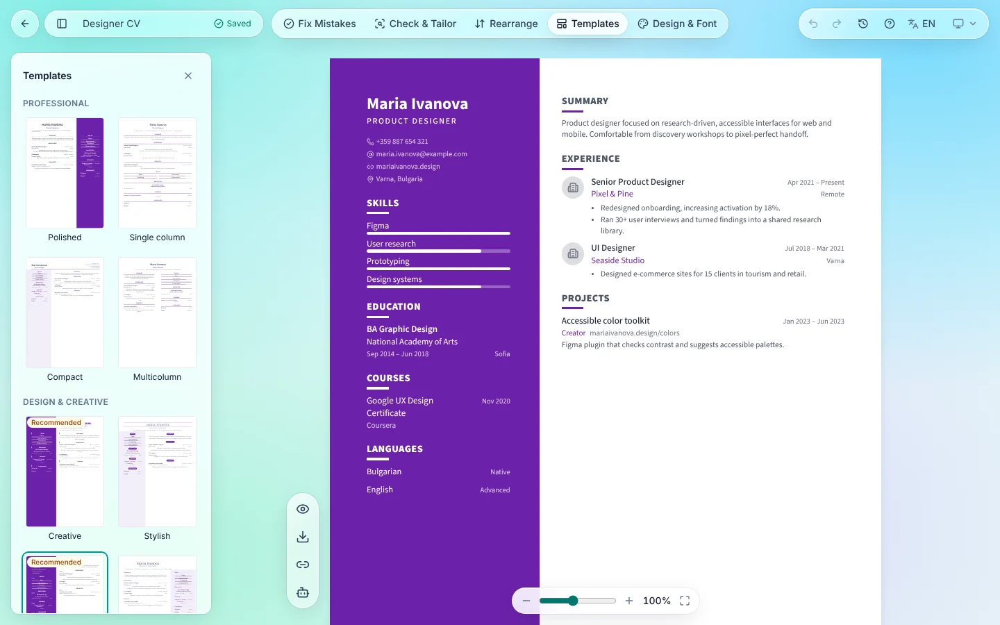
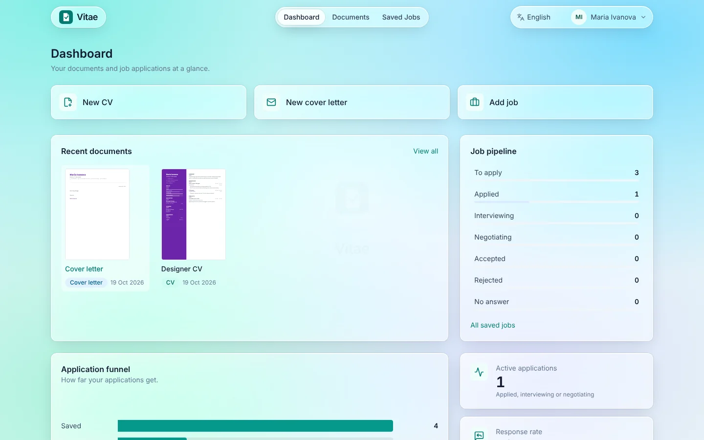
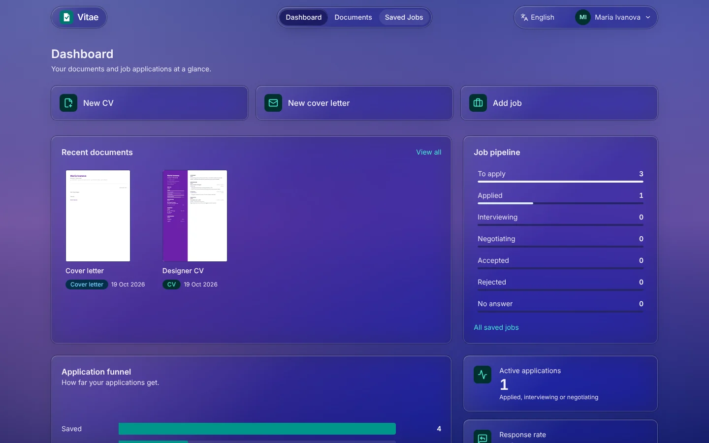
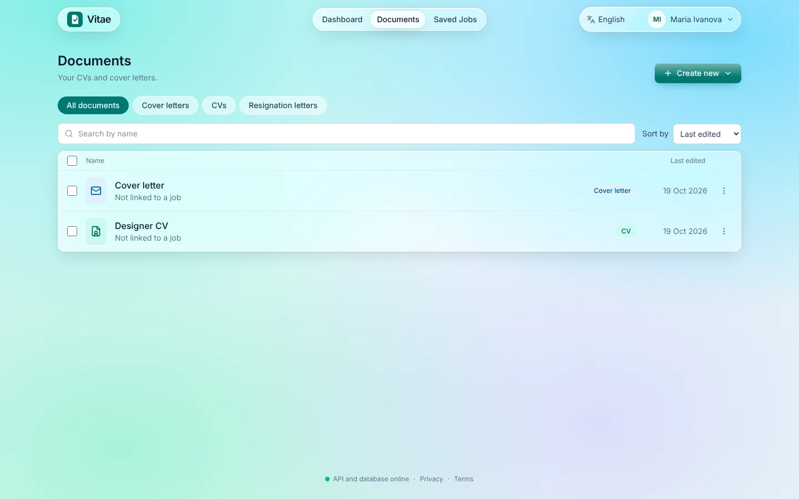
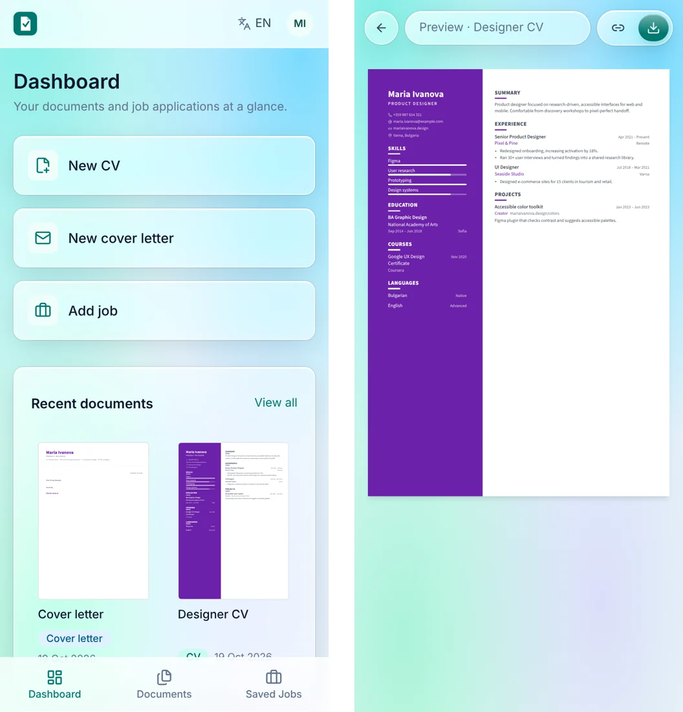

<a id="readme-top"></a>

<div align="center">


# Vitae

**CVs, cover letters and job tracking, with a little help from AI.**

[](https://github.com/georgi4334/CV_generator/actions/workflows/ci.yml)




</div>

## Table of contents

- [Description](#description)
- [How to install and run the project](#how-to-install-and-run-the-project)
- [How to use the project](#how-to-use-the-project)
- [AI features](#ai-features)
- [Configuration](#configuration)
- [Tests](#tests)
- [Deployment](#deployment)
- [Project structure](#project-structure)
- [Documentation](#documentation)
- [Roadmap](#roadmap)
- [How to contribute](#how-to-contribute)
- [Credits](#credits)
- [License](#license)

## Description

Vitae (from _curriculum vitae_) is a hobby project for writing a CV once and sending it many times. You edit the document right on the page, switch the template with one click, and keep a list of the jobs you applied to next to it. It runs entirely on free plans and is meant for personal and family use, not as a business. It is also a playground for trying AI features on the free Google Gemini tier.

### What it does

- **CVs** you edit in place, with autosave, undo/redo, version history, zoom and a live multi-page layout. **16 templates** are grouped by kind of work (Professional, Design & creative, Marketing, Sales), and a Design & Font panel controls colours, fonts, spacing, columns, background patterns and the photo.
- **Examples to start from** for developers, designers, sales and marketing, healthcare and academic CVs, or start blank.
- **Cover letters** and **resignation letters** that match the CV's look and can be filled in from a CV or a saved job.
- **PDF download** with proper page margins, and **share links**: a read-only page anyone can open, with an option to hide your name, contacts and photo.
- **Job tracking:** saved jobs with status, dates, notes and the CV used, plus a dashboard with the pipeline, an application funnel, response rate and reminders.
- **AI (Google Gemini, free tier):** Fix Mistakes, Check & Tailor (compare a CV with a job description) and an AI Assistant.
- Accounts with email confirmation and password reset; English, Bulgarian and German; light and dark themes; phone layouts; keyboard-friendly menus and automatic accessibility tests.

### Why these technologies

- **React, Vite and Tailwind** for a fast editor where every field is edited in place on the page itself.
- **Fastify, Drizzle and PostgreSQL** for a small, typed API; **Zod schemas in a shared package** so the web app and the API agree on every document and request.
- **Gemini behind the API's own provider layer**, so the key never reaches the browser, a mock provider works in development and tests, and another model could be added later.
- **Free plans only** (Cloudflare Pages, Render, Neon, R2, Brevo), which shaped several choices below.

### Challenges

- **Real pages in the browser:** a CV flows across as many pages as it needs. The renderer first draws a hidden, unpaginated copy to measure every block, then fills the visible pages block by block, and the same layout is used for the editor, the preview, the PDF and share links.
- **Hiding personal details on a share link:** the swap happens on the server, not by blurring in the browser, so the real name and contacts never reach the visitor, including names mentioned inside the text.
- **Staying inside free tiers:** the AI has per-minute and per-user daily limits, the free API sleeps when idle (a keep-awake ping is documented), and uploaded photos go to object storage because the server's disk is not kept.
- **Three languages, one source of truth:** typed translation keys fail the build when Bulgarian or German miss a text.

### What is planned

First deployment on free plans, trying the AI features in real use, and later maybe importing existing CVs and a custom domain for reliable email. See the [roadmap](#roadmap).

<p align="right">(<a href="#readme-top">back to top</a>)</p>

## How to install and run the project

### Requirements

- Node.js 22+ (see `.nvmrc`)
- pnpm 10 (`corepack enable` picks the version from `package.json`)
- Docker Desktop, for the local Postgres database

### Installation

```bash
git clone https://github.com/georgi4334/CV_generator.git
cd CV_generator
pnpm install
pnpm db:up                                   # start Postgres (docker compose, port 5433)
cp apps/api/.env.example apps/api/.env
cp apps/web/.env.example apps/web/.env
pnpm dev                                     # web on :5173, api on :3001
```

Open http://localhost:5173 and create an account. In development the emails (confirm your address, reset your password) are printed in the API terminal: copy the link from there.

Notes:

- Docker's Postgres listens on port **5433** so it does not clash with a PostgreSQL installed directly on your computer (which usually uses 5432). If you created `apps/api/.env` before this change, update its `DATABASE_URL` to port 5433.
- If you used the app before accounts existed, the **first account you create takes over** those CVs, cover letters, saved jobs and images. Accounts created afterwards start empty. (This is switched off when `NODE_ENV=production`.)
- After a `git pull`, just run `pnpm dev` again: if dependencies changed, pnpm installs them first (`verifyDepsBeforeRun` in `pnpm-workspace.yaml`).
- The API applies database migrations when it starts, and in development the web app proxies `/api` to it. See the endpoint table in [`docs/PLAN.md`](docs/PLAN.md) (Step 8).

### Commands

| Command                             | What it does                                    |
| ----------------------------------- | ----------------------------------------------- |
| `pnpm dev`                          | Run web and api in watch mode                   |
| `pnpm build`                        | Build all packages                              |
| `pnpm test`                         | Vitest in every package                         |
| `pnpm e2e`                          | Browser tests (Playwright)                      |
| `pnpm coverage`                     | Tests with a coverage report                    |
| `pnpm smoke`                        | Check the live site after a deploy              |
| `pnpm lint`                         | ESLint across the repo                          |
| `pnpm typecheck`                    | TypeScript check in every package               |
| `pnpm format`                       | Format with Prettier                            |
| `pnpm db:up` / `pnpm db:down`       | Start / stop local services                     |
| `pnpm --filter @cv/api db:generate` | Generate SQL migrations from the Drizzle schema |
| `pnpm --filter @cv/api db:migrate`  | Apply migrations                                |

A pre-commit hook (Husky + lint-staged) lints and formats staged files.

<p align="right">(<a href="#readme-top">back to top</a>)</p>

## How to use the project

1. **Create an account** and confirm your email (in development the link is printed in the API terminal).
2. **Create a CV:** on the dashboard choose _New CV_, pick what you do (or _Other_ for a blank start), then pick a template. Recommended templates for your profession come first.
3. **Edit it on the page:** click any text to change it; hover a section or an entry for its toolbar (move, duplicate, delete). Use **Rearrange** to move sections and **Design & Font** for colours, fonts, spacing, columns and a photo. **Templates** switches the look at any time, and the clock icon shows earlier versions.
4. **Use the AI** (after adding your Gemini key under account menu → AI key): **Fix Mistakes** suggests spelling and wording changes, **Check & Tailor** compares the CV with a job description, and the **AI Assistant** helps write a summary or bullet points. See [AI features](#ai-features).
5. **Send it:** download a PDF, or switch on a **share link** and, if you like, **Hide my personal details** so visitors see stand-ins instead of your name, contacts and photo.
6. **Write letters:** _Create new_ in Documents makes a cover letter (from a CV or a saved job) or a resignation letter, in the CV's look.
7. **Track jobs:** save jobs, move them through the pipeline and let the dashboard remind you to follow up.

<table>
  <tr>
    <td width="50%"><br><sub>Dashboard</sub></td>
    <td width="50%"><br><sub>Dark theme</sub></td>
  </tr>
  <tr>
    <td width="50%"><br><sub>Documents: CVs, cover letters and resignation letters</sub></td>
    <td width="50%"><br><sub>On a phone</sub></td>
  </tr>
</table>

The interface is available in English, Bulgarian and German (dropdown in the header). Texts live in `apps/web/src/i18n/locales/{en,bg,de}`; see [`apps/web/src/i18n/README.md`](apps/web/src/i18n/README.md) for how to add or change them.

<p align="right">(<a href="#readme-top">back to top</a>)</p>

## AI features

Fix Mistakes, Check & Tailor and the AI Assistant use Google Gemini. **Each person adds their own free key in the app:** open the account menu (your avatar) → **AI key**, paste a key from [Google AI Studio](https://aistudio.google.com/apikey) (no card needed) and choose the model (Flash, recommended, or Flash-Lite for more free requests a day). The server checks the key with Google, stores it encrypted (AES-256-GCM, see `SECRETS_KEY`) and never sends it back to the browser. With their own key, Google's limits apply instead of the app's daily limit.

Optionally, a key in `apps/api/.env` is a shared fallback for everyone who has not added one (with the app's limit of 30 requests per day per account):

| Variable            | Default                         | Meaning                                                                               |
| ------------------- | ------------------------------- | ------------------------------------------------------------------------------------- |
| `GEMINI_API_KEY`    | (empty: AI off)                 | Your Gemini API key. Stays on the server; the browser never sees it                   |
| `GEMINI_MODEL`      | `gemini-flash-latest`           | The Gemini model; the default always points at Google's current Flash model           |
| `AI_PROVIDER`       | `gemini` with a key, else `off` | `mock` gives fake answers to try the features without a key (development only)        |
| `AI_MAX_PER_MINUTE` | `10`                            | AI requests per minute for the whole API, to stay inside the free quota               |
| `SECRETS_KEY`       | a built-in development value    | Encrypts the keys people save. Production needs its own random value (32+ characters) |

Without a key of their own, each account can make 30 AI requests per day on the shared key. When Gemini's quota is reached the app says the AI is busy and does not count that request.

> **Privacy note:** on Google's free tier, the text you send may be used to improve Google's products, and Google's terms only allow paid use for people in the EU, UK and Switzerland. Fine for trying things out; avoid putting sensitive details (ID numbers, health information) into CVs you run through the AI.

<p align="right">(<a href="#readme-top">back to top</a>)</p>

## Configuration

Settings for the API live in `apps/api/.env` (copy from `.env.example`).

### Accounts and cookies

| Variable           | Default                                       | Meaning                                                                                |
| ------------------ | --------------------------------------------- | -------------------------------------------------------------------------------------- |
| `CORS_ORIGIN`      | `http://localhost:5173,http://127.0.0.1:5173` | Web addresses allowed to call the API (also used to refuse writes from other websites) |
| `APP_URL`          | `http://localhost:5173`                       | Where the web app lives; links in emails point here                                    |
| `COOKIE_SECURE`    | `true` in production, otherwise `false`       | Send the session cookie over HTTPS only                                                |
| `COOKIE_SAME_SITE` | `lax`                                         | `none` when web app and API are on different sites (requires `COOKIE_SECURE=true`)     |
| `TRUST_PROXY`      | `false`                                       | `true` behind a hosting proxy, so rate limits use the real client address              |

Production-only settings (storage, email, proxy secret, error reporting) are in [`docs/DEPLOY.md`](docs/DEPLOY.md).

<p align="right">(<a href="#readme-top">back to top</a>)</p>

## Tests

- `pnpm test`: unit and API tests. The API tests use a `cv_generator_test` database, created automatically on the Postgres from `pnpm db:up`. Without a running Postgres they are skipped with a warning (CI always runs them).
- `pnpm e2e`: browser tests with Playwright against the production builds, a fresh `cv_generator_e2e` database, the mock AI and a mailer that records emails, so the tests can open the links. The first time, install the browser: `pnpm --filter @cv/e2e exec playwright install chromium`. They cover:
  - the main journeys (sign up, a CV edited, saved, restyled and shared; cover and resignation letters; saved jobs; the AI panels),
  - the email flows (confirm, resend, forgot and reset password, delete account),
  - failures (two tabs editing one CV, server errors and going offline while saving, AI busy or over its limit, a session that ends, a server error when a document opens),
  - PDFs (page size, Cyrillic text, margins on every page of a long letter, a CV that spans several pages),
  - odd data (Cyrillic, emoji, markup that must not run, one very long word),
  - the look of every template (screenshots made and compared by CI, because pixels differ a little between computers: after a design change you meant to make, add the label `update-screenshots` to the pull request and CI commits the new pictures; look at them before merging, and approve the waiting CI run, because GitHub holds back checks on a commit that a workflow made),
  - accessibility (axe) and a phone,
  - Safari's engine (WebKit) on a desktop and an iPhone, which CI installs; locally set `E2E_WEBKIT=1` after `playwright install webkit`.
- `pnpm coverage`: the unit and API tests with a coverage report for every package (CI shows the table in the run summary). There is no minimum yet; it shows where tests are thin.
- `pnpm smoke`: checks of the **live** site after a deploy (availability and headers, sign-in, documents with photo upload and share links, jobs, phone layout, and with `SMOKE_AI=1` the real AI), built on the same page objects and fixtures as e2e; `SMOKE_LOCAL=1 pnpm smoke` runs them against the local stack. See [`docs/DEPLOY.md`](docs/DEPLOY.md).

CI runs the format check, lint, type checks, tests and build, on every push and pull request, and the browser tests on every pull request.

## Deployment

Everything can run on free plans:

```
Browser ──► Cloudflare Pages (web app + /api proxy) ──► Render (API) ──► Neon (Postgres)
                                                          ├──► Cloudflare R2 (uploaded images)
                                                          ├──► Brevo (account emails)
                                                          ├──► Google Gemini (AI features)
                                                          └──► Sentry (errors, optional)
```

Step-by-step guide, including what each service gives you and how to test emails and AI: [`docs/DEPLOY.md`](docs/DEPLOY.md).

## Project structure

```
apps/
  web/        React + TypeScript + Vite + Tailwind (React Router, TanStack Query, Axios, Zustand)
  api/        Fastify + TypeScript + Drizzle ORM (PostgreSQL)
packages/
  shared/     Zod schemas and TypeScript types shared by web and api
e2e/          Browser tests (Playwright)
docs/         Plan, deployment guide, architecture, screenshots
```

Inside the apps, code is organised by feature; see [`docs/ARCHITECTURE.md`](docs/ARCHITECTURE.md) for the folder map and the import rules.

## Documentation

Start at [`docs/README.md`](docs/README.md): it has the map, a reading order for new developers
and a "where do I find...?" table.

| Document                                                     | What is in it                                                                  |
| ------------------------------------------------------------ | ------------------------------------------------------------------------------ |
| [`docs/README.md`](docs/README.md)                           | The documentation map and reading order                                        |
| [`docs/ARCHITECTURE.md`](docs/ARCHITECTURE.md)               | Folder map and rules for imports and styles                                    |
| [`docs/domain-model.md`](docs/domain-model.md)               | Documents, sections, design, limits, share links, glossary                     |
| [`docs/web/README.md`](docs/web/README.md)                   | The web app: boot, routes, features, state, i18n, styling                      |
| [`docs/web/editor.md`](docs/web/editor.md)                   | Editing in place: autosave, conflicts, undo, panels                            |
| [`docs/web/renderer.md`](docs/web/renderer.md)               | Drawing documents: pagination, templates, print and PDF                        |
| [`docs/api/README.md`](docs/api/README.md)                   | The backend: lifecycle, auth, limits, storage, mail, AI, environment variables |
| [`docs/api/endpoints.md`](docs/api/endpoints.md)             | Every endpoint                                                                 |
| [`docs/data-model.md`](docs/data-model.md)                   | Database tables and migrations                                                 |
| [`docs/testing.md`](docs/testing.md)                         | Every kind of test, CI, troubleshooting                                        |
| [`docs/guides/README.md`](docs/guides/README.md)             | Recipes: add a template, a section, an endpoint, a language, an AI feature     |
| [`docs/DEPLOY.md`](docs/DEPLOY.md)                           | Deploying on free plans and checking the live site                             |
| [`docs/known-issues.md`](docs/known-issues.md)               | Problems and oddities found while documenting                                  |
| [`docs/PLAN.md`](docs/PLAN.md)                               | The development plan and a log of what was built                               |
| [`apps/web/src/i18n/README.md`](apps/web/src/i18n/README.md) | Adding or changing translations                                                |

<p align="right">(<a href="#readme-top">back to top</a>)</p>

## Roadmap

- [x] CV editor with templates, design settings, photo, version history and PDF
- [x] Cover letters and resignation letters
- [x] Saved jobs, dashboard and reminders
- [x] Accounts, share links and "hide my personal details"
- [x] AI: Fix Mistakes, Check & Tailor, AI Assistant
- [x] English, Bulgarian and German, light and dark themes, phone layouts
- [ ] First deployment on free plans
- [ ] Try the AI features with real use on the Gemini free tier
- [ ] Import an existing CV (later)

The plan, decisions and what was built in each step are in [`docs/PLAN.md`](docs/PLAN.md).

<p align="right">(<a href="#readme-top">back to top</a>)</p>

## How to contribute

This is a personal project, but suggestions and bug reports are welcome. See [`CONTRIBUTING.md`](CONTRIBUTING.md) for the short version: open an issue, branch from `dev`, run the checks, and open a pull request against `dev`.

## Credits

Built by [Georgi](https://github.com/georgi4334), with Claude Code as a coding assistant.

Thanks to:

- [Google Gemini](https://ai.google.dev/) for the AI features
- [Fontsource](https://fontsource.org/) for the self-hosted open-source fonts
- [Lucide](https://lucide.dev/) for the icons
- [Shields.io](https://shields.io/) for the badges
- The free plans of Cloudflare, Render, Neon, Brevo and Sentry that make a hobby deployment possible

## License

No license has been chosen yet, so all rights are reserved. Please ask before reusing the code.

<p align="right">(<a href="#readme-top">back to top</a>)</p>
