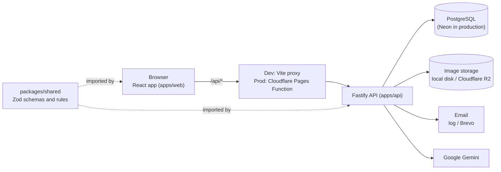

# Vitae developer documentation

Welcome. This is the map of the documentation. If you have just joined the project, read
the first two sections and then pick the page for the part you are working on.

Vitae is a web app for writing CVs, cover letters and resignation letters, sharing them as
read-only links, tracking job applications, and getting help from AI (Google Gemini). It is a
hobby project that runs on free hosting plans.

## The big picture in one minute

- **`apps/web`** is the React app. It draws the CV pages itself (not with a PDF library), so
  what you see in the editor is what is printed.
- **`apps/api`** is the API. Every query is scoped to the signed-in user.
- **`packages/shared`** holds the types and Zod schemas both sides use, so the web app and the
  API always agree on what a CV is.
- **`e2e`** holds the browser tests (Playwright).

## Reading order for a new developer

1. [Root README](../README.md): run the project on your computer.
2. [Architecture](ARCHITECTURE.md): the folder map and the rules for imports and styles.
3. [Domain model](domain-model.md): what a CV, a letter, a section and a design are. Read this
   before the code; everything else builds on it.
4. Your area:
   - Frontend work: [Web app guide](web/README.md), then the [editor](web/editor.md) and the
     [renderer](web/renderer.md).
   - Backend work: [Backend guide](api/README.md), the [endpoint reference](api/endpoints.md) and
     the [data model](data-model.md).
5. [Testing](testing.md) before your first pull request, and the
   [how-to guides](guides/README.md) for step-by-step recipes.

## All pages

| Page                                                               | What is in it                                                                                                                         |
| ------------------------------------------------------------------ | ------------------------------------------------------------------------------------------------------------------------------------- |
| [`../README.md`](../README.md)                                     | What the project is, how to run it, configuration, scripts                                                                            |
| [`ARCHITECTURE.md`](ARCHITECTURE.md)                               | Folder structure and rules (imports, styles, phones)                                                                                  |
| [`domain-model.md`](domain-model.md)                               | Documents, sections, design, templates, limits, hiding personal details, glossary                                                     |
| [`web/README.md`](web/README.md)                                   | Boot, routes, features, data fetching, state, i18n, styling, UI kit, accessibility                                                    |
| [`web/editor.md`](web/editor.md)                                   | Editing in place: stores, autosave, conflicts, undo, panels, history                                                                  |
| [`web/renderer.md`](web/renderer.md)                               | Drawing documents: pagination, templates, letters, print and PDF, share view                                                          |
| [`api/README.md`](api/README.md)                                   | How the backend works: lifecycle, auth, limits, storage, mail, AI, environment variables                                              |
| [`api/endpoints.md`](api/endpoints.md)                             | Every endpoint with its input, output and errors                                                                                      |
| [`data-model.md`](data-model.md)                                   | Database tables, relations, migrations                                                                                                |
| [`testing.md`](testing.md)                                         | Every kind of test, how to run them, the CI pipeline, troubleshooting                                                                 |
| [`guides/README.md`](guides/README.md)                             | Working in this repo and the recipes: add a template, a section, an endpoint, a language, an AI feature, a document type, an e2e test |
| [`DEPLOY.md`](DEPLOY.md)                                           | Putting the app online on free plans, checking the live site                                                                          |
| [`known-issues.md`](known-issues.md)                               | Problems and oddities found while documenting, what was fixed and what is still open                                                  |
| [`PLAN.md`](PLAN.md)                                               | The original plan and a log of what was built, step by step (history, not a reference: the code and these pages win)                  |
| [`../CONTRIBUTING.md`](../CONTRIBUTING.md)                         | How to report a bug or propose a change                                                                                               |
| [`../apps/web/src/i18n/README.md`](../apps/web/src/i18n/README.md) | Adding or changing translations                                                                                                       |

## Where do I find...?

| I want to...                                           | Look here                                                                                           |
| ------------------------------------------------------ | --------------------------------------------------------------------------------------------------- |
| Change how a CV looks or add a template                | `apps/web/src/renderer/templates/`, [guide](guides/add-a-template.md)                               |
| Understand why text wraps or pages break where they do | [Renderer](web/renderer.md) (measure, then paginate)                                                |
| Change what is saved in a document                     | `packages/shared/src/cv/`, [guide](guides/add-a-section-or-field.md)                                |
| Add or change an endpoint                              | `apps/api/src/modules/<area>/routes.ts`, [guide](guides/add-an-api-endpoint.md)                     |
| Change the database                                    | `apps/api/src/db/schema/`, [data model](data-model.md)                                              |
| Fix autosave, undo or the "Changed elsewhere" banner   | `apps/web/src/features/cv-editor/state/`, [editor](web/editor.md)                                   |
| Change a text, or translate                            | `apps/web/src/i18n/locales/`, [guide](guides/add-a-language.md)                                     |
| Change colours, spacing or the glass look              | `apps/web/src/shared/styles/tokens.css`, [web guide](web/README.md#7-styling-and-the-design-system) |
| Change what the AI does                                | `apps/api/src/modules/ai/`, [guide](guides/add-an-ai-feature.md)                                    |
| Change share links or "Hide my personal details"       | `packages/shared/src/documents/share.ts`, `apps/api/src/modules/share/`                             |
| Find an environment variable                           | [Backend guide](api/README.md) (full table), `apps/api/.env.example`                                |
| Know which test to write                               | [Testing](testing.md) (decision table)                                                              |
| Put a change online                                    | [Deploy](DEPLOY.md)                                                                                 |

## Conventions used across the docs

- Code locations are written as repo-relative paths in backticks, without line numbers (line
  numbers go stale). Search the file for the name instead.
- Each page ends with an "Open questions" section where the writer could not verify something
  from the code. Treat those as honest "we are not sure", not as facts.
- When docs and code disagree, the code is right. Please fix the doc in the same pull request.

## Keeping the docs true

Change code and docs together. A pull request that changes an endpoint also updates
[`api/endpoints.md`](api/endpoints.md); one that changes a schema updates
[`domain-model.md`](domain-model.md); one that adds a table updates [`data-model.md`](data-model.md).
The how-to guides list the exact files to touch for the common changes.
