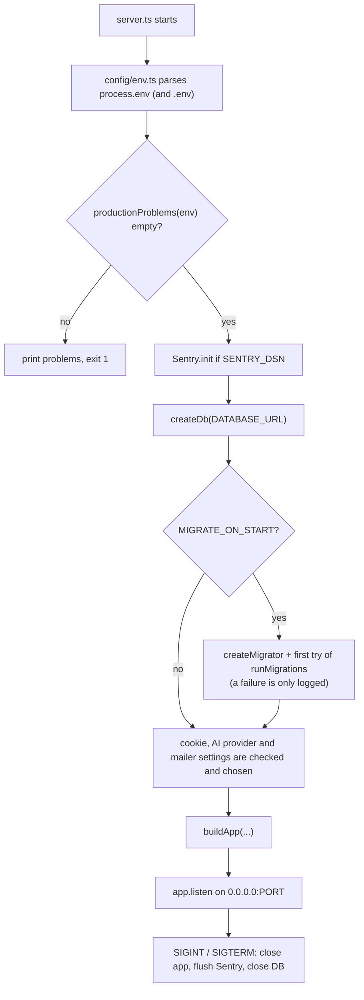
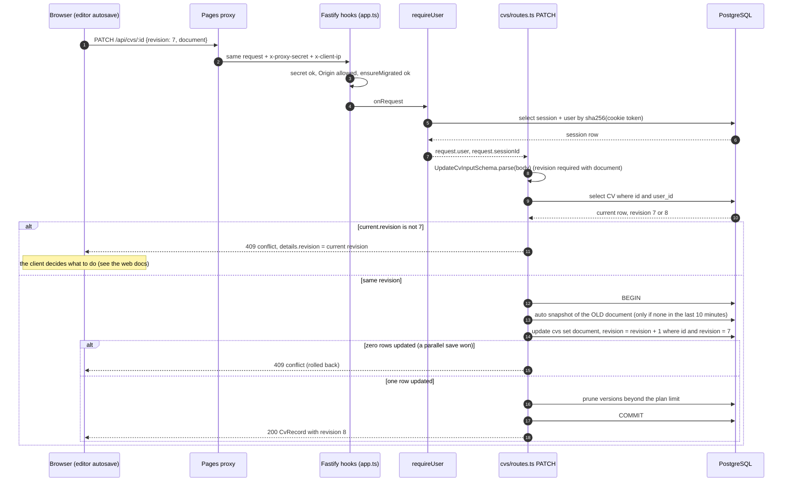

# Backend guide (`apps/api`)

This is the guide to the Vitae API: a small [Fastify](https://fastify.dev) server that stores
users, CVs, cover letters, resignation letters, saved jobs and uploaded images in PostgreSQL, and
proxies a few AI requests to Google Gemini.

Read this file top to bottom once. After that, use these pages as reference:

- [endpoints.md](./endpoints.md): every route, with request, response and errors.
- [../data-model.md](../data-model.md): every table, migrations, how documents are stored.
- [../domain-model.md](../domain-model.md): what a CV, a letter and a job _are_ (the shared Zod schemas).
- [../testing.md](../testing.md): how to run and write tests.
- [../web/README.md](../web/README.md): the React app that calls this API.
- [../guides/README.md](../guides/README.md): step-by-step recipes (for example, "add an endpoint").
- [../ARCHITECTURE.md](../ARCHITECTURE.md), [../DEPLOY.md](../DEPLOY.md), [../PLAN.md](../PLAN.md): the older overview, the deployment guide and the project plan.

## Contents

1. [Quick start](#1-quick-start)
2. [How the server boots](#2-how-the-server-boots)
3. [Folder map](#3-folder-map)
4. [What each module does](#4-what-each-module-does)
5. [Request lifecycle](#5-request-lifecycle)
6. [Errors](#6-errors)
7. [Auth, sessions and cookies](#7-auth-sessions-and-cookies)
8. [Email verification and password reset](#8-email-verification-and-password-reset)
9. [Rate limiters](#9-rate-limiters)
10. [Plans and limits](#10-plans-and-limits)
11. [Saving documents: revisions and versions](#11-saving-documents-revisions-and-versions)
12. [Storage and uploads](#12-storage-and-uploads)
13. [Mailer](#13-mailer)
14. [The AI layer](#14-the-ai-layer)
15. [Sentry](#15-sentry)
16. [Production checks](#16-production-checks)
17. [Environment variables](#17-environment-variables)
18. [Gotchas](#18-gotchas)
19. [Open questions](#19-open-questions)

---

## 1. Quick start

You need Node 22+, pnpm and Docker (for Postgres).

```bash
pnpm install
pnpm db:up                                   # Postgres on localhost:5433 (docker-compose.yml)
cp apps/api/.env.example apps/api/.env       # optional: the defaults already work
pnpm dev                                     # API on :3001 and web on :5173
pnpm --filter @cv/api test                   # API tests (need the database)
pnpm --filter @cv/api typecheck
```

On the first start the API applies the SQL migrations by itself (`MIGRATE_ON_START` defaults to
`true`), so there is no extra setup step. Without `BREVO_API_KEY`, "emails" are printed in the API
terminal: copy the verification or reset link from there.

Check that it works: `curl localhost:3001/api/health` answers
`{"status":"ok","database":"up","email":"log","timestamp":"..."}`.

> The API only listens on `/api/*`. In the browser the Vite dev server proxies `/api` to port 3001
> and in production a Cloudflare Pages function does (see [DEPLOY.md](../DEPLOY.md)).

---

## 2. How the server boots

There are two entry points on purpose:

- `apps/api/src/server.ts` reads the configuration, chooses the real implementations (database,
  storage, mailer, AI provider) and starts listening.
- `apps/api/src/app.ts` exports `buildApp(options)`. It builds the Fastify app from
  **injected** parts and never reads `process.env`. Tests call `buildApp` directly with a memory
  mailer, a temporary upload folder and so on, and use `app.inject(...)` instead of a real port.



Details worth knowing:

- **A failed first migration does not stop the server.** `server.ts` logs it and starts anyway.
  `/api/health` then reports `database: "down"`, and every request to a data route retries the
  migration (see "ensureMigrated" below) and answers `503 database_unavailable` until it works.
  This is what lets you start the API before Docker has finished starting Postgres.
- `server.ts` throws on a few bad combinations: `COOKIE_SAME_SITE=none` without secure cookies,
  `AI_PROVIDER=gemini` without `GEMINI_API_KEY`, and `AI_PROVIDER=mock` in production.
- `buildApp` creates the Fastify instance with `bodyLimit` of 2 MiB and `trustProxy` from the
  option. JSON bodies larger than 2 MiB are refused.

---

## 3. Folder map

```
apps/api/
  src/
    server.ts            Process entry point (config -> real parts -> listen)
    app.ts               buildApp(): hooks, plugins, route registration
    config/
      env.ts             Zod-validated environment (the single place that reads process.env)
      production.ts      productionProblems() and productionWarnings(): start-up checks
    db/
      client.ts          createDb(url): postgres.js + Drizzle, isHealthy(), close()
      migrate.ts         runMigrations() and createMigrator() (the retrying wrapper)
      schema/            One file per area; index.ts re-exports all (drizzle-kit reads it)
    infra/               Things that talk to the outside world; never import from modules/
      errors.ts          HttpError, error handler, JSON 404, "database down" detection
      rateLimit.ts       In-memory fixed-window limiter
      mailer.ts          Log, file, memory and Brevo mailers
      storage/           index.ts (interface + local disk), r2.ts (Cloudflare R2)
    modules/
      auth/              routes, sessions, requireUser, password (scrypt), tokens, emails
      cvs/               CVs and their versions
      cover-letters/     Cover letters
      resignations/      Resignation letters
      jobs/              Saved jobs (the application tracker)
      share/             Owner share controls and the public shared-document route
      uploads/           Image upload, delete and public download
      ai/                routes, provider interface, gemini, mock, prompts
      health/            GET /health
      professions/       GET /professions
  drizzle/               Generated SQL migrations + meta/ (journal and snapshots)
  drizzle.config.ts      drizzle-kit settings (schema folder, output folder, DATABASE_URL)
  test/                  modules/*.test.ts (API tests on a real DB) and support/ (setup)
  uploads/               Local uploaded files in development (git-ignored)
  tsup.config.ts         Production bundle: src/server.ts -> dist/server.js
```

The rule from [ARCHITECTURE.md](../ARCHITECTURE.md) still holds: `infra/` never imports from
`modules/`, and every query is scoped to `request.user.id`.

A module is usually one `routes.ts` that exports a Fastify plugin
(`async function cvRoutes(app, opts)`) and receives its dependencies (`database`, `storage`, ...)
through `opts`. There are no globals and no service classes.

---

## 4. What each module does

| Module                   | What it owns                                                                                                                                                                      |
| ------------------------ | --------------------------------------------------------------------------------------------------------------------------------------------------------------------------------- |
| `modules/health`         | `GET /api/health`: reports database up/down and whether emails are really delivered or only logged.                                                                               |
| `modules/professions`    | `GET /api/professions`: the profession presets from `@cv/shared` (`PROFESSIONS`).                                                                                                 |
| `modules/auth`           | Sign-up, sign-in, sign-out, profile, password change/reset, email verification, account deletion. Also exports `requireUser`, the session helpers and the scrypt password hasher. |
| `modules/cvs`            | CVs: CRUD, duplicate (also "tailored copy for a job"), revisions, version history and restore.                                                                                    |
| `modules/cover-letters`  | Cover letters: CRUD, duplicate, optional links to a CV and a job.                                                                                                                 |
| `modules/resignations`   | Resignation letters: CRUD and duplicate.                                                                                                                                          |
| `modules/jobs`           | Saved jobs for the application tracker, with links to a CV and a cover letter.                                                                                                    |
| `modules/share`          | Owner endpoints to switch a public link on/off and reset it (the same three routes for CVs, cover letters and resignation letters), plus the public `GET /api/shared/:slug`.      |
| `modules/uploads`        | Image upload (PNG, JPEG, WebP up to 5 MB), delete, and the public image download.                                                                                                 |
| `modules/ai`             | Fix Mistakes, Check & Tailor and the AI Assistant, the provider layer, prompts and the per-user daily quota.                                                                      |
| `config`, `db`, `infra/` | Not modules, but the shared plumbing described in the sections below.                                                                                                             |

For the shapes of the documents themselves (CV sections, design, letters) read
[../domain-model.md](../domain-model.md). The API stores them as JSON and never looks inside,
except to validate them on write and to mask personal data on public shares.

---

## 5. Request lifecycle

All routes live under the `/api` prefix. `buildApp` builds three nested scopes so that each group
of routes gets exactly the hooks it needs:

```
Fastify root
  hooks: proxy secret + clientIp, security headers (onSend), CORS, origin check
  /api
    public:        /health, /ping, /professions, GET /uploads/:id
    data scope:    [ensureMigrated hook], decorates request.user / request.sessionId
      public:      GET /shared/:slug, /auth/register|login|logout|forgot-password|reset-password|verify-email
      session:     /auth/me, /auth/resend-verification, /auth/change-password, /auth/delete-account
      user scope:  [requireUser hook]
                   /cvs, /cover-letters, /resignations, /jobs, share routes,
                   POST|DELETE /uploads, /ai/*
```

### Step by step

1. **Proxy secret** (`app.ts`, first `onRequest` hook). If `PROXY_SECRET` is set, every request
   except `/api/health` and `/api/ping` must carry the `x-proxy-secret` header (compared with
   `timingSafeEqual`), otherwise `403 forbidden`. The same hook sets `request.clientIp`: the
   `x-client-ip` header when the proxy sent one (at most 100 characters), otherwise `request.ip`.
2. **Security headers** (`onSend`): `X-Content-Type-Options: nosniff`, `Referrer-Policy: no-referrer`,
   `X-Frame-Options: DENY`, `Cross-Origin-Resource-Policy: same-site`.
3. **CORS** (`@fastify/cors`): allowed origins are the comma-separated `CORS_ORIGIN`; credentials
   are allowed; methods `GET, POST, PUT, PATCH, DELETE`.
4. **Origin check** (a later `onRequest` hook, registered after CORS). For every method except `GET`, `HEAD`, `OPTIONS`:
   if the request has an `Origin` header that is not in the allowed list, it is refused with
   `403 forbidden_origin`. A request with **no** `Origin` header (curl, tests, server-to-server)
   passes. This is the second line of defence after `SameSite` cookies.
5. **`ensureMigrated`** (data scope only, only when `MIGRATE_ON_START` is on). The first request
   waits for the migration promise; if it fails, the request gets `503 database_unavailable` and
   the next request tries again. After one success it costs nothing.
6. **`requireUser`** (user scope, and the `/auth/me` group). Reads the `cv_session` cookie, looks
   the session up (see [section 7](#7-auth-sessions-and-cookies)) and sets `request.user` and
   `request.sessionId`. No valid session means `401 unauthorized`.
7. **Handler**. Validates `params`, `query` and `body` with Zod (`Schema.parse(request.body)`),
   using the schemas from `@cv/shared`. A parse error becomes `400 validation_error`
   through the error handler. Handlers then touch the database with Drizzle, always filtering by
   `request.user.id`.
8. **Error handler**: anything thrown becomes the [error JSON](#6-errors).

### Example: saving a CV (authenticated write with revision conflict)

This is `PATCH /api/cvs/:id`, the request the editor's autosave sends.



Two details make this safe. First, the revision is checked twice: once with a plain `if` (so the
409 can carry the current revision in `details`) and once inside the `UPDATE ... WHERE revision = ?`
(so two saves racing each other cannot both win). Second, the snapshot, the update and the prune
share one transaction.

---

## 6. Errors

Every error response has the same JSON shape (`ApiErrorSchema` in `packages/shared/src/api/api.ts`):

```json
{
  "error": {
    "code": "conflict",
    "message": "This CV was changed somewhere else",
    "details": { "revision": 8 }
  }
}
```

`details` is optional. The web app reads `error.code`, so **codes are API**: do not rename them
casually. The handler lives in `apps/api/src/infra/errors.ts` (`registerErrorHandler`):

| Thrown                                                        | Response                                                                                                      |
| ------------------------------------------------------------- | ------------------------------------------------------------------------------------------------------------- |
| `HttpError(status, code, message, details?)`                  | exactly that                                                                                                  |
| `ZodError`                                                    | `400 validation_error`, `details` = the Zod `issues` array                                                    |
| A database connection error (`ECONNREFUSED`, `57P01`, ... )   | `503 database_unavailable`                                                                                    |
| Any other error with a `statusCode` below 500 (Fastify's own) | that status with code `bad_request` (for example malformed JSON, or a body over the limit)                    |
| Anything else                                                 | `500 internal_error`; logged, sent to Sentry through `onServerError`. `details.cause` only outside production |
| Unknown route                                                 | `404 not_found` ("Route GET /api/x not found")                                                                |

`isDatabaseUnavailable` follows the `cause` chain up to five levels, because Drizzle wraps the
driver error.

### Error codes in use

| Code                                            | Status        | Where / meaning                                                                                   |
| ----------------------------------------------- | ------------- | ------------------------------------------------------------------------------------------------- |
| `forbidden`                                     | 403           | Missing or wrong `x-proxy-secret`.                                                                |
| `forbidden_origin`                              | 403           | State-changing request from an origin that is not in `CORS_ORIGIN`.                               |
| `unauthorized`                                  | 401           | No cookie, unknown or expired session.                                                            |
| `validation_error`                              | 400           | Zod rejected params or body. `details` has the issues.                                            |
| `bad_request`                                   | 4xx           | Fastify-level errors (bad JSON, payload too large, ...).                                          |
| `not_found`                                     | 404           | Unknown route, or the row does not exist **or belongs to someone else** (same answer on purpose). |
| `conflict`                                      | 409           | Save based on an old `revision`.                                                                  |
| `plan_limit`                                    | 403           | The plan's document limit is reached.                                                             |
| `email_taken`                                   | 409           | Sign-up with an existing email.                                                                   |
| `invalid_credentials`                           | 401           | Wrong email or password (same answer for both).                                                   |
| `wrong_password`                                | 403           | Change password or delete account with a wrong current password.                                  |
| `invalid_token`                                 | 400           | Reset or verification link is unknown, used or expired.                                           |
| `too_many_requests`                             | 429           | An auth rate limit was hit.                                                                       |
| `email_failed`                                  | 502           | Resending the verification email failed.                                                          |
| `no_file`, `file_too_large`, `unsupported_type` | 400, 413, 415 | Upload problems.                                                                                  |
| `ai_unavailable`                                | 503           | No AI provider is configured.                                                                     |
| `ai_busy`                                       | 429           | Per-minute AI limit, or the provider said "quota".                                                |
| `ai_limit`                                      | 429           | The user's daily AI quota is used up.                                                             |
| `ai_blocked`                                    | 422           | The provider refused the content.                                                                 |
| `ai_failed`                                     | 502           | Provider error or an unusable answer.                                                             |
| `invalid_target`                                | 400           | AI Assistant called without a usable target.                                                      |
| `database_unavailable`                          | 503           | Database not reachable (or migrations failed).                                                    |
| `internal_error`                                | 500           | Bug or unexpected failure.                                                                        |

To throw your own error: `throw new HttpError(409, 'conflict', 'message', { optional: 'details' })`.
For a missing row use the helper `notFound('CV')` (message "CV not found").

---

## 7. Auth, sessions and cookies

Vitae uses **server-side sessions in a cookie**, not JWTs.

- **Cookie:** `cv_session` (`SESSION_COOKIE` in `modules/auth/sessions.ts`). Flags: `httpOnly`,
  `path=/`, `Secure` and `SameSite` from configuration, `Max-Age` 30 days.
- **Token:** `newToken()` makes 32 random bytes as base64url. The database stores only the
  SHA-256 hash (`hashToken`) in `sessions.token_hash`, so a leaked table cannot be used to sign in.
- **Lookup:** `findSession` joins `sessions` with `users`. Unknown token returns `null`; an expired
  one is deleted and returns `null`.
- **Lifetime:** `expires_at` is set to 30 days after sign-in (idle limit). When a session is used
  and `last_used_at` is more than a day old, `last_used_at` is updated and `expires_at` becomes
  `min(now + 30 days, created_at + 90 days)` (absolute limit). The one-day threshold exists to
  avoid a database write on every request.
- **Passwords:** scrypt from `node:crypto` (N=2^15, r=8, p=3, 64-byte key, 16-byte salt, password
  normalised with NFKC). Stored as `scrypt$N$r$p$salt$hash`, so the cost can be raised later
  without locking anyone out. Logging in with an unknown email still computes one hash
  (`verifyAgainstDummy`) so response time does not reveal which emails exist.
- **Password rules** live in `packages/shared/src/auth/auth.ts`: 8 to 128 characters, not in the
  short list of very common passwords. Emails are trimmed, lower-cased and validated.
- **Sessions are created** on sign-up and sign-in. A user may have many sessions (one per browser).
- **Sessions end** on logout (that one only), on password reset (all of them), on password change
  (all **except** the current one) and on account deletion (cascade).
- **Cookie settings** come from `COOKIE_SECURE` (default: `true` in production) and
  `COOKIE_SAME_SITE` (default `lax`). `none` is only for a web app and API on different sites and
  requires secure cookies. In production the web app's Cloudflare function proxies `/api`, so the
  cookie is first-party and `lax` works.
- **`requireUser(database)`** (`modules/auth/requireUser.ts`) is an `onRequest` hook factory.
  After it, handlers can use `request.user` (`id`, `plan`, `email`, `name`, `emailVerified`,
  `locale`) and `request.sessionId`.

Email verification is **informational**: the API does not block unverified users from anything.
The flag is shown in the UI (a banner) and returned in `User.emailVerified`.

`plan` (`free` or `pro`) is read from the database on every request. Nothing in the API changes
it; to upgrade someone today you update the `users.plan` column by hand.

---

## 8. Email verification and password reset

Both use one-time tokens in the `auth_tokens` table (`purpose` is `email_verification` or
`password_reset`). As with sessions, only the SHA-256 hash is stored; the secret is only in the
email link.

| Flow         | Token lifetime | Email link                         | What happens on use                                                                                                              |
| ------------ | -------------- | ---------------------------------- | -------------------------------------------------------------------------------------------------------------------------------- |
| Verify email | 24 hours       | `APP_URL/verify-email?token=...`   | `users.email_verified_at = now()`                                                                                                |
| Reset        | 1 hour         | `APP_URL/reset-password?token=...` | New password hash, **also marks the email verified** (the link reached the mailbox), deletes **all** sessions, clears the cookie |

How it works in `modules/auth/routes.ts`:

- `issueToken` deletes older tokens of the same purpose for that user and inserts a new one in a
  transaction. Requesting a new link therefore kills the previous link.
- `useToken` is one `UPDATE ... SET used_at = now() WHERE hash = ? AND purpose = ? AND used_at IS NULL AND expires_at > now() RETURNING user_id`.
  That single statement makes a link usable once, even with two simultaneous clicks.
  A miss gives `400 invalid_token`.
- `POST /auth/forgot-password` always answers `204`, whether or not the account exists, and also
  when the per-email limit is exceeded. Only the per-IP limit can answer `429`. Accounts without a
  password hash get no email.
- Sign-up and forgot-password send the email **in the background** (a failure is logged, never
  returned). `POST /auth/resend-verification` waits for the send and answers `502 email_failed` if
  it fails, because the user asked for it explicitly.
- The email text is localised (`en`, `bg`, `de`) from the user's `locale` in
  `modules/auth/emails.ts`; for forgot-password the request may pass its own `locale`.

---

## 9. Rate limiters

`infra/rateLimit.ts` is a tiny fixed-window counter in a `Map`. `hit(key)` returns `false` once the
key has used its attempts in the current window; `reset(key)` forgets a key.

**They live in the memory of one API process.** A restart clears them, and two API instances would
each count separately. That is fine for the single free instance this app runs on; see the comment
in the file before scaling out.

| Limiter        | Max in window                     | Key                  | Used by                                                                           | When exceeded                    |
| -------------- | --------------------------------- | -------------------- | --------------------------------------------------------------------------------- | -------------------------------- |
| `loginIp`      | 50 / 15 min                       | client IP            | `POST /auth/login`                                                                | `429 too_many_requests`          |
| `loginAccount` | 10 / 15 min                       | `ip:email`           | `POST /auth/login` (reset after a successful login)                               | `429 too_many_requests`          |
| `register`     | 10 / hour                         | client IP            | `POST /auth/register`                                                             | `429 too_many_requests`          |
| `forgotIp`     | 5 / hour                          | client IP            | `POST /auth/forgot-password`                                                      | `429 too_many_requests`          |
| `forgotEmail`  | 3 / hour                          | email                | `POST /auth/forgot-password`                                                      | silently `204`, no email is sent |
| `token`        | 20 / hour                         | client IP            | `POST /auth/reset-password`, `POST /auth/verify-email`                            | `429 too_many_requests`          |
| `resend`       | 3 / hour                          | user id              | `POST /auth/resend-verification`                                                  | `429 too_many_requests`          |
| `password`     | 10 / 15 min                       | user id              | `POST /auth/change-password` and `POST /auth/delete-account` (one shared counter) | `429 too_many_requests`          |
| AI per minute  | `AI_MAX_PER_MINUTE` (10) / minute | the constant `'all'` | every AI call that reaches the provider                                           | `429 ai_busy`                    |

Notes:

- The auth limits are multiplied by `AUTH_LIMIT_SCALE` (default 1). Only the browser (Playwright)
  tests set it higher, and production start-up **refuses** a value above 1.
- Behind the proxy, "client IP" is `request.clientIp`, not `request.ip`. Always use
  `request.clientIp` in new code.
- The AI per-minute limit is global for the whole API, not per user: Gemini's free quota is global too.
- The daily AI quota is a different mechanism (database, per user): see [section 14](#14-the-ai-layer).

---

## 10. Plans and limits

`PLAN_LIMITS` in `packages/shared/src/api/api.ts` is the single source of truth. `null` means unlimited.

| Plan   | `maxCvs` | `maxVersionsPerCv` | `aiRequestsPerDay` |
| ------ | -------- | ------------------ | ------------------ |
| `free` | 20       | 30                 | 30                 |
| `pro`  | no limit | 200                | 300                |

- `maxCvs` is checked on create and duplicate, **separately for each document kind**: a free user
  may have 20 CVs, 20 cover letters and 20 resignation letters. Hitting it gives
  `403 plan_limit`. Saved jobs have no limit.
- `maxVersionsPerCv` is applied by `pruneVersions` in `modules/cvs/routes.ts` after a save or a
  manual version.
- `aiRequestsPerDay` is the AI quota ([section 14](#14-the-ai-layer)).
- Upload limits (`UPLOAD_MAX_BYTES` = 5 MiB; PNG, JPEG, WebP) are the same for every plan. There is
  no cap on the number of uploads per user.

---

## 11. Saving documents: revisions and versions

CVs, cover letters and resignation letters share one pattern (details in
[../data-model.md](../data-model.md#how-documents-are-stored)):

- The whole document is one JSONB column. The API validates it on write with the "saveable" Zod
  schemas in `packages/shared/src/api/api.ts` (document shape plus the 5000-character text limit)
  and does not validate on read.
- `revision` starts at 1 and goes up by one on every **document** save. A document save must send
  the revision it was based on, otherwise `400 validation_error` (`revision is required...`); a
  stale one gives `409 conflict`. Renaming or relinking (sending `title`, `jobId`, ...) without a
  `document` needs no revision and does not change it.
- Only **CVs** have version history (`cv_versions`): automatic snapshots of the previous content
  while editing (at most one per 10 minutes), manual snapshots (`POST /cvs/:id/versions`) and a
  "Before restore" snapshot created by restore. Letters have none.

---

## 12. Storage and uploads

`infra/storage/index.ts` defines a three-method interface:

```ts
interface Storage {
  put(key: string, data: Buffer, contentType: string): Promise<void>
  get(key: string): Promise<Readable | null>
  remove(key: string): Promise<void>
}
```

| Implementation | Chosen when               | Where files go                                                                                                                       |
| -------------- | ------------------------- | ------------------------------------------------------------------------------------------------------------------------------------ |
| Local disk     | `STORAGE=local` (default) | The folder `UPLOAD_DIR` (default `uploads`, relative to where the process runs, so `apps/api/uploads` with `pnpm dev`). Git-ignored. |
| Cloudflare R2  | `STORAGE=r2`              | A private bucket, reached with S3-style signed requests (`aws4fetch`) at `https://<R2_ACCOUNT_ID>.r2.cloudflarestorage.com`.         |

Both refuse any key that is not `name.ext` with letters, digits and dashes
(`/^[a-z0-9-]+\.[a-z0-9]+$/i`), so a key can never escape the folder or bucket.
The bucket is **not** public: the API itself streams every image.

### Upload flow (`modules/uploads/routes.ts`)

1. `POST /api/uploads` (signed in): `multipart/form-data` with one file. The size limit is
   `UPLOAD_MAX_BYTES` (5 MiB) and one file per request.
2. The file type is decided by its **first bytes** (`sniffImageType`: PNG, JPEG or WebP
   signature), not by the file name or the client's content type.
3. The key is `<new uuid>.<png|jpg|webp>`; the file is written to storage, then a row is inserted
   in `uploads` (`id`, `user_id`, `storage_key`, `content_type`, `size`).
4. The answer is `{ id, url: "/api/uploads/<id>", contentType, size }`. The editor stores that
   `url` string in the document (for example `header.photoUrl`).
5. `GET /api/uploads/:id` is **public** (no login), because CVs and public share pages embed images
   by URL; ids are random UUIDs. It answers with `Cache-Control: public, max-age=31536000, immutable`.
6. `DELETE /api/uploads/:id` removes the row, then the file. Deleting a user deletes their upload
   rows by cascade, and `POST /auth/delete-account` also removes their files from storage.

---

## 13. Mailer

`infra/mailer.ts` defines `Mailer { send(email), delivers }` and four implementations.
`server.ts` picks one in this order:

| Condition           | Mailer              | Behaviour                                                                                                                      |
| ------------------- | ------------------- | ------------------------------------------------------------------------------------------------------------------------------ |
| `E2E_MAIL_FILE` set | `createFileMailer`  | Appends one JSON line per email to that file, so Playwright can read the links. `delivers: true`.                              |
| `BREVO_API_KEY` set | `createBrevoMailer` | `POST https://api.brevo.com/v3/smtp/email`, plain text, 15 s timeout, sender `MAIL_FROM` / `MAIL_FROM_NAME`. `delivers: true`. |
| otherwise           | `createLogMailer`   | Prints the email in the API log. `delivers: false`.                                                                            |

Tests use `createMemoryMailer()` (an `outbox` array). `delivers` is what `GET /api/health` reports
as `email: "service"` (true) or `"log"` (false).

Emails are plain text only, in `en`, `bg` or `de`. To add an email, add a template to
`modules/auth/emails.ts` and send it with `opts.mailer.send`. Decide whether it should be sent in
the background (log failures) or awaited (report failures), like the two existing flows.

---

## 14. The AI layer

Three features share one pipeline: **Fix Mistakes** (proofreading), **Check & Tailor** (keywords and
rewrites for a job posting) and the **AI Assistant** (summary, experience bullets, cover-letter
body). Code is in `apps/api/src/modules/ai/`.

**The AI routes never read your CVs from the database.** The browser extracts the text of the open
document as a list of `{ path, label, text }` fields (`cvFields`, `letterFields` and
`resignationFields` in `packages/shared/src/ai/ai.ts`) and sends them. The server maps the AI's
answer back to those paths. Limits: 250 fields, 4000 characters per field, 30 000 in total,
job posting up to 20 000 characters.

### Providers

`AiProvider` (`provider.ts`) is `{ label, complete(request) -> string }`. `server.ts` picks:

| `AI_PROVIDER` | Result                                                                                               |
| ------------- | ---------------------------------------------------------------------------------------------------- |
| unset         | `gemini` if `GEMINI_API_KEY` is set, otherwise `off`                                                 |
| `gemini`      | `createGeminiProvider` (needs the key, or start-up throws)                                           |
| `mock`        | `createMockProvider`: rule-based fake answers for development and e2e; start-up throws in production |
| `off`         | no provider: AI routes answer `503 ai_unavailable`, `GET /ai/status` says `enabled: false`           |

- **Gemini** (`gemini.ts`) calls `POST https://generativelanguage.googleapis.com/v1beta/models/<GEMINI_MODEL>:generateContent`
  with the key in the `x-goog-api-key` header, a system instruction, and
  `responseMimeType: application/json`. Timeout 45 s. Mapping to `AiError` kinds: HTTP 429 means
  `busy`; a `promptFeedback.blockReason` or finish reason `SAFETY` means `blocked`; anything else
  means `failed`. "Thought" parts are ignored.
- **Mock** (`mock.ts`) works from the structured `request.input`, not from the prompt: a short typo list
  for Fix, a keyword vocabulary for Tailor, canned text for the Assistant.
- `generateJson(provider, request, zodSchema)` extracts the JSON object from the answer (it
  tolerates a Markdown fence), validates it, and **retries once** with a "your previous answer was
  not valid" suffix. Two bad answers give `AiError('failed')`.

### Prompts (`prompts.ts`)

- Fields are numbered `f1, f2, ...` so the model can refer to them; `numberFields` keeps the
  map back to editor paths.
- Every system prompt says that document text and job postings are **data** and that instructions
  inside them must be ignored (prompt-injection guard), and asks for the output in the document's
  language (`AI_LANGUAGE_NAMES`).
- Temperatures: fix 0.1, tailor 0.3, assist 0.6. The "never invent facts" rule is in the tailor and
  assist prompts.
- After the model answers, `routes.ts` **filters** the output: Fix keeps only suggestions whose
  `original` text really occurs in that field (max 60); Tailor keeps up to 25 keywords, 6 advice
  items, 10 rewrites; Assistant keeps 1 summary, 8 bullets or 6 letter paragraphs.

### Quota and limiter (`run()` in `ai/routes.ts`)

1. No provider: `503 ai_unavailable`.
2. Global per-minute limiter (`AI_MAX_PER_MINUTE`, key `'all'`): `429 ai_busy`.
3. **Daily quota:** one atomic upsert on `ai_usage (user_id, day)` with
   `ON CONFLICT DO UPDATE SET count = count + 1 WHERE count < limit`. If no row comes back the
   user is over the limit: `429 ai_limit`. `day` is the UTC date, so the quota resets at midnight UTC.
4. The provider is called. **If it fails, the count is given back** (`greatest(count - 1, 0)`).
5. The response includes `usage: { used, limit }`. `GET /api/ai/status` returns the same numbers
   without spending any.

`POST /ai/fix-mistakes` with an empty `fields` list answers immediately and costs nothing.

---

## 15. Sentry

Set `SENTRY_DSN` and `server.ts` calls `Sentry.init({ dsn, environment: NODE_ENV, tracesSampleRate: 0 })`
(errors only, no performance traces). The error handler calls the `onServerError` option for
**unexpected 500 errors only**. It sends the exception with one tag, `route` (the route pattern, not
the URL), and the user id. **Request bodies are never attached**, because documents are personal data.
Expected errors (`HttpError`, validation, database-down 503) are not reported. On shutdown
`Sentry.close(2000)` flushes pending events. The web app has its own DSN (`VITE_SENTRY_DSN`).

---

## 16. Production checks

`config/production.ts` runs at start-up (`server.ts`), and does nothing unless `NODE_ENV=production`.

`productionProblems(env)` returns messages that **stop the server** (exit code 1):

- `STORAGE` must be `r2` (Render's disk is wiped on every deploy), and all four `R2_*` values must be set.
- `E2E_MAIL_FILE` must be empty, and `AUTH_LIMIT_SCALE` must be 1.
- `BREVO_API_KEY` and `MAIL_FROM` must be set.
- `APP_URL` must not start with `http://localhost`; `CORS_ORIGIN` must not contain `localhost`.
- `PROXY_SECRET`, if set, must be at least 32 characters.

`productionWarnings(env)` only prints a warning for: no `PROXY_SECRET`, no `SENTRY_DSN`, no `GEMINI_API_KEY`.

Other behaviour that depends on `NODE_ENV=production`: cookies are `Secure` by default, error
responses no longer include `details.cause`, the first sign-up no longer inherits the legacy
`dev@localhost` data (`claimDevData`), and `AI_PROVIDER=mock` is refused.

---

## 17. Environment variables

All variables are parsed in `apps/api/src/config/env.ts` with Zod. If a value is invalid the
process fails at start-up with a Zod error. A `.env` file in the working directory (`apps/api/.env`)
is loaded first with `process.loadEnvFile`; it does not override variables already set in the
shell. `apps/api/.env.example` has a starter file. The default values below are the ones for
development.

| Name                   | Default                                        | Meaning                                                                                                                |
| ---------------------- | ---------------------------------------------- | ---------------------------------------------------------------------------------------------------------------------- |
| `NODE_ENV`             | `development`                                  | `development`, `test` or `production`. Turns on the production checks, secure cookies, hides error details.            |
| `PORT`                 | `3001`                                         | HTTP port (listens on `0.0.0.0`).                                                                                      |
| `DATABASE_URL`         | `postgres://cv:cv@localhost:5433/cv_generator` | Postgres connection string (matches `docker-compose.yml`; Neon in production). Also used by drizzle-kit.               |
| `CORS_ORIGIN`          | `http://localhost:5173,http://127.0.0.1:5173`  | Comma-separated web origins allowed to call the API (CORS and the origin check).                                       |
| `APP_URL`              | `http://localhost:5173`                        | Public address of the web app; used in email links.                                                                    |
| `COOKIE_SECURE`        | unset (`true` in production, else `false`)     | `true` or `false`. Whether the session cookie is HTTPS-only.                                                           |
| `COOKIE_SAME_SITE`     | `lax`                                          | `lax`, `strict` or `none`. `none` requires secure cookies.                                                             |
| `TRUST_PROXY`          | `false`                                        | `true` behind a hosting proxy so Fastify reads the client address from `X-Forwarded-For`. `render.yaml` sets `true`.   |
| `PROXY_SECRET`         | empty                                          | Shared with the web app's proxy. When set, requests must carry `x-proxy-secret`. At least 32 characters in production. |
| `MIGRATE_ON_START`     | `true`                                         | `true` or `false`. Apply pending migrations when the API starts (and retry on requests while that fails).              |
| `UPLOAD_DIR`           | `uploads`                                      | Folder for uploads when `STORAGE=local`.                                                                               |
| `STORAGE`              | `local`                                        | `local` or `r2`.                                                                                                       |
| `R2_ACCOUNT_ID`        | empty                                          | Cloudflare account id (required when `STORAGE=r2`).                                                                    |
| `R2_ACCESS_KEY_ID`     | empty                                          | R2 API token key id (required with `r2`).                                                                              |
| `R2_SECRET_ACCESS_KEY` | empty                                          | R2 API token secret (required with `r2`).                                                                              |
| `R2_BUCKET`            | empty                                          | Bucket name (required with `r2`).                                                                                      |
| `BREVO_API_KEY`        | empty                                          | Brevo API key; without it emails are only printed in the log. Required in production.                                  |
| `MAIL_FROM`            | empty                                          | Sender address, verified in Brevo. Required in production.                                                             |
| `MAIL_FROM_NAME`       | `Vitae` (`APP_NAME`)                           | Sender display name.                                                                                                   |
| `AI_PROVIDER`          | unset (`gemini` if a key is set, else `off`)   | `gemini`, `mock` or `off`.                                                                                             |
| `GEMINI_API_KEY`       | empty                                          | Google AI Studio key. Empty means AI is off (unless `AI_PROVIDER=mock`).                                               |
| `GEMINI_MODEL`         | `gemini-flash-latest`                          | Gemini model name.                                                                                                     |
| `AI_MAX_PER_MINUTE`    | `10`                                           | Global AI requests per minute for the whole API.                                                                       |
| `SENTRY_DSN`           | empty                                          | Turns on error reporting when set.                                                                                     |
| `E2E_MAIL_FILE`        | empty                                          | Browser tests only: append emails to this file. Refused in production.                                                 |
| `AUTH_LIMIT_SCALE`     | `1` (1 to 1000)                                | Browser tests only: multiplies the auth rate limits. Refused above 1 in production.                                    |

Test-only variables (read by `apps/api/test/support`, not by `env.ts`): `TEST_DATABASE_URL`
(default `postgres://cv:cv@localhost:5433/cv_generator_test`) and `REQUIRE_DB_TESTS=1`
(fail instead of skip when there is no database). See [../testing.md](../testing.md).

---

## 18. Gotchas

1. **Use `request.clientIp`, not `request.ip`**, for anything about the visitor (rate limits, logs).
   Behind the proxy, `request.ip` is the proxy's address.
2. **A "not found" can mean "not yours".** Every query filters by `user_id`, and a row of another
   user answers `404`, not `403`. Keep it that way in new routes, and scope _linked_ ids too (a
   job's `cvId` must be one of the user's own CVs: see `assertOwnCv` and `findOwnJob`).
3. **`revision` is only for documents.** Sending `title` without `document` never conflicts and
   never changes the revision. Sending `document` without `revision` is a `400`.
4. **The auto-snapshot stores the old content.** It is made _before_ the update, from the row read
   at the start of the request, so the history holds what was replaced.
5. **Rate limiters are per process and in memory.** Restart = reset. Tests that hit limits create
   a fresh app. Do not assume they work across instances.
6. **Health and ping skip the database gate.** `/api/health` answers 200 even when the database is
   down (`database: "down"`); `/api/ping` never touches the database so a free database can sleep.
   Render's health check uses `/api/ping`.
7. **Public routes exist.** `GET /api/shared/:slug` and `GET /api/uploads/:id` need no login. Do
   not put anything private in what they return. Hidden-personal-details masking happens on the
   server before the response leaves.
8. **Schemas come from `@cv/shared`.** Do not re-declare a request shape in the API; add or change
   it in `packages/shared/src/` so the web app gets the same type. The API bundle includes the
   shared source (`noExternal` in `tsup.config.ts`).
9. **Ids in request bodies use `RefIdSchema`.** Route `:id` params are validated with `z.uuid()`
   and ids inside request bodies (`jobId`, `cvId`, `coverLetterId`) with `RefIdSchema`
   (`z.guid()`, in `packages/shared/src/cv/common.ts`), so a malformed id is a
   `400 validation_error`. Use `RefIdSchema`, not `IdSchema`, for any new field that points at
   another row. `IdSchema` ("a non-empty string") is only for ids inside stored documents.
10. **Migrations are part of the deploy.** The API applies them at start; if you change the
    schema you must commit the generated SQL _and_ the `drizzle/meta` files. See
    [../data-model.md](../data-model.md#migrations).
11. **Upload files and rows can drift.** The file is stored before its row is inserted, and a row
    is deleted before its file. A crash in between leaves an orphan file. Deleting a CV does not
    delete its photo upload, and nothing cleans unused uploads up automatically (I found no such job).
12. **Share links and `isActive`.** The first `PUT .../share` creates the link **inactive** unless
    the body says otherwise (the database default would be active). `POST .../share/reset` always
    switches the link **on** again.
13. **A `.env` file is read from the current directory.** Start the API from `apps/api` (as
    `pnpm dev` does) or the file and the default `uploads` folder are not found.
14. **`ensureMigrated` only exists when `MIGRATE_ON_START` is true.** With it off, the API trusts
    that you migrated the database yourself.
15. **AI errors refund the quota; limiter hits do not.** A failed provider call gives the daily
    count back, but the per-minute counter has already been used.
16. **Test database is truncated before every test.** Never point `TEST_DATABASE_URL` at a
    database you care about.

---

## 19. Open questions

These are things I could not settle from the code alone. Please confirm or fix them.

- **Cookie lifetime vs session lifetime.** The server extends `sessions.expires_at` up to 90 days
  after sign-in, but the cookie is only set at sign-in with `Max-Age` 30 days and is never set
  again. The browser may therefore drop the cookie 30 days after sign-in even for an active user.
  I did not find code that refreshes the cookie. Is that intended?
- **`pruneVersions` and manual versions.** A comment says it deletes "the oldest automatic
  snapshots", but the query does not filter on `auto`, so it deletes the oldest versions of any
  kind (including labelled ones) beyond `maxVersionsPerCv`. Restore does not call it.
- **German reset email.** `modules/auth/emails.ts` writes "CV-Generator-Kontos" in the German reset
  text instead of using `APP_NAME` like the other texts.
- **Upload size vs `bodyLimit`.** `buildApp` sets `bodyLimit` to 2 MiB while uploads may be 5 MiB. I
  believe the multipart plugin is not bound by `bodyLimit`, and the upload tests confirm only that
  a file over 5 MiB gets `413` and that small images work. Test with an image between 2 and 5 MiB
  before relying on it.
- **`dev@localhost` account.** `DEV_USER_EMAIL` is a leftover from before login existed: nothing in
  the code creates that user any more, and it is only used to hand old local data to the first
  real account (not in production). Is the feature still wanted?
- **Stray comment in `config/env.ts`.** The line "Set to true behind a hosting proxy..." sits
  above `AI_PROVIDER` but describes `TRUST_PROXY`.
- **`docs/ARCHITECTURE.md`** lists the mailer as "log/Brevo"; the code also has a file mailer
  (browser tests) and a memory mailer (unit tests). Not wrong, only incomplete.
