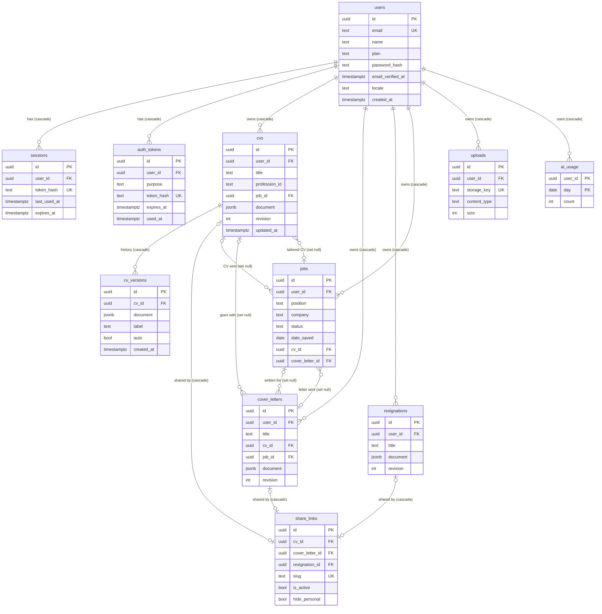

# Data model

This page describes the PostgreSQL database behind the API: every table, how tables relate, how
migrations work and how to change the schema safely. The code is in `apps/api/src/db/`, the SQL
migrations in `apps/api/drizzle/`.

Related reading: [api/README.md](./api/README.md) (the backend guide),
[api/endpoints.md](./api/endpoints.md) (which route touches which table),
[domain-model.md](./domain-model.md) (the shape of the JSON documents).

## Contents

1. [Overview](#overview)
2. [Entity diagram](#entity-diagram)
3. [Tables](#tables)
4. [Cascade and delete rules](#cascade-and-delete-rules)
5. [How documents are stored](#how-documents-are-stored)
6. [Share links](#share-links)
7. [Migrations](#migrations)
8. [Changing the schema](#changing-the-schema)
9. [Test databases](#test-databases)
10. [Open questions](#open-questions)

---

## Overview

- PostgreSQL 17 locally (`docker-compose.yml`, host port **5433**), Neon in production.
- Accessed with [Drizzle ORM](https://orm.drizzle.team) over the `postgres` (postgres.js) driver,
  with a pool of at most 5 connections (`apps/api/src/db/client.ts`).
- 11 tables, defined one file per area in `apps/api/src/db/schema/`:

| File              | Tables                                             |
| ----------------- | -------------------------------------------------- |
| `users.ts`        | `users`, `sessions`, `auth_tokens`                 |
| `cvs.ts`          | `cvs`, `cv_versions`                               |
| `coverLetters.ts` | `cover_letters`                                    |
| `resignations.ts` | `resignations`                                     |
| `jobs.ts`         | `jobs`                                             |
| `shareLinks.ts`   | `share_links`                                      |
| `uploads.ts`      | `uploads`                                          |
| `aiUsage.ts`      | `ai_usage`                                         |
| `columns.ts`      | (helper: the shared `created_at` column)           |
| `index.ts`        | re-exports everything; drizzle-kit reads this file |

- Conventions used everywhere: primary keys are `uuid` generated by the database
  (`gen_random_uuid()`); timestamps are `timestamptz`; `created_at` defaults to `now()` (helper
  `createdAt()` in `columns.ts`); column names are `snake_case` in SQL and `camelCase` in code.
  `updated_at` is **not** maintained by a trigger: routes set it with `updatedAt: sql\`now()\``.
- Every user-owned table has a `user_id` and every query filters on it (the API has no row-level
  security; the filter is in the route code).

---

## Entity diagram



The diagram lists only the columns that matter; the next section has all of them.

---

## Tables

"UK" means unique. "Cascade" and "set null" describe what happens to **this** row when the
referenced row is deleted.

### `users`

Accounts. Code: `apps/api/src/db/schema/users.ts`.

| Column              | Type                  | Notes                                                                                           |
| ------------------- | --------------------- | ----------------------------------------------------------------------------------------------- |
| `id`                | uuid PK               | Default `gen_random_uuid()`.                                                                    |
| `email`             | text, UK, not null    | Always lower case (the shared `EmailSchema` normalises it).                                     |
| `name`              | text, not null        | Default `''`.                                                                                   |
| `plan`              | text, not null        | `free` (default) or `pro`. Typed as `Plan` in code; no database enum or check. Changed by hand. |
| `password_hash`     | text, nullable        | scrypt string `scrypt$N$r$p$salt$hash`. Null means "cannot sign in with a password".            |
| `email_verified_at` | timestamptz, nullable | Null = not verified. The API exposes it as `emailVerified`.                                     |
| `locale`            | text, not null        | `en` (default), `bg` or `de`. Language of account emails.                                       |
| `created_at`        | timestamptz           | Default `now()`.                                                                                |

### `sessions`

One row per signed-in browser. Only the hash of the cookie token is stored.

| Column         | Type                     | Notes                                                                                   |
| -------------- | ------------------------ | --------------------------------------------------------------------------------------- |
| `id`           | uuid PK                  |                                                                                         |
| `user_id`      | uuid FK, not null        | `users.id`, **cascade**.                                                                |
| `token_hash`   | text, UK, not null       | SHA-256 hex of the cookie token.                                                        |
| `created_at`   | timestamptz              |                                                                                         |
| `last_used_at` | timestamptz, default now | Refreshed at most once a day.                                                           |
| `expires_at`   | timestamptz, not null    | See the lifetime rules in [api/README.md](./api/README.md#7-auth-sessions-and-cookies). |

Index: `sessions_user_idx` on `(user_id)`. Expired rows are deleted when someone tries to use them;
I found no scheduled clean-up for rows that are never used again.

### `auth_tokens`

One-time email links (verification and password reset). Only the hash is stored.

| Column       | Type                  | Notes                                                          |
| ------------ | --------------------- | -------------------------------------------------------------- |
| `id`         | uuid PK               |                                                                |
| `user_id`    | uuid FK, not null     | `users.id`, **cascade**.                                       |
| `purpose`    | text, not null        | `password_reset` or `email_verification` (`AuthTokenPurpose`). |
| `token_hash` | text, UK, not null    | SHA-256 hex.                                                   |
| `expires_at` | timestamptz, not null | 1 hour (reset) or 24 hours (verification) after creation.      |
| `used_at`    | timestamptz, nullable | Set when the link is used; a used token never works again.     |
| `created_at` | timestamptz           |                                                                |

Index: `auth_tokens_user_idx` on `(user_id, purpose)`. Issuing a new token deletes the user's older
tokens of the same purpose.

### `cvs`

Code: `apps/api/src/db/schema/cvs.ts`.

| Column          | Type                     | Notes                                                                   |
| --------------- | ------------------------ | ----------------------------------------------------------------------- |
| `id`            | uuid PK                  |                                                                         |
| `user_id`       | uuid FK, not null        | `users.id`, **cascade**.                                                |
| `title`         | text, not null           | At most 200 characters (checked by Zod, not by the database).           |
| `profession_id` | text, nullable           | A profession preset id (`PROFESSIONS` in `@cv/shared`); no foreign key. |
| `job_id`        | uuid FK, nullable        | `jobs.id`, **set null**. The saved job this CV was tailored for.        |
| `document`      | jsonb, not null          | The whole CV (content + design). Typed as `CvDocument`.                 |
| `revision`      | integer, not null        | Default 1; `+1` on every document save.                                 |
| `created_at`    | timestamptz              |                                                                         |
| `updated_at`    | timestamptz, default now | Set by the routes.                                                      |

Index: `cvs_user_updated_idx` on `(user_id, updated_at DESC)` (the documents list).

### `cv_versions`

History of a CV. Only CVs have it.

| Column       | Type              | Notes                                                             |
| ------------ | ----------------- | ----------------------------------------------------------------- |
| `id`         | uuid PK           |                                                                   |
| `cv_id`      | uuid FK, not null | `cvs.id`, **cascade**.                                            |
| `document`   | jsonb, not null   | A full copy of the CV document at that moment (not a diff).       |
| `label`      | text, nullable    | User label, or "Before restore" for the snapshot restore creates. |
| `auto`       | boolean, not null | Default true. `false` for manual versions and "Before restore".   |
| `created_at` | timestamptz       |                                                                   |

Index: `cv_versions_cv_created_idx` on `(cv_id, created_at DESC)`.

### `cover_letters`

Code: `apps/api/src/db/schema/coverLetters.ts`.

| Column                     | Type              | Notes                                                |
| -------------------------- | ----------------- | ---------------------------------------------------- |
| `id`                       | uuid PK           |                                                      |
| `user_id`                  | uuid FK, not null | `users.id`, **cascade**.                             |
| `title`                    | text, not null    |                                                      |
| `cv_id`                    | uuid FK, nullable | `cvs.id`, **set null**. The CV it goes with.         |
| `job_id`                   | uuid FK, nullable | `jobs.id`, **set null**. The job it was written for. |
| `document`                 | jsonb, not null   | Typed as `CoverLetterDocument`.                      |
| `revision`                 | integer, not null | Default 1.                                           |
| `created_at`, `updated_at` | timestamptz       |                                                      |

Index: `cover_letters_user_updated_idx` on `(user_id, updated_at DESC)`.

### `resignations`

Code: `apps/api/src/db/schema/resignations.ts`.

| Column                     | Type              | Notes                           |
| -------------------------- | ----------------- | ------------------------------- |
| `id`                       | uuid PK           |                                 |
| `user_id`                  | uuid FK, not null | `users.id`, **cascade**.        |
| `title`                    | text, not null    |                                 |
| `document`                 | jsonb, not null   | Typed as `ResignationDocument`. |
| `revision`                 | integer, not null | Default 1.                      |
| `created_at`, `updated_at` | timestamptz       |                                 |

Index: `resignations_user_updated_idx` on `(user_id, updated_at DESC)`. No links to jobs or CVs.

### `jobs`

The application tracker. Code: `apps/api/src/db/schema/jobs.ts`.

| Column                                                  | Type              | Notes                                                                            |
| ------------------------------------------------------- | ----------------- | -------------------------------------------------------------------------------- |
| `id`                                                    | uuid PK           |                                                                                  |
| `user_id`                                               | uuid FK, not null | `users.id`, **cascade**.                                                         |
| `position`                                              | text, not null    |                                                                                  |
| `company`                                               | text, not null    |                                                                                  |
| `status`                                                | text, not null    | Default `to_apply`. One of the `JOB_STATUSES` in `@cv/shared`; no database enum. |
| `type`                                                  | text, nullable    | `remote`, `onsite`, `hybrid` or null.                                            |
| `date_saved`                                            | date, not null    | Returned as a `YYYY-MM-DD` string (Drizzle `mode: 'string'`).                    |
| `date_applied`                                          | date, nullable    | Same format.                                                                     |
| `cv_id`                                                 | uuid FK, nullable | `cvs.id`, **set null**. The CV sent for this job.                                |
| `cover_letter_id`                                       | uuid FK, nullable | `cover_letters.id`, **set null**.                                                |
| `notes`, `location`, `salary`, `contact`, `description` | text, not null    | Default `''`. `description` is the pasted job posting.                           |
| `created_at`, `updated_at`                              | timestamptz       |                                                                                  |

Index: `jobs_user_saved_idx` on `(user_id, date_saved DESC)`.

### `share_links`

See [Share links](#share-links) below for the rules.

| Column                     | Type                  | Notes                                                                        |
| -------------------------- | --------------------- | ---------------------------------------------------------------------------- |
| `id`                       | uuid PK               |                                                                              |
| `cv_id`                    | uuid FK, UK, nullable | `cvs.id`, **cascade**.                                                       |
| `cover_letter_id`          | uuid FK, UK, nullable | `cover_letters.id`, **cascade**.                                             |
| `resignation_id`           | uuid FK, UK, nullable | `resignations.id`, **cascade**.                                              |
| `slug`                     | text, UK, not null    | 16 random URL-safe characters (12 random bytes as base64url).                |
| `is_active`                | boolean, not null     | Database default `true`; the first `PUT` from the API creates it as `false`. |
| `hide_personal`            | boolean, not null     | Default `false`.                                                             |
| `created_at`, `updated_at` | timestamptz           |                                                                              |

Check constraint: `share_links_one_document`.

### `uploads`

Metadata of uploaded images; the bytes are in storage (local disk or R2).

| Column         | Type               | Notes                                                                           |
| -------------- | ------------------ | ------------------------------------------------------------------------------- |
| `id`           | uuid PK            | Also used in the public URL `/api/uploads/<id>`.                                |
| `user_id`      | uuid FK, not null  | `users.id`, **cascade** (rows only; files are removed by `delete-account`).     |
| `storage_key`  | text, UK, not null | `<id>.<png\|jpg\|webp>`: the file name on disk or the object key in the bucket. |
| `content_type` | text, not null     | `image/png`, `image/jpeg` or `image/webp`.                                      |
| `size`         | integer, not null  | Bytes.                                                                          |
| `created_at`   | timestamptz        |                                                                                 |

No index besides the primary key and the unique key. There is no foreign key from a CV to an
upload: the CV document just contains the URL string.

### `ai_usage`

Daily AI request counter per user. Code: `apps/api/src/db/schema/aiUsage.ts`.

| Column    | Type              | Notes                                                                                                               |
| --------- | ----------------- | ------------------------------------------------------------------------------------------------------------------- |
| `user_id` | uuid FK, not null | `users.id`, **cascade**. Part of the primary key.                                                                   |
| `day`     | date, not null    | The **UTC** date. Part of the primary key.                                                                          |
| `count`   | integer, not null | Default 0. Incremented by an atomic upsert; see the AI section of [api/README.md](./api/README.md#14-the-ai-layer). |

Primary key: `(user_id, day)`. Old days are never deleted (a few bytes per active user and day).

---

## Cascade and delete rules

| You delete...      | What else happens                                                                                                                                                                                                                                                                                                |
| ------------------ | ---------------------------------------------------------------------------------------------------------------------------------------------------------------------------------------------------------------------------------------------------------------------------------------------------------------- |
| a **user**         | Cascade: their sessions, auth tokens, CVs (and those CVs' versions and share links), cover letters (and share links), resignations (and share links), jobs, upload rows, AI usage. Stored **files** are not touched by the database; `POST /api/auth/delete-account` removes them from storage after the delete. |
| a **CV**           | Cascade: its `cv_versions` and `share_links` row. Set null: `jobs.cv_id`, `cover_letters.cv_id`. Its upload files stay.                                                                                                                                                                                          |
| a **cover letter** | Cascade: its `share_links` row. Set null: `jobs.cover_letter_id`.                                                                                                                                                                                                                                                |
| a **resignation**  | Cascade: its `share_links` row.                                                                                                                                                                                                                                                                                  |
| a **job**          | Set null: `cvs.job_id`, `cover_letters.job_id`.                                                                                                                                                                                                                                                                  |
| an **upload** row  | Nothing else in the database. Documents that mention its URL are not updated and will show a broken image.                                                                                                                                                                                                       |
| a **share link**   | Nothing else (the document is untouched).                                                                                                                                                                                                                                                                        |

Foreign keys are created with `ON UPDATE no action`. Cross-links between `cvs`, `jobs` and
`cover_letters` form cycles, which is why the schema files use `references((): AnyPgColumn => ...)`
for them. Because the links are `set null`, deleting any one of them never blocks.

---

## How documents are stored

CVs, cover letters and resignation letters follow one design:

- **One JSONB column, `document`, holds the whole document**: content _and_ design. The TypeScript
  type comes from `@cv/shared` (`CvDocument`, `CoverLetterDocument`, `ResignationDocument`) through
  Drizzle's `.$type<...>()`. This is a compile-time label only; the database does not check the
  JSON's shape.
- **Validation happens in the API on write.** `POST` and `PATCH` use the "saveable" schemas in
  `packages/shared/src/api/api.ts` (the document schema plus a limit of 5000 characters for any
  single text). Reading does not validate, so a document saved under older rules still opens.
- **`schemaVersion`:** a CV document carries `schemaVersion` (currently `1`,
  `CV_SCHEMA_VERSION`). The comment next to it says to add a migration for stored documents when the
  shape changes; I did not find such a migration mechanism yet (see [Open questions](#open-questions)).
- **`revision`** (integer, starts at 1) is an optimistic-locking counter. A document save sends the
  revision it started from; the `UPDATE` only matches `WHERE revision = <that>`, so a stale or
  parallel save fails with `409 conflict` instead of overwriting. Changing only `title` or links
  does not bump it.
- **Versions (CVs only).** `cv_versions` stores **full copies** of the document, not diffs:
  - automatic: before a document save, the _previous_ content is stored, at most one automatic
    snapshot per 10 minutes (`AUTO_VERSION_MINUTES`);
  - manual: `POST /api/cvs/:id/versions` copies the current content (optional label);
  - restore: stores the current content as "Before restore", then replaces the CV's document with the
    chosen version and bumps the revision.
  - After saves and manual versions the oldest versions beyond `PLAN_LIMITS[plan].maxVersionsPerCv`
    (30 free, 200 pro) are deleted.
- **Images** are not inside the JSON. The document holds a URL such as `/api/uploads/<uuid>`
  (for example the header photo) and the file is in storage; the `uploads` table records who owns it.
- **Duplicating** copies the JSON into a new row (revision 1, new id, no versions, no share link).
- **Public shares** read the same row; the server masks personal details before sending when
  `hide_personal` is on.

---

## Share links

A share link is a public, read-only URL (`/s/<slug>` in the web app, `GET /api/shared/:slug` in
the API) to one document.

Rules, all enforced in the database or in `apps/api/src/modules/share/routes.ts`:

- **Exactly one target.** `share_links` has three nullable foreign keys: `cv_id`, `cover_letter_id`,
  `resignation_id`. The check constraint `share_links_one_document` requires that the number of
  non-null ones is exactly 1:
  `(cv_id is not null)::int + (cover_letter_id is not null)::int + (resignation_id is not null)::int = 1`.
- **At most one link per document.** Each of the three foreign keys is `UNIQUE`. The routes use
  `INSERT ... ON CONFLICT (<that column>) DO UPDATE`, so "turn sharing on" is an upsert.
- **Deleted with the document** (`ON DELETE CASCADE`).
- **`slug`** is unique, random and unguessable (96 bits). A reset writes a new slug, so the old
  address returns `404`. Valid slugs match `SHARE_SLUG_PATTERN` (`[A-Za-z0-9_-]{8,64}`).
- **`is_active`** switches the link on and off while keeping the address. An inactive link answers
  `404` like an unknown one. The database default is `true`, but the API's first `PUT` creates the
  link inactive unless the body says `isActive: true`; `reset` always sets it to `true`.
- **`hide_personal`**: when true, the public response has an empty `title` and the document goes
  through `hidePersonalDetails` (`packages/shared/src/documents/share.ts`): name, email, phone, link,
  location, photo, and for letters the sender/recipient/employer details, plus the author's name
  and contact details where they appear in the text, are replaced with stand-ins like `Xxxxx Xxxxxxx`.
  This runs on the server, so the real values never reach the visitor.
- The owner's lists show `shared: true` when a link exists **and** is active.

---

## Migrations

### The pieces

| What                                 | Where                                                                                                                               |
| ------------------------------------ | ----------------------------------------------------------------------------------------------------------------------------------- |
| Schema source of truth               | `apps/api/src/db/schema/*.ts` (exported by `index.ts`)                                                                              |
| drizzle-kit settings                 | `apps/api/drizzle.config.ts` (dialect `postgresql`, schema `./src/db/schema/index.ts`, output `./drizzle`, URL from `DATABASE_URL`) |
| Generated SQL                        | `apps/api/drizzle/NNNN_name.sql`                                                                                                    |
| Journal and snapshots                | `apps/api/drizzle/meta/_journal.json` and `NNNN_snapshot.json`                                                                      |
| Runner used by the API and the tests | `apps/api/src/db/migrate.ts` (`runMigrations`, `createMigrator`)                                                                    |
| Calls the runner at start-up         | `apps/api/src/server.ts` (when `MIGRATE_ON_START=true`)                                                                             |

The journal (`_journal.json`) is the list of migrations the runner applies, in order. **A `.sql`
file that is not in the journal is ignored.** Drizzle keeps its own bookkeeping table in the
database (`__drizzle_migrations`) to remember which ones already ran. The `snapshot.json` files let
drizzle-kit compute the difference for the _next_ `generate`; do not delete them.

Current migrations:

| #    | File                           | What it does                                                                           |
| ---- | ------------------------------ | -------------------------------------------------------------------------------------- |
| 0000 | `0000_init.sql`                | `users`, `cvs`, `cv_versions`, `uploads`                                               |
| 0001 | `0001_share_links.sql`         | `share_links` (CV only at that point)                                                  |
| 0002 | `0002_jobs.sql`                | `jobs`; links `cvs.job_id`. Hand-added `UPDATE` clears old `cvs.job_id` values first   |
| 0003 | `0003_cover_letters.sql`       | `cover_letters`; `share_links.cover_letter_id`; first "exactly one" check              |
| 0004 | `0004_auth.sql`                | `sessions`, `auth_tokens`; `users.password_hash`, `users.email_verified_at`            |
| 0005 | `0005_ai.sql`                  | `ai_usage`; `jobs.description`                                                         |
| 0006 | `0006_user_locale.sql`         | `users.locale`                                                                         |
| 0007 | `0007_share_hide_personal.sql` | `share_links.hide_personal`                                                            |
| 0008 | `0008_resignations.sql`        | `resignations`; `share_links.resignation_id`; the check becomes "exactly one of three" |

### How they run

`runMigrations(database)` calls Drizzle's `migrate()` with the migrations folder.
`MIGRATIONS_FOLDER` is found by looking for `meta/_journal.json` in two places relative to the
file: `../../drizzle` (running from `src/db/` in development) and `../drizzle` (running the bundled
`dist/server.js`, where the file sits in `dist/`). The first folder that has a journal wins.

**`createMigrator(apply)` makes it safe to start before the database is ready.** It returns an
`ensureMigrated()` function that:

1. runs `apply()` once and remembers the promise, so concurrent callers share one run;
2. on success, returns the same finished promise every time (no more work);
3. on failure, forgets the failed promise and rethrows, so the **next** call tries again.

How it is wired:

- `server.ts` calls `ensureMigrated()` once at start. If it fails (for example Postgres is still
  starting), the error is logged and the server keeps running.
- `app.ts` adds an `onRequest` hook in the "data" scope that awaits `ensureMigrated()` for every
  data route. While it fails the route answers `503 database_unavailable`; once the database is up
  the first request runs the migrations and everything works, without restarting the API.
- `/api/health`, `/api/ping`, `/api/professions` and `GET /api/uploads/:id` are outside that hook.
  `/health` then shows `database: "down"` (or `"up"` even if the migrations have not run yet).
- `MIGRATE_ON_START=false` disables all of it (no `ensureMigrated` at all). Then you must migrate
  the database yourself (`pnpm --filter @cv/api db:migrate`).
- The test setup calls `runMigrations` too, so the test database always has the current schema.
- Production (Render) uses the default `true`: every deploy migrates Neon when the new version starts.

---

## Changing the schema

Example: add a column `phone` to `users`.

1. **Edit the schema** in `apps/api/src/db/schema/users.ts` (new table: create a file and export
   it from `schema/index.ts`).
2. **Generate the migration:**

   ```bash
   pnpm --filter @cv/api db:generate
   # optional readable name:  pnpm --filter @cv/api exec drizzle-kit generate --name user_phone
   ```

   This writes `apps/api/drizzle/00NN_*.sql`, a new snapshot and a journal entry. It reads the
   schema files and the previous snapshot; it does not need a running database.

3. **Read the SQL.** Check it does what you meant. If existing rows need fixing (backfills, clearing
   old links), add hand-written statements to the file, as `0002_jobs.sql` and `0003_cover_letters.sql`
   do (separate statements with `--> statement-breakpoint`).
4. **Apply it.** Either restart `pnpm dev` (the API migrates on start) or run
   `pnpm --filter @cv/api db:migrate`. Use `pnpm --filter @cv/api db:studio` to browse the data.
5. **Update the rest:** the Zod schemas in `packages/shared/src/` (so the web app gets the new
   field), the route's mapping function (for example `toUser`, `toJob`), the tests, and these docs.
6. **Run the tests:** `pnpm --filter @cv/api test` (the test database is migrated automatically).
7. **Commit** the `.sql` file **and** everything under `apps/api/drizzle/meta/`.

Rules of thumb:

- **Never edit a migration that has been committed or deployed.** Add a new one.
- A new `NOT NULL` column on a table that already has rows needs a `DEFAULT` (or a backfill in the
  same migration), as `users.locale` did.
- New table with a `user_id`? Add `ON DELETE CASCADE` and filter every query by `user_id`.
- New table? Also add it to the `truncate` list in `apps/api/test/support/context.ts` unless it
  references a table that is already listed (it is then truncated by `CASCADE`).
- Two developers generating a migration at the same time will clash on the number and the snapshot.
  Merge one first, then regenerate the other.

---

## Test databases

(Details in [testing.md](./testing.md).)

- The API tests use a **real Postgres**, not a mock. The default URL is
  `postgres://cv:cv@localhost:5433/cv_generator_test` (same server as development, different
  database); override with `TEST_DATABASE_URL`. CI sets its own.
- `apps/api/test/support/globalSetup.ts` runs once per test run: it connects to the server's
  `postgres` database, creates the test database if it does not exist, and applies the migrations
  with `runMigrations`.
- If Postgres is not reachable the database tests are **skipped** with a warning, unless
  `REQUIRE_DB_TESTS=1` is set (CI), which makes it a failure. Start it with `pnpm db:up`.
- `useTestApp()` (`apps/api/test/support/context.ts`) builds a real app on that database and, before
  **every test**, runs `TRUNCATE ... CASCADE` on the tables and creates a fresh signed-in user
  `user@example.com` directly in the database (no password). The vitest setting `fileParallelism: false`
  makes test files run one after another because they share this database.
- Because of the truncate, **never point `TEST_DATABASE_URL` at a database with data you want**.
- The browser (Playwright) tests start their own API against a separate database, by default
  `cv_generator_e2e` (`E2E_DATABASE_URL`, see `e2e/playwright.config.ts`); see [testing.md](./testing.md).

---

## Open questions

- **Document schema migrations.** `CV_SCHEMA_VERSION` says to "add a migration for stored
  documents" when the document shape changes, but I found no code that upgrades stored JSON. How
  should a breaking change to `CvDocument` be rolled out?
- **No clean-up jobs.** I found nothing that deletes expired `sessions`, used or expired
  `auth_tokens`, old `ai_usage` rows or unused `uploads`. Is that intended for now?
- **`share_links` header comment.** The comment at the top of `shareLinks.ts` says "to a CV or
  cover letter"; the table now also covers resignation letters.
- **Value sets are not enforced in SQL.** `users.plan`, `jobs.status`, `jobs.type`,
  `auth_tokens.purpose` and `users.locale` are plain `text`; only the TypeScript types and Zod
  schemas restrict them.
- **`pruneVersions`.** The comment says it removes old _automatic_ snapshots, but the query removes
  the oldest versions of any kind above the limit (see [api/README.md](./api/README.md#19-open-questions)).
