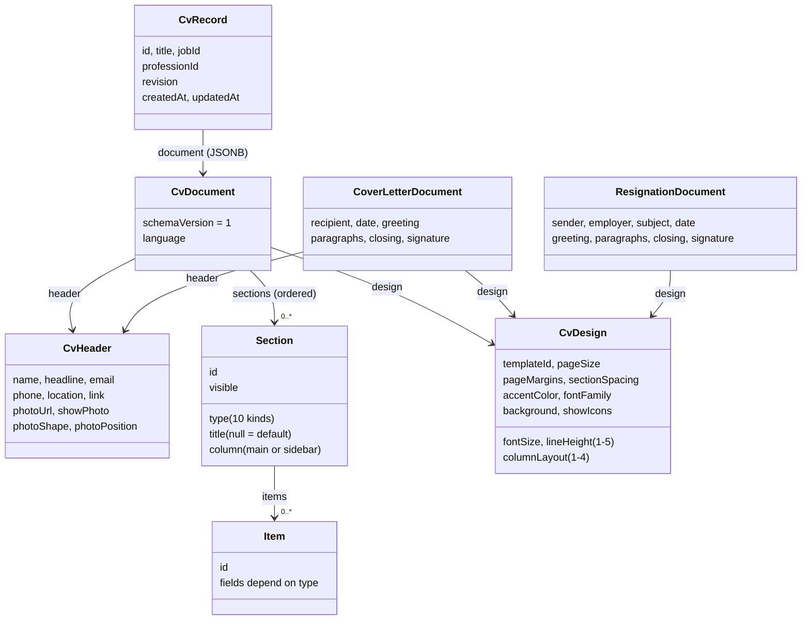

# Domain model and the shared package

This page explains `packages/shared`: the code that defines what a CV, a cover letter, a resignation letter, a job or a user _is_ in Vitae. If you change how a document looks in the database, in the API or in the editor, you will almost always start here.

Related pages: [API overview](api/README.md), [API endpoints](api/endpoints.md), [database tables](data-model.md), [web app](web/README.md), [editor](web/editor.md), [renderer](web/renderer.md), [testing](testing.md), [how-to guides](guides/README.md).

## Contents

1. [What the shared package is](#1-what-the-shared-package-is)
2. [The document types](#2-the-document-types)
3. [Factories and examples](#3-factories-and-examples)
4. [Limits and the "lenient read, strict write" rule](#4-limits-and-the-lenient-read-strict-write-rule)
5. [API contract, share links and hiding personal details](#5-api-contract-share-links-and-hiding-personal-details)
6. [Jobs, AI, auth and plans](#6-jobs-ai-auth-and-plans)
7. [Formatting helpers](#7-formatting-helpers)
8. [How to change a schema safely](#8-how-to-change-a-schema-safely)
9. [Glossary](#9-glossary)
10. [Open questions](#10-open-questions)

## 1. What the shared package is

`@cv/shared` is a small TypeScript package with **Zod schemas, the TypeScript types inferred from them, and pure helper functions**. The web app and the API both use it, so there is exactly one definition of every shape that crosses the network.

Why it exists:

- The browser and the server agree on the shape of a CV because they run the _same_ schema. No copy-pasted interfaces that drift apart.
- The API validates incoming requests with these schemas. The web app validates API responses with the same schemas (see `apps/web/src/features/cv-editor/api.ts`, where every response goes through a `...Schema.parse(data)` call).
- Rules that must be identical on both sides (text limits, plan limits, how personal details are hidden) live in one place.

The package contains no React, no database code and no HTTP code. It has one runtime dependency: `zod` (v4).

### How it is built and imported

There is **no build step** for this package. Its `package.json` exports the TypeScript source directly:

```json
"exports": { ".": "./src/index.ts" }
```

Both apps list it as a workspace dependency (`"@cv/shared": "workspace:*"` in `apps/web/package.json` and `apps/api/package.json`), and both import from the package name only:

```ts
import { CvDocumentSchema, createEmptyCv, type CvDocument } from '@cv/shared'
```

How each side turns the TypeScript source into something that runs:

| Consumer     | How                                                                                                                                                              |
| ------------ | ---------------------------------------------------------------------------------------------------------------------------------------------------------------- |
| Web (Vite)   | Vite compiles the `.ts` source like any other file. There is no alias for `@cv/shared` in `apps/web/vite.config.ts`; pnpm's workspace link is enough.            |
| API (tsup)   | `apps/api/tsup.config.ts` sets `noExternal: ['@cv/shared']`, so the shared source is bundled into the API build (`dist`). The comment there explains why.        |
| Type-checker | Each package has a `tsconfig.json` that extends `tsconfig.base.json` (strict mode, `moduleResolution: "bundler"`). `pnpm typecheck` runs `tsc` in every package. |
| Tests        | `packages/shared` runs its own tests with `vitest` (`pnpm --filter @cv/shared test`). The web tests and API tests import the package the same way as production. |

Because it is plain source, a change in `packages/shared` shows up in both apps immediately in dev mode. There is nothing to rebuild.

Everything is re-exported from `packages/shared/src/index.ts`. **Always import from `'@cv/shared'`, never from a deep path** (the same rule is in [ARCHITECTURE.md](ARCHITECTURE.md#shared-package-packagessharedsrc)).

> Note: the shared section of `ARCHITECTURE.md` lists the folders but does not mention `resignation/`. The folder exists and is exported from `index.ts`; the list below is the complete one.

### Folder map of `packages/shared/src`

| Folder          | What is in it                                                                                                                                                                                                                                        |
| --------------- | ---------------------------------------------------------------------------------------------------------------------------------------------------------------------------------------------------------------------------------------------------- |
| `common/`       | `id.ts` (`createId`, a random UUID), `brand.ts` (`APP_NAME` = "Vitae"), `textLimit.ts` (`TEXT_MAX`, `withinTextLimit`), `health.ts` (health-check response).                                                                                         |
| `cv/`           | The CV model and everything the other document types reuse: `common.ts` (ids, dates, levels, languages), `header.ts`, `sections.ts`, `design.ts`, `document.ts`, `factories.ts`, `professions.ts`, `i18n.ts` (titles, month names, date formatting). |
| `cover-letter/` | `coverLetter.ts`: cover letter schema, default texts, `createCoverLetter`, `formatLetterDate`.                                                                                                                                                       |
| `resignation/`  | `resignation.ts`: resignation schema, limits, default texts per language, `createResignationLetter`.                                                                                                                                                 |
| `documents/`    | `documents.ts` (document types, stored records, list summaries) and `share.ts` (share links, shared-document schemas, hiding personal details).                                                                                                      |
| `api/`          | `api.ts`: create/update inputs for documents, error shape, versions, uploads, plans and plan limits.                                                                                                                                                 |
| `examples/`     | `index.ts` (`createExampleCv` with one filled-in CV per profession), `build.ts` (the helper that gives examples fresh ids).                                                                                                                          |
| `jobs/`         | `jobs.ts`: saved jobs (statuses, types, create/update inputs).                                                                                                                                                                                       |
| `ai/`           | `ai.ts`: AI request and response schemas, plus helpers that turn a document into AI "fields" and count keyword matches.                                                                                                                              |
| `auth/`         | `auth.ts`: user, register, login and password schemas.                                                                                                                                                                                               |
| `index.ts`      | The one public entry point; re-exports all of the above (`cv/index.ts` re-exports the CV files except `professions.ts`, which `index.ts` exports separately).                                                                                        |

Most files have a `*.test.ts` next to them. Read those tests: they are the quickest way to see how a function is meant to be used.

## 2. The document types

A user owns three kinds of documents. They share some parts (the header, the design, the language) but each has its own body.

| Type         | `DocumentType` value | Schema                      | Source                                            | Body                                                                                      |
| ------------ | -------------------- | --------------------------- | ------------------------------------------------- | ----------------------------------------------------------------------------------------- |
| CV           | `'cv'`               | `CvDocumentSchema`          | `packages/shared/src/cv/document.ts`              | `header` + ordered `sections`                                                             |
| Cover letter | `'coverLetter'`      | `CoverLetterDocumentSchema` | `packages/shared/src/cover-letter/coverLetter.ts` | `header`, `recipient`, `date`, `greeting`, `paragraphs`, `closing`, `signature`           |
| Resignation  | `'resignation'`      | `ResignationDocumentSchema` | `packages/shared/src/resignation/resignation.ts`  | `sender`, `employer`, `subject`, `date`, `greeting`, `paragraphs`, `closing`, `signature` |

Every document also has these three top-level fields:

- `schemaVersion`: a literal number (`z.literal(...)`). Today it is `1` for all three types (`CV_SCHEMA_VERSION`, `COVER_LETTER_SCHEMA_VERSION`, `RESIGNATION_SCHEMA_VERSION`). A document whose version is not exactly this number fails validation.
- `language`: one of `'en-US'`, `'en-GB'`, `'bg'` (`CV_LANGUAGES` in `packages/shared/src/cv/common.ts`). It decides default section titles, month names, "Present", default letter texts and the language sent to the AI. The interface language (`LOCALES`: `en`, `bg`, `de`, in `auth.ts`) is a separate thing and belongs to the user, not to a document.
- `design`: the same `CvDesignSchema` for all three (see [Design](#design)).

A document is stored as one JSONB value in its table, next to a `revision` counter (see [data-model.md](data-model.md)). Content and design are kept apart on purpose: switching template or colour never touches the text.

### Structure diagram



Cover letters reuse `CvHeaderSchema` and `CvDesignSchema`. Resignation letters reuse only `CvDesignSchema` and have their own `sender` block instead of a header.

### The CV

`CvDocumentSchema` is `{ schemaVersion, language, header, sections, design }`.

#### Header (`packages/shared/src/cv/header.ts`)

| Field           | Type                                  | Notes                                                                              |
| --------------- | ------------------------------------- | ---------------------------------------------------------------------------------- |
| `name`          | string                                | Limit 150 characters (see [limits](#header-and-resignation-limits)).               |
| `headline`      | string                                | Job title line. Limit 300.                                                         |
| `email`         | string                                | Limit 254. Not validated as an email address in the CV.                            |
| `phone`         | string                                | Limit 40.                                                                          |
| `location`      | string                                | Limit 150.                                                                         |
| `link`          | string                                | One website or profile link. Limit 300.                                            |
| `photoUrl`      | string or `null`                      | Path of an uploaded image (see `UploadSchema`).                                    |
| `showPhoto`     | boolean                               | The photo is only drawn when this is true.                                         |
| `photoShape`    | `'circle'`, `'rounded'`, `'square'`   | `.default('circle')`: older CVs without it still parse.                            |
| `photoPosition` | `'name'`, `'top-left'`, `'top-right'` | `.default('name')`. `'name'` means "where the template puts it, next to the name". |

#### Sections (`packages/shared/src/cv/sections.ts`)

`sections` is an array. Each section is one object of a **discriminated union on `type`** (`SectionSchema`), so TypeScript narrows the fields once you check `section.type`.

Every section has the same base fields:

| Field     | Meaning                                                                                                                |
| --------- | ---------------------------------------------------------------------------------------------------------------------- |
| `id`      | Non-empty string (`createId()` makes a UUID). `IdSchema` is lenient on purpose: it is for ids inside stored documents. |
| `type`    | One of `SECTION_TYPES` (below).                                                                                        |
| `title`   | `null` means "use the default title for the CV language" (`getSectionTitle`). A string overrides it.                   |
| `column`  | `'main'` or `'sidebar'`. See the column rule below.                                                                    |
| `visible` | `false` hides the section in the CV and in the AI fields, but keeps the data.                                          |

The ten section types and their extra fields:

| `type`         | Extra section fields    | Item fields (every item also has `id`)                                                                                  |
| -------------- | ----------------------- | ----------------------------------------------------------------------------------------------------------------------- |
| `summary`      | `text`                  | No items: one `text` string.                                                                                            |
| `experience`   | `items`, `showLogos`    | `title`, `company`, `location`, date range, `bullets[]`, `logoUrl` (or `null`).                                         |
| `education`    | `items`                 | `degree`, `institution`, `location`, date range, `bullets[]`.                                                           |
| `skills`       | `items`, `levelDisplay` | `name`, `level` (1-5 or `null`). `levelDisplay` is one of `none`, `dots`, `bar`, `pills`, `bullets` (`SKILL_DISPLAYS`). |
| `achievements` | `items`                 | `icon` (key from the icon picker, for example `trophy`), `title`, `description`.                                        |
| `courses`      | `items`                 | `title`, `institution`, `date` (`YYYY` or `YYYY-MM`, or `null`).                                                        |
| `projects`     | `items`                 | `name`, `role`, `link`, date range, `description`, `bullets[]`.                                                         |
| `languages`    | `items`, `levelDisplay` | `name`, `level` (1 beginner to 5 native, required). `levelDisplay` is `none`, `bar`, `dots` or `text`.                  |
| `certificates` | `items`                 | `name`, `issuer`, `date`, `expiryDate` (`.default(null)`, missing in older CVs), `link`.                                |
| `custom`       | `items`                 | `title`, `subtitle`, `date` (free text), `description`, `bullets[]`.                                                    |

Shared building blocks (`packages/shared/src/cv/common.ts`):

- **Date range**: `startDate`, `endDate` (both `YYYY` / `YYYY-MM` strings or `null`) and `isCurrent`. When `isCurrent` is true the end date is ignored and the date is shown as "Present".
- **`YearMonthSchema`**: regex `^\d{4}(-(0[1-9]|1[0-2]))?$`. Only a year, or a year and month. There is no day.
- **`LevelSchema`**: an integer from 1 to 5. Used for skill and language levels and for the design sliders.
- **`HexColorSchema`**: `#RRGGBB`, exactly six hex digits.

**The `column` rule.** Order in the `sections` array is the order on the page, _per column_. A section's `column` says whether it is drawn in the main column or the sidebar. The sidebar only exists when the template and `design.columnLayout` have one; single-column templates and `columnLayout: 1` draw everything in one flow. The shared package only stores the value; the actual placement is the renderer's job (see [web/renderer.md](web/renderer.md)). The default CV puts summary and experience in `main`, and achievements, skills, courses and education in `sidebar` (`DEFAULT_SECTION_LAYOUT` in `packages/shared/src/cv/factories.ts`).

The array can hold several sections of the same type (for example two `custom` sections). Nothing in the schema stops that.

#### Design (`packages/shared/src/cv/design.ts`)

`CvDesignSchema` is shared by CVs, cover letters and resignation letters.

| Field            | Type / allowed values               | Notes                                                                                                                                                                                                                                        |
| ---------------- | ----------------------------------- | -------------------------------------------------------------------------------------------------------------------------------------------------------------------------------------------------------------------------------------------- |
| `templateId`     | one of `TEMPLATE_IDS`               | See templates below.                                                                                                                                                                                                                         |
| `pageSize`       | `'A4'` or `'Letter'` (`PAGE_SIZES`) |                                                                                                                                                                                                                                              |
| `pageMargins`    | level 1-5                           | Slider. How a level maps to millimetres or pixels is decided in the renderer (`apps/web/src/renderer/templates/tokens.ts`).                                                                                                                  |
| `sectionSpacing` | level 1-5                           | Slider.                                                                                                                                                                                                                                      |
| `fontSize`       | level 1-5                           | Slider.                                                                                                                                                                                                                                      |
| `lineHeight`     | level 1-5                           | Slider.                                                                                                                                                                                                                                      |
| `accentColor`    | `#RRGGBB`                           | `ACCENT_PRESETS` are the six swatches in the Design & Font panel; any valid hex is accepted.                                                                                                                                                 |
| `fontFamily`     | one of `FONT_FAMILIES`              | Ten free Google Fonts that also cover Cyrillic, so Bulgarian text renders. Default `Rubik`.                                                                                                                                                  |
| `columnLayout`   | integer 1-4                         | Matches the four "Column layout" thumbnails in the panel. `1` is one column; the other values change the sidebar's width or position (the exact meaning is in the renderer: `sidebarFor` in `apps/web/src/renderer/document/PageFrame.tsx`). |
| `background`     | string                              | A pattern id, `'none'` for a plain page. The schema accepts any string; the known ids are `BACKGROUNDS` in `apps/web/src/renderer/templates/backgrounds.ts`.                                                                                 |
| `showIcons`      | boolean                             | Contact and section icons on or off.                                                                                                                                                                                                         |

`DEFAULT_DESIGN` is: template `polished`, A4, all four sliders at `2`, accent `#00585a`, font `Rubik`, `columnLayout: 4`, background `'none'`, icons on.

**Templates.** There are 16 template ids in `TEMPLATE_IDS`:

- `LETTER_TEMPLATE_IDS` (8): `polished`, `contemporary`, `creative`, `timeline`, `stylish`, `single-column`, `compact`, `multicolumn`. Cover letters and resignation letters can use these.
- CV only (8): `portfolio`, `elegant`, `vivid`, `spotlight`, `modern`, `bold`, `monogram`, `executive`.

`TEMPLATE_CATEGORIES` groups templates for the pickers (`TEMPLATE_CATEGORY` maps each id to one), and `templatesIn(category, ids?)` lists the templates of a category in `TEMPLATE_IDS` order:

| Category       | Templates                                              |
| -------------- | ------------------------------------------------------ |
| `professional` | `polished`, `single-column`, `compact`, `multicolumn`  |
| `design`       | `creative`, `stylish`, `portfolio`, `elegant`, `vivid` |
| `marketing`    | `contemporary`, `spotlight`, `modern`                  |
| `sales`        | `timeline`, `bold`, `monogram`, `executive`            |

**Letter fallbacks.** A letter cannot use a CV-only template, so a letter made from such a CV gets the closest letter template. The table is `LETTER_FALLBACK` (private) behind the helpers `isLetterTemplate(id)`, `letterTemplateFor(id)` and `letterDesign(design)` (the same design with `templateId` replaced):

| CV-only template | Letter template |
| ---------------- | --------------- |
| `portfolio`      | `creative`      |
| `elegant`        | `stylish`       |
| `vivid`          | `contemporary`  |
| `spotlight`      | `creative`      |
| `modern`         | `polished`      |
| `bold`           | `compact`       |
| `monogram`       | `polished`      |
| `executive`      | `contemporary`  |

The schema only stores the template **id**. What a template looks like, and its own default sliders, lives in the web app (`apps/web/src/renderer/templates/templates.ts`, see [web/renderer.md](web/renderer.md)).

### The cover letter

`CoverLetterDocumentSchema` (`packages/shared/src/cover-letter/coverLetter.ts`):

| Field        | Notes                                                                                                          |
| ------------ | -------------------------------------------------------------------------------------------------------------- |
| `header`     | The same `CvHeaderSchema`, "usually copied from the linked CV so the letter and CV match".                     |
| `recipient`  | `name`, `title`, `company`, `address`, all strings.                                                            |
| `date`       | A free string, already written out (for example "15 October 2026"), not an ISO date.                           |
| `greeting`   | String, for example "Dear Hiring Manager,".                                                                    |
| `paragraphs` | Array of strings, **at least 1 and at most 20**.                                                               |
| `closing`    | String, for example "Sincerely,".                                                                              |
| `signature`  | String; a new letter starts with the header name.                                                              |
| `design`     | `CvDesignSchema`. Letters use the template's header style and ignore the column layout (see PLAN.md, step 13). |

A cover letter record also has a `cvId` (the CV it goes with) so the header and design can be copied again.

### The resignation letter

`ResignationDocumentSchema` (`packages/shared/src/resignation/resignation.ts`) looks like a formal business letter:

| Field        | Notes                                                                       |
| ------------ | --------------------------------------------------------------------------- |
| `sender`     | `name`, `email`, `phone`, `residence` (for example "12 Oak Street, Sofia"). |
| `employer`   | `company`, `contact`, `address`, `postalCode`, `city`.                      |
| `subject`    | String.                                                                     |
| `date`       | Free string, written out like the cover letter date.                        |
| `greeting`   | String.                                                                     |
| `paragraphs` | At least 1, at most 20.                                                     |
| `closing`    | String.                                                                     |
| `signature`  | String.                                                                     |
| `design`     | `CvDesignSchema`: "the CV's fonts and colours".                             |

There is no `header` in a resignation letter; the sender block replaces it. That matters for the share/hide code, which tells the three types apart by their fields (see section 5).

## 3. Factories and examples

Factories build a valid, new document. They live next to the schemas. All of them use `createId()`, so every call gives fresh ids.

| Function                                                                  | File                          | What it returns                                                                                                                                                                                                                                       |
| ------------------------------------------------------------------------- | ----------------------------- | ----------------------------------------------------------------------------------------------------------------------------------------------------------------------------------------------------------------------------------------------------- |
| `createItem(type)`                                                        | `cv/factories.ts`             | A blank item for a section type (for example a skill with `level: null`, a language with `level: 3`, an experience with one empty bullet).                                                                                                            |
| `createSection(type, column)`                                             | `cv/factories.ts`             | A section with `title: null`, `visible: true` and one blank item (or empty `text` for `summary`). Skills start with `levelDisplay: 'none'`, languages with `'dots'`.                                                                                  |
| `createEmptyCv(language?, layout?)`                                       | `cv/factories.ts`             | An empty CV. Defaults: `en-US` and `DEFAULT_SECTION_LAYOUT`. Empty header (`showPhoto: false`) and a copy of `DEFAULT_DESIGN`.                                                                                                                        |
| `createExampleCv(professionId)`                                           | `examples/index.ts`           | A filled-in sample CV for the profession (English, `en-US`). Fresh ids on every call.                                                                                                                                                                 |
| `createCoverLetter({ cv?, company?, language?, today? })`                 | `cover-letter/coverLetter.ts` | A letter with three empty paragraphs. With a `cv` it copies the header (and uses `letterDesign(cv.design)`); without one it uses an empty header and `DEFAULT_DESIGN`. `company` fills the recipient. The language defaults to the CV's.              |
| `createResignationLetter({ cv?, company?, contact?, language?, today? })` | `resignation/resignation.ts`  | A letter with the language's default subject, greeting and three paragraphs (`RESIGNATION_DEFAULTS`). With a `cv` it copies name, email, phone, location (as `residence`) and the design. A `contact` switches the greeting to `greetingTo(contact)`. |

The `today` parameter exists so tests can pass a fixed date.

### Professions

`packages/shared/src/cv/professions.ts` defines five professions (`PROFESSION_IDS`). A profession is a preset used by the "Create new CV" wizard: which sections a new CV starts with, in which column, and which templates to suggest. `PROFESSIONS` is also what the public `GET /professions` endpoint returns (`apps/api/src/modules/professions/routes.ts`).

| Id                   | Name                | Recommended templates (first = default)    | Starting sections (column)                                                                               |
| -------------------- | ------------------- | ------------------------------------------ | -------------------------------------------------------------------------------------------------------- |
| `software-developer` | Software Developer  | `polished`, `compact`, `single-column`     | summary, experience, projects (main); skills, achievements, education, certificates, languages (sidebar) |
| `designer`           | Designer            | `creative`, `portfolio`, `vivid`           | summary, experience, projects (main); skills, education, courses, languages (sidebar)                    |
| `sales-marketing`    | Sales & Marketing   | `polished`, `spotlight`, `bold`            | summary, experience (main); achievements, skills, education, languages (sidebar)                         |
| `healthcare`         | Healthcare          | `single-column`, `timeline`, `polished`    | summary, experience, education (main); certificates, skills, languages (sidebar)                         |
| `academic`           | Academic & Research | `single-column`, `multicolumn`, `timeline` | summary, education, experience, projects (main); skills, courses, languages (sidebar)                    |

`isProfessionId(value)` checks a stored value, because a saved CV keeps its `professionId` as plain text (`CvRecordSchema.professionId` is `string | null`, while the create/update input uses the strict `ProfessionIdSchema`).

The example CVs are built with `buildExample` (`examples/build.ts`): you write items without ids and it adds ids, `title: null`, `visible: true`, a header without photo, and merges your partial design over `DEFAULT_DESIGN`. Examples are used for "Start from example" in the wizard (`apps/web/src/features/new-cv/buildNewCv.ts`), for the welcome page, and as mock data in tests.

Other callers: the API uses `createEmptyCv()` when a CV is created without a document (`apps/api/src/modules/cvs/routes.ts`); the web app uses `createCoverLetter` and `createResignationLetter` in the "new letter" pages, and the fake API in tests (`apps/web/src/test/fakeCvApi.ts`).

## 4. Limits and the "lenient read, strict write" rule

This is the most important rule to understand before changing a schema.

> **Read schemas are lenient. Write inputs are strict.** A document that is already stored must always be openable, even if rules got stricter since it was saved. New saves must obey the current rules.

The reason: documents live in the database for years. If we add a text limit today, a CV saved last year with a 6,000-character summary must still open, so the user can shorten it. So the _read_ schemas (`CvDocumentSchema`, `CvRecordSchema`, ...) contain **no length limits**, and new optional fields use `.default(...)` so old JSON still parses (for example `photoShape`, `photoPosition` and `expiryDate`). The limits are added only where a document is _written_.

### Header and resignation limits

| Where                                               | What                                                                                                                                                                                |
| --------------------------------------------------- | ----------------------------------------------------------------------------------------------------------------------------------------------------------------------------------- |
| `HEADER_LIMITS` (`cv/header.ts`)                    | `name` 150, `headline` 300, `email` 254, `phone` 40, `location` 150, `link` 300.                                                                                                    |
| `RESIGNATION_LIMITS` (`resignation/resignation.ts`) | sender: `name` 150, `email` 254, `phone` 40, `residence` 200. Employer: `company` 150, `contact` 150, `address` 200, `postalCode` 20, `city` 100. Also `subject` 200 and `date` 60. |
| `TEXT_MAX` (`common/textLimit.ts`)                  | 5000 characters for **any single text** anywhere in a document (a summary, a bullet, a paragraph).                                                                                  |

Helpers:

- `fieldMaxLength(path)` returns the header limit for a path such as `header.name`, or `undefined`.
- `resignationFieldMaxLength(path)` does the same for `sender.*`, `employer.*`, `subject` and `date`.
- `headerWithinLimits(doc)` and `resignationWithinLimits(doc)` return true when no limited field is too long.
- `withinTextLimit(value, max = TEXT_MAX)` walks any value (strings, arrays, objects) and returns false if any string is longer than `max`.

### The `Saveable*` schemas

In `packages/shared/src/api/api.ts` three private schemas wrap the read schemas with `.refine(...)` checks:

| Schema                      | Wraps                       | Extra checks                                                         |
| --------------------------- | --------------------------- | -------------------------------------------------------------------- |
| `SaveableCvSchema`          | `CvDocumentSchema`          | `headerWithinLimits` (error on path `header`) and `withinTextLimit`. |
| `SaveableLetterSchema`      | `CoverLetterDocumentSchema` | the same two checks.                                                 |
| `SaveableResignationSchema` | `ResignationDocumentSchema` | `resignationWithinLimits` and `withinTextLimit`.                     |

They are not exported. They are used as the `document` field of `CreateCvInputSchema`, `UpdateCvInputSchema` and the cover-letter and resignation equivalents. So the limits are enforced exactly when a document enters the system through the API.

### What is enforced where

| Place                             | What happens                                                                                                                                                                                                |
| --------------------------------- | ----------------------------------------------------------------------------------------------------------------------------------------------------------------------------------------------------------- |
| Web, while typing                 | `EditableText` (`apps/web/src/renderer/editing/EditableText.tsx`) stops the input at `fieldMaxLength(path) ?? resignationFieldMaxLength(path) ?? TEXT_MAX`. This is for the user's comfort.                 |
| API, on save (create and `PATCH`) | The route parses the body with the input schema. A too-long text makes `ZodError`, which `apps/api/src/infra/errors.ts` turns into HTTP 400 with code `validation_error`. **This is the real enforcement.** |
| API, on read                      | `toRecord` in `apps/api/src/modules/cvs/routes.ts` returns the stored JSON as it is, with no validation or limits.                                                                                          |
| Web, on read                      | `CvRecordSchema.parse(data)` etc. in the feature `api.ts` files. This checks the _shape_ and fills defaults, but has no length limits.                                                                      |

Never rely on the web limit alone: a client can skip it. And never add a length limit to a read schema: it would make old documents fail to load.

Note that the same idea applies to jobs: `JOB_TEXT_MAX` and friends are on the job input schemas, and the "date is not in the future" check is on the inputs only ("for what people type, not what is stored").

## 5. API contract, share links and hiding personal details

### Document records and summaries (`documents/documents.ts`)

A **record** is what the API returns for one document. All three share `id`, `title`, `jobId` (set when it is a tailored copy for a saved job), `createdAt` and `updatedAt` (ISO datetimes), plus `type`, `revision` and `document`:

| Schema                    | Extra fields                                                     |
| ------------------------- | ---------------------------------------------------------------- |
| `CvRecordSchema`          | `professionId` (string or `null`), `document: CvDocumentSchema`  |
| `CoverLetterRecordSchema` | `cvId` (string or `null`), `document: CoverLetterDocumentSchema` |
| `ResignationRecordSchema` | `document: ResignationDocumentSchema`                            |

`DocumentSummarySchema` is one row of the "All documents" list: the common fields, `type` and a `shared` boolean, but **no document body**.

### Create, update and duplicate inputs (`api/api.ts`)

| Schema                                                         | Notes                                                                                                                 |
| -------------------------------------------------------------- | --------------------------------------------------------------------------------------------------------------------- |
| `CreateCvInputSchema`                                          | All optional: `title`, `professionId`, `jobId`, `document` (a `SaveableCvSchema`). No document means an empty CV.     |
| `UpdateCvInputSchema`                                          | `revision`, `title`, `professionId`, `jobId`, `document`. A `refine` requires `revision` whenever `document` is sent. |
| `DuplicateCvInputSchema`                                       | `{ jobId? }`. With a job, the copy is "tailored for" it.                                                              |
| `CreateCoverLetterInputSchema`, `UpdateCoverLetterInputSchema` | Same pattern, with `cvId` instead of `professionId`.                                                                  |
| `CreateResignationInputSchema`, `UpdateResignationInputSchema` | Same pattern, no link fields.                                                                                         |

`title` is trimmed, 1 to `TITLE_MAX` (200) characters.

### Revisions and conflicts

Every record has an integer `revision` that starts at 1 and **increases by one on each save of the document**. A save must say which revision it was based on:

1. The client sends `PATCH /cvs/:id` with `{ revision, document }`.
2. If `revision` differs from the stored one, the API answers **409** with code `conflict` and `details: { revision: <current> }` (`apps/api/src/modules/cvs/routes.ts`). The update statement also has the revision in its `WHERE`, so two saves at the same moment cannot both win.
3. Renaming or relinking (title, `professionId`, `jobId` without `document`) does **not** need or change the revision, so a rename in the Documents list never conflicts with an open editor.

On the web side the autosave class (`apps/web/src/features/cv-editor/state/autosave.ts`) keeps the revision, sends it with every save, and on a `conflict` error stops saving and shows a conflict banner (`ConflictBanner.tsx`); the user can then overwrite the server copy. See [web/editor.md](web/editor.md) and [api/endpoints.md](api/endpoints.md).

### Versions (snapshots)

`CvVersionSummarySchema` is `{ id, label (string or null), auto (boolean), createdAt }`. `auto: true` means the API made it while editing; `false` means the user saved it. `CreateVersionInputSchema` takes an optional `label` (1-100 characters). Versions store a whole copy of the CV document in the `cv_versions` table (see [data-model.md](data-model.md)). In the web client a single version with its body is read as `CvVersionSummarySchema.extend({ document: CvDocumentSchema })`.

Only CVs have versions in the shared schemas; there is no version schema for letters.

### Other API schemas in `api/api.ts`

- `ApiErrorSchema`: every error is `{ error: { code, message, details? } }`.
- `UploadSchema`: `{ id, url, contentType, size }`; `UPLOAD_MAX_BYTES` (5 MB) and `UPLOAD_CONTENT_TYPES` (png, jpeg, webp).
- `PLANS` and `PLAN_LIMITS` (see [section 6](#plans)).

### Share links (`documents/share.ts`)

A share link is a public, read-only page at `/s/<slug>` (`sharePath`). It is off until the owner turns it on.

| Schema                                                                 | What it is                                                                                                                      |
| ---------------------------------------------------------------------- | ------------------------------------------------------------------------------------------------------------------------------- |
| `ShareLinkSchema`                                                      | `slug`, `isActive`, `hidePersonal`, `createdAt`, `updatedAt`. Turning the link off keeps the slug so it can be turned on again. |
| `ShareStateSchema`                                                     | `{ link: ShareLink or null }`; `null` until the document has been shared once.                                                  |
| `UpdateShareInputSchema`                                               | `{ isActive?, hidePersonal? }`, with a `refine` that at least one is present.                                                   |
| `SharedCvSchema`, `SharedCoverLetterSchema`, `SharedResignationSchema` | What the public page receives: `type`, `title`, the full `document`, `hidePersonal` and `updatedAt`. No ids, no owner details.  |
| `SharedDocumentSchema`                                                 | Discriminated union of the three on `type`.                                                                                     |
| `SHARE_SLUG_PATTERN`                                                   | `^[A-Za-z0-9_-]{8,64}$`. The API answers a malformed slug like an unknown one (404).                                            |

The public endpoint is `GET /shared/:slug` (`publicShareRoutes` in `apps/api/src/modules/share/routes.ts`). It sends `x-robots-tag: noindex, nofollow` and `cache-control: private, no-store`.

### Hiding personal details

The owner can switch on **"Hide my personal details"** on a share link, to post the link publicly (for example to ask for feedback). The design principle is: **the real details never leave the server**.

1. When `hidePersonal` is true, the public endpoint calls `hidePersonalDetails(document)` before replying, and sets `title` to an empty string (titles often contain the owner's name).
2. `hidePersonalDetails` returns a copy of the document with **stand-ins** (`HIDDEN_PERSONAL`) in place of real values.
3. The web page receives the stand-ins and draws them **blurred**, so they look like real text but cannot be read or copied. The blur is applied per field path using `HIDDEN_PERSONAL_PATHS`; `apps/web/src/renderer/editing/primitives.tsx` checks `HIDDEN_PERSONAL_PATHS.has(path)` and wraps the value in a blurred span with a screen-reader label.

The stand-ins (`HIDDEN_PERSONAL`):

| Key     | Stand-in            | Key          | Stand-in      |
| ------- | ------------------- | ------------ | ------------- |
| `name`  | `Xxxxx Xxxxxxx`     | `company`    | `Xxxxx Xxxxx` |
| `email` | `xxxxx@xxxxx.xxx`   | `address`    | `Xxxxxx xx`   |
| `phone` | `+00 000 000 000`   | `postalCode` | `0000`        |
| `link`  | `xxxxxxx.xxx/xxxxx` | `location`   | `Xxxxxx`      |

`HIDDEN_PERSONAL_PATHS` is a `ReadonlySet<string>` of the document paths that hold stand-ins: `header.name`, `header.email`, `header.phone`, `header.link`, `header.location`, `signature`, `recipient.name`, `recipient.company`, `recipient.address`, `sender.name`, `sender.email`, `sender.phone`, `sender.residence`, `employer.company`, `employer.contact`, `employer.address`, `employer.postalCode`, `employer.city`. If you add a new personal field to a document, add it here and to `hidePersonalDetails`, otherwise it will be shown in clear text.

#### The algorithm

`hidePersonalDetails` has three overloads (CV, cover letter, resignation). It tells the types apart by their fields: if the object has `sender` it is a resignation; else if it has `signature` it is a cover letter; else it is a CV. (The resignation check must come first because a resignation also has `signature`.) Then:

1. **Fields are masked.** For each known personal field, the value is replaced with its stand-in **only if it is not blank**; empty fields stay empty (`maskText`, and `hideHeader` for the header). The CV and cover-letter header also gets `photoUrl: null` and `showPhoto: false`.
2. **Free text is scrubbed.** The name and contacts are often repeated in text ("Thanks, Maria", the company name in a paragraph). A **scrubber** (`scrubber(swaps)`) replaces the real values wherever they appear as **whole words**:
   - It takes a list of `[real, stand-in]` pairs. Pairs shorter than 2 characters are ignored.
   - It matches case-insensitively, **longest first**, so "Pixel & Pine Ltd" is replaced before "Pine".
   - "Whole word" is done with Unicode lookarounds (`(?<![\p{L}\p{N}])` ... `(?![\p{L}\p{N}])`), so "Ana" does not change "Analytics", and it works for Cyrillic.
   - `nameWords(name)` adds each word of a name that has 3 or more letters, mapped to `Xxxxx`. That is how a first name on its own is hidden.
3. **Which fields are scrubbed**, per type:

| Type         | Masked fields                                                                                | Texts scrubbed                                                                                  | Names/contacts the scrubber knows                                                                         |
| ------------ | -------------------------------------------------------------------------------------------- | ----------------------------------------------------------------------------------------------- | --------------------------------------------------------------------------------------------------------- |
| CV           | header name, email, phone, link, location; photo removed                                     | `header.headline` and **every string in `sections`** (except keys named `id`), via `scrubTexts` | header name (and its words), email, phone, link                                                           |
| Cover letter | header (as above), `recipient.name/company/address`, `signature`. `recipient.title` is kept. | `greeting`, `paragraphs`, `closing`                                                             | header contacts, signature (and words), recipient name (and words), recipient company, recipient address  |
| Resignation  | all of `sender`, all of `employer`, `signature`                                              | `subject`, `greeting`, `paragraphs`, `closing`                                                  | company, contact (and words), sender name (and words), email, phone, residence, employer address and city |

#### What is hidden and what is not

Hidden: the fields in the table above, the photo, the title of the shared page, and any place in the scrubbed texts where one of the _known_ values appears as a whole word.

**Not** hidden (by design or limitation):

- **A name that only appears in free text.** The scrubber only knows what is in the structured fields. If the header name is empty but the summary says "I am Maria Ivanova", nothing is replaced, because there is no value to search for. Likewise a former employer, a city in an experience entry, a university or a person's name in a bullet are shown as they are. The code comment says it plainly: "other words (cities, employers) are the author's to check", and the share dialog asks the owner to check the rest (see PLAN.md, "Hide my personal details").
- Words shorter than 3 letters inside a name are not scrubbed as separate words (the full name still is).
- For a cover letter: `date`, `recipient.title`, and `header.headline` are neither masked nor scrubbed.
- For a resignation letter: `date` is shown as is, and the postal code is masked as a field but not searched for in texts.
- Photos of companies (`logoUrl` in experience) are not removed.
- The design and structure (templates, section titles, dates) are shown as they are.

## 6. Jobs, AI, auth and plans

### Jobs (`jobs/jobs.ts`)

A **job** is a saved job application, shown in the "Saved Jobs" table.

- `JOB_STATUSES` is the pipeline, in order: `to_apply`, `applied`, `interviewing`, `negotiating`, `accepted`, `rejected`, `no_answer`. `JOB_STATUS_LABELS` has the display text.
- `JOB_TYPES`: `remote`, `onsite`, `hybrid` (nullable on a job); `JOB_TYPE_LABELS`.
- Fields (`jobFields`): `position` and `company` (required, 1-200), `status`, `type`, `dateApplied` (ISO date or `null`), `cvId`, `coverLetterId`, `notes` (up to 5000), `location`, `salary` (up to 100), `contact`, `description` (the pasted job posting, up to `JOB_DESCRIPTION_MAX` = 20,000, defined in `ai.ts`).
- `CreateJobInputSchema`: position and company required, everything else has a default (`status` defaults to `to_apply`). `dateSaved` is optional (the user's local date; the server falls back to its own UTC date).
- `UpdateJobInputSchema`: all fields optional, so the table and drawer send only what changed.
- `JobSchema` adds `id`, `dateSaved`, `createdAt`, `updatedAt`.
- `dateApplied` on input uses `PastOrTodaySchema`: not in the future, with one day of slack for time zones. That check is only on the inputs, not on `JobSchema`.
- `withStatus(job, status, today)` changes the status and fills `dateApplied` with `today` the first time a job leaves `to_apply`, unless the user already set it.

A job points to a CV (`cvId`) and a cover letter (`coverLetterId`); a CV or letter can point back with `jobId`. Deleting is handled in the database (see [data-model.md](data-model.md)).

### AI (`ai/ai.ts`)

Three AI features: **Fix Mistakes**, **Check & Tailor** and the **AI Assistant**. The idea is that the browser sends the document as a flat list of **fields**, each with the editor path it came from (`AiFieldSchema`: `path`, `label`, `text`), so a suggestion can be applied to exactly the right field later.

- Limits: `AI_FIELD_MAX` 4000 characters per field, `AI_FIELDS_MAX` 250 fields, `AI_TOTAL_MAX` 30,000 characters in total, `AI_INSTRUCTION_MAX` 500.
- Inputs: `FixMistakesInputSchema`, `TailorInputSchema` (adds a `jobDescription`, at least 30 characters), `AssistInputSchema` (`task` is one of `ASSIST_TASKS`: `summary`, `bullets`, `letter`, plus optional target path, instruction, posting, company and position).
- Results: `FixMistakesResultSchema` (`suggestions`), `TailorResultSchema` (`keywords`, `advice`, `rewrites`), `AssistResultSchema` (`texts`), all with `usage` (`used`, `limit`); `AiStatusSchema` says whether AI is enabled and where text is sent.
- Field builders: `cvFields(cv)` (visible sections only, plus the headline; no contact details), `letterFields(letter)` and `resignationFields(letter)` (subject, greeting, paragraphs, closing; no names or addresses). The path format is `sections.<sectionId>.items.<itemId>.bullets.0`, `paragraphs.1` and so on.
- `matchKeywords(fields, keywords)` computes the match score in code (0-100, "high" keywords count double) so the score is stable. `containsTerm` is a whole-word, any-case matcher. `applySuggestion(text, suggestion)` replaces the first occurrence of `original`, or returns `null` if the text changed.
- `AI_LANGUAGE_NAMES` maps a CV language to the name given to the model.

### Auth (`auth/auth.ts`)

- `UserSchema`: `id`, `email`, `name`, `plan`, `emailVerified`, `locale`, `createdAt`. This is everything the browser may know about the signed-in user.
- `EmailSchema` trims, limits to 254 characters, validates, and **lowercases** (`normalizeEmail`).
- `NewPasswordSchema`: 8 to 128 characters and not in a list of common passwords (`isCommonPassword`). `ExistingPasswordSchema` (private) only checks that something was typed, because rules may have changed since the password was set.
- Inputs: `RegisterInputSchema` (email, password, optional `name`, `locale` default `en`), `LoginInputSchema`, `ForgotPasswordInputSchema`, `ResetPasswordInputSchema`, `VerifyEmailInputSchema`, `ChangePasswordInputSchema`, `UpdateProfileInputSchema` (name and/or locale), `DeleteAccountInputSchema`. Tokens from emails must be 20-200 characters.
- `LOCALES`: `en`, `bg`, `de`. This is the interface and account-email language, not the document language.

For how sessions and cookies work, see [api/README.md](api/README.md).

### Plans

`PLANS` is `['free', 'pro']`. `PLAN_LIMITS` (in `api/api.ts`) is the single place for plan rules, enforced by the API:

| Plan   | `maxCvs`           | `maxVersionsPerCv` | `aiRequestsPerDay` |
| ------ | ------------------ | ------------------ | ------------------ |
| `free` | 20                 | 30                 | 30                 |
| `pro`  | unlimited (`null`) | 200                | 300                |

### Smaller shared pieces

- `HealthResponseSchema` (`common/health.ts`): `status`, `database` (`up`/`down`), `email` (`service`/`log`), `timestamp`.
- `APP_NAME` (`common/brand.ts`): the product name, `Vitae`, used by the web app and the API (emails).

## 7. Formatting helpers

All in `packages/shared/src/cv/i18n.ts` unless noted. They are pure and deterministic. Month names are **fixed tables, not `Intl`**, because `Intl` output differs between browsers and Node, and the same CV must look the same in the browser, in print and in tests.

| Function / constant                                  | What it does                                                                                                                                           |
| ---------------------------------------------------- | ------------------------------------------------------------------------------------------------------------------------------------------------------ |
| `DEFAULT_SECTION_TITLES`                             | Default title for each section type, per language (for example `summary` is "Summary" in `en-US`, "Profile" in `en-GB`, "Профил" in `bg`).             |
| `getSectionTitle(section, language)`                 | `section.title` if set, else the default for the language.                                                                                             |
| `shortMonthNames(language)`                          | Twelve short month names (also used by the date picker).                                                                                               |
| `formatYearMonth(value, language)`                   | `"2024"` stays `"2024"`; `"2024-05"` becomes `"May 2024"`. `null` gives `""`.                                                                          |
| `formatDateRange(range, language)`                   | `"May 2021 – Present"`, `"2019 – 2022"`, or `""`. `isCurrent` uses "Present" (`до момента` in Bulgarian).                                              |
| `formatCertificateDates(dates, language)`            | `"May 2023 · Expires May 2026"`, just the issue date when no expiry, or `""`.                                                                          |
| `isBefore(end, start)`                               | True when the end is before the start. A bare year counts as its whole year, so `2021` to `2021-03` is valid.                                          |
| `LANGUAGE_LEVEL_LABELS`                              | Text for language levels 1-5 (Beginner ... Native) per language, for the `text` level display.                                                         |
| `COVER_LETTER_DEFAULTS` (`cover-letter/`)            | Greeting, closing and date locale per language.                                                                                                        |
| `formatLetterDate(date, language)` (`cover-letter/`) | Writes a date out ("15 October 2026") with `Intl.DateTimeFormat` and the language's locale (`en-US`, `en-GB`, `bg-BG`). Note this one does use `Intl`. |
| `RESIGNATION_DEFAULTS` (`resignation/`)              | Default subject, greeting, closing and paragraph texts per language.                                                                                   |

## 8. How to change a schema safely

Stored documents are the hard part. Changing the TypeScript is easy; making sure every document already in the database still works is the real job.

**First decide what kind of change it is.**

| Change                                                                    | Safe?                               | What to do                                                                                                           |
| ------------------------------------------------------------------------- | ----------------------------------- | -------------------------------------------------------------------------------------------------------------------- |
| Add an optional field with `.default(...)` or `.nullable().default(null)` | Yes                                 | Old JSON parses and gets the default. This is the pattern used for `photoShape`, `photoPosition` and `expiryDate`.   |
| Add a required field without a default                                    | **No**                              | Every stored document fails `CvRecordSchema.parse` in the browser. Add a default instead, or write a data migration. |
| Remove or rename a field, change a type, change an enum                   | **No** (unless you handle old data) | Old documents no longer match. Needs a migration and a `schemaVersion` bump.                                         |
| Tighten a rule (a new max length, a new regex)                            | Only on the **write** side          | Put it in the `Saveable*` refinements or the input schemas, never in the read schema (see section 4).                |
| Add a new section type or a new template id                               | Mostly                              | Old documents do not contain it, so they still parse. But see the checklist: many places switch on the type.         |

**`schemaVersion`.** Each document type has a version constant with a comment "Bump when the document shape changes, and add a migration for stored documents" (`CV_SCHEMA_VERSION`). The schema uses `z.literal(1)`, so bumping it makes all old documents fail validation until they are migrated. In the code I read there is **no migration code for stored documents yet** (see Open questions), so a breaking change means writing one: a Drizzle migration in `apps/api/drizzle/` that rewrites the JSONB (and the `cv_versions` snapshots, which also hold old documents), plus keeping the schema able to parse the old shape until it has run.

**Checklist for a change to a document schema:**

1. **Schema**: edit the Zod schema in `packages/shared/src/...`. Prefer `.default(...)` for new fields. Keep `index.ts` exports in sync if you add a file.
2. **Factories and examples**: update `createItem`/`createSection`/`createEmptyCv`, `createCoverLetter`, `createResignationLetter`, the `EMPTY_HEADER` constant in `cover-letter/coverLetter.ts`, and every example in `examples/index.ts` (the TypeScript compiler will point at most of them). `buildExample` in `examples/build.ts` also lists header fields by name.
3. **Limits**: if the field is user text, decide its limit and add it to `HEADER_LIMITS` / `RESIGNATION_LIMITS` (the `Saveable*` schemas then pick it up). `TEXT_MAX` already covers any string.
4. **Share and privacy**: if it can hold personal data, update `HIDDEN_PERSONAL_PATHS` and `hidePersonalDetails` in `documents/share.ts`, and its test.
5. **AI**: if the user can write text in it, decide whether `cvFields` / `itemTexts` in `ai/ai.ts` should send it.
6. **API** (`apps/api`): the routes validate with the shared schemas, so usually nothing to change. Check `apps/api/src/db/schema/*.ts` (typed JSONB columns) and add a Drizzle migration if existing rows must change. Remember `toRecord` does not validate on read.
7. **Web** (`apps/web`): update the renderer for the new field (templates in `renderer/templates`, editing in `renderer/editing`), the editor panels and store (`features/cv-editor`), the wizard (`features/new-cv`), and the i18n strings in `apps/web/src/i18n`. See [web/editor.md](web/editor.md) and [web/renderer.md](web/renderer.md).
8. **Fake API**: `apps/web/src/test/fakeCvApi.ts` is the in-memory API used by web tests; it uses the shared factories and `hidePersonalDetails`, so check it still behaves like the real API.
9. **Tests**: update or add tests in the shared package (for example `cv.test.ts`, `share.test.ts`, `resignation.test.ts`), API tests in `apps/api/test`, web tests, and the end-to-end tests in `e2e/` if the user flow changes. See [testing.md](testing.md).
10. **Existing documents**: ask yourself "does a document saved yesterday still pass `CvRecordSchema.parse`?" If you are not sure, write a quick test that parses an old-shaped object.
11. **Docs**: update this page, [data-model.md](data-model.md) and the relevant guide in [guides/README.md](guides/README.md).

Run `pnpm typecheck` and `pnpm test` from the repository root before opening a pull request. A type error in the other app after a change in `packages/shared` is normal and useful: it is a list of the places you still have to update.

## 9. Glossary

| Term               | One-line meaning                                                                                                                 | Where it lives                                                               |
| ------------------ | -------------------------------------------------------------------------------------------------------------------------------- | ---------------------------------------------------------------------------- |
| Document           | The JSON content of a CV, cover letter or resignation letter (what is stored in JSONB).                                          | `packages/shared/src/cv/document.ts`, `cover-letter/`, `resignation/`        |
| Record             | A document plus its database fields (`id`, `title`, `revision`, dates, links); what the API returns.                             | `packages/shared/src/documents/documents.ts`                                 |
| Summary (list)     | One row of the documents list, without the body.                                                                                 | `DocumentSummarySchema` in `documents/documents.ts`                          |
| Revision           | Integer on a record that goes up on every document save; a save with an old one gets 409 `conflict`.                             | `documents/documents.ts`, `api/api.ts`, `apps/api/src/modules/cvs/routes.ts` |
| Conflict           | The 409 answer when someone else saved first; the web editor stops autosaving and shows a banner.                                | `apps/web/src/features/cv-editor/state/autosave.ts`                          |
| Version / snapshot | A saved copy of a whole CV (automatic or named by the user) that can be restored. Not the same as `revision` or `schemaVersion`. | `CvVersionSummarySchema` in `api/api.ts`; table `cv_versions`                |
| `schemaVersion`    | Number inside a document for its shape; meant for future migrations (currently `1`).                                             | `cv/document.ts` and the two letter files                                    |
| Header             | The person's name, headline, contacts and photo settings at the top of a CV or cover letter.                                     | `packages/shared/src/cv/header.ts`                                           |
| Section            | One block of a CV (summary, experience, skills ...), with a type, a column and a visibility flag.                                | `packages/shared/src/cv/sections.ts`                                         |
| Entry / item       | One element inside a section (one job, one degree, one skill). Has its own `id`.                                                 | `*ItemSchema` in `cv/sections.ts`                                            |
| Block              | Not a type in the shared code. Informally it means a section (or one of its items); prefer "section" or "item".                  | n/a                                                                          |
| Column             | `main` or `sidebar`: which column a section is drawn in.                                                                         | `ColumnSchema` in `cv/sections.ts`                                           |
| Column layout      | Design setting 1-4 for how the page columns are arranged.                                                                        | `CvDesignSchema.columnLayout` in `cv/design.ts`                              |
| Design             | Template, fonts, colours, sliders and page settings, kept apart from content.                                                    | `packages/shared/src/cv/design.ts`                                           |
| Template           | A named look (`TemplateId`); only the id is stored, the drawing code is in the web renderer.                                     | `TEMPLATE_IDS` in `cv/design.ts`; `apps/web/src/renderer/templates`          |
| Letter template    | A template that letters can use; CV-only ones fall back to one of these.                                                         | `LETTER_TEMPLATE_IDS`, `letterTemplateFor` in `cv/design.ts`                 |
| Level              | Integer 1-5 used by sliders, skills and language proficiency.                                                                    | `LevelSchema` in `cv/common.ts`                                              |
| Profession         | A preset (starting sections and recommended templates) for the new-CV wizard.                                                    | `packages/shared/src/cv/professions.ts`                                      |
| Example CV         | A filled-in sample CV for a profession.                                                                                          | `packages/shared/src/examples/index.ts`                                      |
| Factory            | A function that builds a valid new document (`createEmptyCv`, `createCoverLetter` ...).                                          | `cv/factories.ts` and the letter files                                       |
| Tailored copy      | A copy of a CV made for a saved job; its `jobId` points to the job.                                                              | `DuplicateCvInputSchema` in `api/api.ts`                                     |
| Lenient read       | Read schemas have no length limits and use defaults, so old stored documents always open.                                        | `cv/`, `documents/documents.ts`                                              |
| Strict write       | Input schemas enforce current limits when a document is saved.                                                                   | `Saveable*` schemas in `api/api.ts`                                          |
| `TEXT_MAX`         | 5000-character limit for any single text in a document.                                                                          | `packages/shared/src/common/textLimit.ts`                                    |
| Share link         | A public read-only `/s/<slug>` address for one document; off by default.                                                         | `ShareLinkSchema` in `documents/share.ts`                                    |
| Hide personal      | Share option that replaces name, contacts and photo with stand-ins on the server.                                                | `hidePersonal` flag; `hidePersonalDetails` in `documents/share.ts`           |
| Stand-in           | The fake value shown instead of a hidden detail (`Xxxxx Xxxxxxx`).                                                               | `HIDDEN_PERSONAL` in `documents/share.ts`                                    |
| Hidden paths       | Set of document paths that hold stand-ins; the browser blurs them.                                                               | `HIDDEN_PERSONAL_PATHS` in `documents/share.ts`                              |
| Scrubber           | Whole-word, case-insensitive replacement of known names and contacts inside free text.                                           | `scrubber` in `documents/share.ts`                                           |
| Field (AI)         | One piece of document text sent to the AI with its editor path.                                                                  | `AiFieldSchema` in `ai/ai.ts`                                                |
| Job                | A saved job application with a status in the pipeline.                                                                           | `packages/shared/src/jobs/jobs.ts`                                           |
| Plan               | `free` or `pro`, with limits on CVs, versions and AI requests.                                                                   | `PLANS`, `PLAN_LIMITS` in `api/api.ts`                                       |
| Locale             | Interface and account-email language (`en`, `bg`, `de`), separate from a document's `language`.                                  | `LOCALES` in `auth/auth.ts`                                                  |

## 10. Open questions

These are things I could not confirm from the code, or that look inconsistent. They are worth checking before relying on them.

- **No stored-document migration code found.** `CV_SCHEMA_VERSION` says "add a migration for stored documents", and PLAN.md says `schemaVersion` exists "so we can migrate JSONB data later", but I found no code that reads `schemaVersion` to migrate. Only database migrations (`apps/api/drizzle/`) exist.
- **The API does not validate documents when reading from the database** (`toRecord` returns `row.document` as is). Only the web app parses responses. So a corrupt row would reach the browser and fail there.
- **Meaning of `columnLayout` values 1-4** is defined by the renderer, not the schema. I listed where to look but did not document each value (see [web/renderer.md](web/renderer.md)).
- **Scrubbing touches every string in CV `sections`** (`scrubTexts` skips only keys named `id`), including structural strings such as `type`, `column`, `icon`, dates and URLs. A name word equal to one of those (for example a person called "Main") could rewrite a structural value. This looks like an unlikely edge case but I did not test it.
- **Cover letter `header.headline` is not scrubbed** in `hidePersonalDetails`, while the CV branch does scrub it. This may be intentional; it is not mentioned in the code.
- **`ARCHITECTURE.md`** lists the shared folders without `resignation/`; the folder exists and is exported.
- **Comments mention "Step 5", "Step 7" and "Step 13"** (for example in `cv/sections.ts`, `cv/design.ts`, `jobs/jobs.ts`). These refer to steps in [PLAN.md](PLAN.md), not to code.
