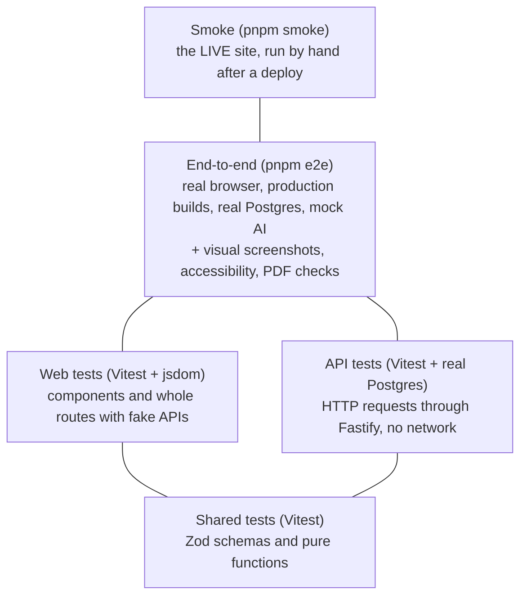
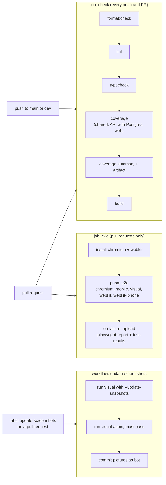

# Testing, quality and CI

This page explains how Vitae is tested, how to run every kind of test on your own computer, what CI does for you, and what to do when a test fails. Read it once from top to bottom; later, use the headings and tables as a reference.

Related pages: [Architecture](ARCHITECTURE.md), [Deploying](DEPLOY.md), [API guide](api/README.md), [Web guide](web/README.md), [Renderer](web/renderer.md), [Domain model](domain-model.md), [How-to guides](guides/README.md).

## Contents

1. [The test strategy](#1-the-test-strategy)
2. [Running everything locally](#2-running-everything-locally)
3. [Shared package tests](#3-shared-package-tests-packagesshared)
4. [API tests](#4-api-tests-appsapitest)
5. [Web tests](#5-web-tests-appswebsrc)
6. [End-to-end tests](#6-end-to-end-tests-e2e)
7. [Visual screenshots](#7-visual-screenshots)
8. [The smoke test](#8-the-smoke-test)
9. [Coverage](#9-coverage)
10. [CI](#10-ci-githubworkflows)
11. [Pre-commit, lint, format and typecheck](#11-pre-commit-lint-format-and-typecheck)
12. [Troubleshooting](#12-troubleshooting-failing-and-flaky-tests)
13. [Open questions](#13-open-questions)

## 1. The test strategy

There are several layers. The lower a test sits, the faster and more precise it is. The higher it sits, the more of the real system it covers, and the slower and more fragile it is. Write the lowest test that can catch your bug.



| Layer                         | Where                                                                | What it is for                                                                                                                           | Speed                           |
| ----------------------------- | -------------------------------------------------------------------- | ---------------------------------------------------------------------------------------------------------------------------------------- | ------------------------------- |
| Shared unit tests             | `packages/shared/src/**/*.test.ts`                                   | Schemas, limits, example data, formatting. The contract both apps rely on.                                                               | Seconds                         |
| API tests                     | `apps/api/test/modules/*.test.ts`                                    | Routes, validation, auth, ownership, revisions, rate limits, providers. Uses a real Postgres, never a database mock.                     | Seconds (needs Postgres)        |
| Web component and route tests | `apps/web/src/**/*.test.ts(x)`                                       | UI behaviour. Small components render alone; features render the real route tree against in-memory fake APIs.                            | About one minute for everything |
| Renderer tests                | `apps/web/src/renderer/**`                                           | The CV document renderer, pagination, templates (see [Renderer](web/renderer.md)).                                                       | Fast                            |
| Browser e2e                   | `e2e/tests/*.spec.ts`                                                | Whole journeys across browser, web build, API and database: sign-up, editing, autosave, PDF, share links, email, accessibility, phones.  | Minutes                         |
| Visual screenshots            | `e2e/tests/visual.spec.ts`, pictures in `e2e/tests/__screenshots__/` | Catches accidental layout changes in the CV templates.                                                                                   | Part of e2e                     |
| Smoke                         | `e2e/smoke/*.spec.ts`                                                | Checks the deployed site and the real services (database, photo storage, email, optionally AI). Also runs in CI against the local stack. | A few minutes, by hand          |
| Coverage                      | `pnpm coverage`, `scripts/coverage-summary.mjs`                      | Shows where unit and API tests are thin. Not a gate.                                                                                     | Slower than `pnpm test`         |

### I changed X, which test do I write?

| I changed...                                                    | Write this                                                                                               | Where                                                               |
| --------------------------------------------------------------- | -------------------------------------------------------------------------------------------------------- | ------------------------------------------------------------------- |
| A Zod schema, a limit, an example CV, a formatter in `shared`   | A unit test next to the file                                                                             | `packages/shared/src/<area>/<area>.test.ts`                         |
| An API route, its validation or its response                    | An API test using `useTestApp()`                                                                         | `apps/api/test/modules/<area>.test.ts`                              |
| Who may see or change a record                                  | A cross-user case in the isolation test                                                                  | `apps/api/test/modules/isolation.test.ts`                           |
| An AI prompt or provider                                        | An API test with a scripted provider, or a fetch fake for Gemini                                         | `apps/api/test/modules/ai.test.ts`, `gemini.test.ts`                |
| Env parsing or production safety checks                         | A test of the config function                                                                            | `apps/api/test/modules/production.test.ts`                          |
| A small UI component (modal, toast, select)                     | A component test with `render` from Testing Library                                                      | next to the component, e.g. `apps/web/src/shared/ui/Modal.test.tsx` |
| A feature screen (jobs, documents, editor, auth)                | A route-level test: `import '@/test/appHarness'` and `renderRoute(...)`                                  | `apps/web/src/features/<feature>/<feature>.test.tsx`                |
| A Zustand store or a pure helper in the web app                 | A plain unit test                                                                                        | next to the file, e.g. `cvEditorStore.test.ts`                      |
| The CV renderer, pagination or a template                       | A renderer test                                                                                          | `apps/web/src/renderer/**`                                          |
| Translations                                                    | Usually nothing: `i18n.test.tsx` checks every key exists in all languages. Add a test for new behaviour. | `apps/web/src/i18n/i18n.test.tsx`                                   |
| Something that needs a real browser (layout, focus, print, PDF) | An e2e test                                                                                              | `e2e/tests/`                                                        |
| Something that needs two or more real services working together | An e2e test                                                                                              | `e2e/tests/`                                                        |
| How a template looks                                            | Nothing new: update the screenshots with the `update-screenshots` label                                  | [Section 7](#7-visual-screenshots)                                  |
| Deploy settings, storage, real email or real AI                 | Run the smoke test after the deploy                                                                      | [Section 8](#8-the-smoke-test)                                      |

A rule of thumb: if you can test it without a browser, do. Put the check in the lowest layer, then add one e2e journey only for what the lower layers cannot see.

## 2. Running everything locally

You need Node 22 or newer (`.nvmrc`, `engines` in `package.json`) and pnpm (`packageManager` in `package.json`). Install once with `pnpm install`.

### Commands

All root commands are in the root `package.json`. They call the scripts of each package.

| Command                                                           | What it does                                                                                 | Needs Postgres?                     |
| ----------------------------------------------------------------- | -------------------------------------------------------------------------------------------- | ----------------------------------- |
| `pnpm db:up`                                                      | Starts Postgres with Docker (`docker-compose.yml`, host port 5433). `pnpm db:down` stops it. | n/a                                 |
| `pnpm test`                                                       | `pnpm -r test`: runs `vitest run` in `packages/shared`, `apps/api` and `apps/web`.           | API tests only (skipped without it) |
| `pnpm coverage`                                                   | `pnpm -r test:coverage`: the same tests with `vitest run --coverage`.                        | Same as above                       |
| `pnpm e2e`                                                        | `playwright test` in `e2e/`: browser tests against production builds.                        | Yes, always                         |
| `pnpm smoke`                                                      | `playwright test -c playwright.smoke.config.ts`: checks the live site.                       | No (uses the live services)         |
| `pnpm lint`, `pnpm format:check`, `pnpm format`, `pnpm typecheck` | See [section 11](#11-pre-commit-lint-format-and-typecheck).                                  | No                                  |
| `pnpm build`                                                      | `pnpm -r build` (API with `tsup`, web with `vite build`). CI runs it last.                   | No                                  |

### Environment switches for e2e

| Variable                   | Effect (all read in `e2e/playwright.config.ts`)                                                                                                                      |
| -------------------------- | -------------------------------------------------------------------------------------------------------------------------------------------------------------------- |
| `E2E_DATABASE_URL`         | Database for e2e. Default `postgres://cv:cv@localhost:5433/cv_generator_e2e`. The name must contain `e2e` (checked by `e2e/scripts/reset-db.mjs`).                   |
| `E2E_VISUAL=1`             | Adds the `visual` project (screenshots) locally. In CI (`CI` set) it is always on.                                                                                   |
| `E2E_WEBKIT=1`             | Adds the `webkit` and `webkit-iphone` projects locally. Run `pnpm --filter @cv/e2e exec playwright install webkit` first.                                            |
| `E2E_CROSS_ON_CHROMIUM=1`  | Runs the Safari journeys (`cross-browser.spec.ts`) on Chromium (desktop) and Pixel 7 (`mobile` project) instead, to debug them without WebKit.                       |
| `E2E_WORKERS=4`            | Runs spec files in parallel (default 1). About a third faster on 4 workers, but see [Why the suite runs one test at a time](#why-the-suite-runs-one-test-at-a-time). |
| `PLAYWRIGHT_CHROMIUM_PATH` | Use an already installed Chromium instead of the one Playwright downloads. Also read by the smoke config.                                                            |
| `CI`                       | Turns on retries (1), `forbidOnly`, the HTML and GitHub reporters, and the `visual` and WebKit projects.                                                             |

The first time you run e2e, install the browser: `pnpm --filter @cv/e2e exec playwright install chromium`.

### Examples

```bash
# Start Postgres (needed for API tests and e2e)
pnpm db:up

# Everything quick
pnpm test

# One package
pnpm --filter @cv/web test
pnpm --filter @cv/api test
pnpm --filter @cv/shared test

# One test file, or one test by name (Vitest filters)
pnpm --filter @cv/web exec vitest run src/features/jobs/jobs.test.tsx
pnpm --filter @cv/api exec vitest run test/modules/auth.test.ts -t "limits sign-ups"

# Watch mode: reruns the affected tests when you save
pnpm --filter @cv/web exec vitest
pnpm --filter @cv/api exec vitest

# Browser tests
pnpm e2e
pnpm --filter @cv/e2e exec playwright test auth.spec.ts --project=chromium
pnpm --filter @cv/e2e exec playwright test --headed --debug auth.spec.ts
pnpm --filter @cv/e2e exec playwright test --ui

# Optional projects
E2E_VISUAL=1 pnpm e2e
E2E_WEBKIT=1 pnpm e2e
E2E_CROSS_ON_CHROMIUM=1 pnpm e2e

# Live site (see section 8)
SMOKE_URL=https://example.pages.dev SMOKE_EMAIL=... SMOKE_PASSWORD=... pnpm smoke
SMOKE_LOCAL=1 pnpm smoke      # the same tests against the local stack
```

### Postgres: when it is needed and what happens without it

- **API tests** use the database in `TEST_DATABASE_URL`. The default (`apps/api/test/support/env.ts`) is `postgres://cv:cv@localhost:5433/cv_generator_test`, which matches `docker-compose.yml`. CI sets its own URL on port 5432.
- If Postgres cannot be reached, `apps/api/test/support/globalSetup.ts` prints a warning ("Skipping database tests...") and every `describe.skipIf(!dbAvailable)` block is skipped. Vitest still exits with success. So **a green `pnpm test` without Postgres does not prove the API works.** Look for the warning at the top of the output.
- In CI, `REQUIRE_DB_TESTS=1` turns that skip into a hard failure.
- **e2e** always needs Postgres. `e2e/scripts/reset-db.mjs` connects to the `postgres` database on the same server and drops and recreates the e2e database, so there is no fallback.
- Web and shared tests never need a database.

## 3. Shared package tests (`packages/shared`)

- Config: `packages/shared/vitest.config.ts` (only coverage settings; default Node environment).
- Run: `pnpm --filter @cv/shared test`.
- Files sit next to the code: `ai/ai.test.ts`, `auth/auth.test.ts`, `common/*.test.ts`, `cv/cv.test.ts`, `cv/templates.test.ts`, `cv/professions.test.ts`, `cv/format.test.ts`, `cover-letter/coverLetter.test.ts`, `resignation/resignation.test.ts`, `jobs/jobs.test.ts`, `documents/share.test.ts`, `examples/examples.test.ts`.
- What they check: that schemas accept good input and reject bad input, that text limits hold, and that every example CV is valid. Example data matters because the web app, the API and the e2e tests all start from it.
- Use these tests for any rule that lives in a schema, so you do not have to repeat it in the API or the web tests.

## 4. API tests (`apps/api/test`)

API tests start the real Fastify app (`buildApp` from `apps/api/src/app.ts`) on a real Postgres and send requests with `app.inject(...)`. No port is opened. See [API guide](api/README.md) for the code under test.

### The pieces

| File                                   | Role                                                                                                                                                                                                                                   |
| -------------------------------------- | -------------------------------------------------------------------------------------------------------------------------------------------------------------------------------------------------------------------------------------- |
| `apps/api/vitest.config.ts`            | Sets `globalSetup`, `fileParallelism: false`, `testTimeout: 20_000` and the coverage settings.                                                                                                                                         |
| `apps/api/test/support/env.ts`         | Exports `TEST_DATABASE_URL`.                                                                                                                                                                                                           |
| `apps/api/test/support/globalSetup.ts` | Runs once before all tests: connects to the server's `postgres` database, creates the test database if it does not exist, applies migrations (`runMigrations`), and provides `dbAvailable` to the test files. Skips or fails as above. |
| `apps/api/test/support/context.ts`     | Exports `dbAvailable` and `useTestApp()`.                                                                                                                                                                                              |

Why `fileParallelism: false`: all test files share one database and each test truncates the tables, so two files running at once would delete each other's data. Tests inside one file also run one after another. The timeout is 20 s because password hashing is slow on purpose and a busy CI machine needs the time.

### `useTestApp()`

Call it once inside a `describe`. It returns a context object that is filled before each test:

| Field                  | Meaning                                                                                                                       |
| ---------------------- | ----------------------------------------------------------------------------------------------------------------------------- |
| `ctx.app`              | The Fastify app (built once per file) with the memory mailer, a temporary upload folder and CORS for `http://localhost:5173`. |
| `ctx.database`         | The Drizzle database handle.                                                                                                  |
| `ctx.mailer`           | A memory mailer (`createMemoryMailer`). Sent emails are in `ctx.mailer.outbox`, cleared before each test.                     |
| `ctx.cookie`, `userId` | The default user `user@example.com`, already signed in. Send `headers: { cookie: ctx.cookie }`.                               |
| `ctx.signUp(email)`    | Creates another user and session directly in the database and returns `{ cookie, userId }`.                                   |

Before every test the hook truncates `users, cvs, cv_versions, uploads, share_links, jobs, cover_letters, resignations, sessions, auth_tokens` with `cascade`. **If you add a table, add it to that list**, or data will leak between tests.

How users are created: `ctx.signUp` inserts a row in `users` and calls `createSession`. It does not use the register route, so it is fast and does not hit password hashing or the rate limits. Tests of the real sign-up flow (`auth.test.ts`) build their own app with a local `freshApp()` helper, because a fresh app has fresh rate limits.

### Other test doubles

- **Mailer**: `createMemoryMailer()` for most tests. `production.test.ts` also tests the file mailer (used by e2e) and the Brevo mailer with a recording `fetch`.
- **AI**: `ai.test.ts` defines a `scripted()` provider: you queue answers (or errors) and read back the requests. It also uses `createMockProvider()` from `apps/api/src/modules/ai/mock.ts`, the same fake provider e2e uses. `gemini.test.ts` tests the real Gemini provider against a fake `fetch`, so no network call is made.
- **Storage**: `createLocalStorage(<temp folder>)`. The R2 storage is tested with a recording `fetch` in `production.test.ts`.

### Example: a test with two users

This is the shape of `apps/api/test/modules/isolation.test.ts`, shortened:

```ts
import { describe, expect, it } from 'vitest'
import { dbAvailable, useTestApp } from '../support/context'

describe.skipIf(!dbAvailable)('accounts stay apart', () => {
  const ctx = useTestApp()
  const as = (cookie: string) => (method: string, url: string, payload?: object) =>
    ctx.app.inject({ method: method as 'GET', url: `/api${url}`, payload, headers: { cookie } })

  it('CVs: only your own', async () => {
    const a = as(ctx.cookie)
    const b = as((await ctx.signUp('other@example.com')).cookie)
    const cv = (await a('POST', '/cvs', { title: 'Private' })).json()

    expect((await b('GET', '/cvs')).json()).toEqual([])
    expect((await b('GET', `/cvs/${cv.id}`)).statusCode).toBe(404)
    expect((await a('GET', `/cvs/${cv.id}`)).json().title).toBe('Private')
  })
})
```

The cross-user pattern, used for every kind of record:

1. User A creates the record.
2. User B lists (must be empty) and then tries every read and write route on A's id.
3. Each of those must answer **404** (not 403), so the existence of the record is not revealed.
4. A reads the record again and it is unchanged.

When you add a new owned record type, add a case to `isolation.test.ts`.

Always wrap database tests in `describe.skipIf(!dbAvailable)`. Tests that do not need the database (like `gemini.test.ts`) do not need it.

## 5. Web tests (`apps/web/src`)

- Runner: Vitest with the `jsdom` environment, configured in the `test` block of `apps/web/vite.config.ts` (there is no separate vitest config). The `@` alias to `src` works in tests too.
- Setup file `apps/web/src/test/setup.ts`: cleans up the DOM after each test, preloads the lazy page chunks (`preloadPages()`), and starts i18n in English, so tests read English text.
- Libraries: `@testing-library/react` (`render`, `screen`, `within`, `fireEvent`, `waitFor`). There is no user-event library; tests use `fireEvent`.
- Tests live next to the code they test. See [Web guide](web/README.md).
- You may see "Not implemented: Window's print() method" in the output. It is jsdom's message when code calls `window.print()`; it is harmless.

### The test folder (`apps/web/src/test`)

| File              | Role                                                                                                                                                                                                                                       |
| ----------------- | ------------------------------------------------------------------------------------------------------------------------------------------------------------------------------------------------------------------------------------------ |
| `setup.ts`        | Global setup, see above.                                                                                                                                                                                                                   |
| `appHarness.ts`   | Import it **first** in a route-level test. It mocks the feature API modules (`cv-editor/api`, `cover-letters/api`, `resignation/api`, `jobs/api`, `auth/api`) and `useHealth`, and resets all stores before each test.                     |
| `fakeCvApi.ts`    | `createFakeCvApi()`: an in-memory CV, cover letter, resignation, job and share-link API with the same rules as the real one (revisions, 404s).                                                                                             |
| `fakeAuthApi.ts`  | `createFakeAuthApi()`, plus `TEST_USER` (`ann@example.com`).                                                                                                                                                                               |
| `fakeAiApi.ts`    | `createFakeAiApi()`: the test decides each AI answer and can read the requests.                                                                                                                                                            |
| `fakeHolders.ts`  | `fake` and `auth`: objects with a `current` field that hold the fake instances, so a test can reach the same fake the app uses (`fake.current.jobs`).                                                                                      |
| `renderRoute.tsx` | `renderRoute(path, { user })`: renders the real route tree (`routes` from `@/app/router`) in a memory router with a fresh React Query client. The user is signed in as `TEST_USER` unless `user` says otherwise (`null` means signed out). |
| `appHelpers.ts`   | `page()` (queries inside the CV document), and `SAVE_TIMEOUT = { timeout: 4000 }` for `findBy...`/`waitFor` calls that wait for autosave.                                                                                                  |

Why the holders exist: `vi.mock` calls are hoisted and run before imports, so the mocked modules create the fake lazily and store it in `fake.current`. The `beforeEach` in the harness calls `fake.current.reset()`.

### Writing a route-level test

```tsx
// Route-level tests: the real app with fake APIs (see test/appHarness.ts).
import '@/test/appHarness' // first import, always
import { fake } from '@/test/fakeHolders'
import { fireEvent, screen, within } from '@testing-library/react'
import { describe, expect, it } from 'vitest'
import { renderRoute } from '@/test/renderRoute'

describe('saved jobs', () => {
  it('adds the first job', async () => {
    renderRoute('/jobs')
    fireEvent.click(await screen.findByRole('button', { name: 'Add your first job' }))
    const drawer = within(screen.getByRole('dialog', { name: 'Add job' }))
    fireEvent.change(drawer.getByRole('textbox', { name: 'Position *' }), {
      target: { value: 'Frontend Engineer' },
    })
    fireEvent.click(drawer.getByRole('button', { name: 'Add job' }))

    expect(await screen.findByRole('button', { name: 'Frontend Engineer' })).toBeDefined()
    expect([...fake.current.jobs.values()][0]).toMatchObject({ position: 'Frontend Engineer' })
  })
})
```

Tips:

- Find elements by role and accessible name, like a user (and a screen reader) would. This also keeps the UI accessible.
- Assert on the fake's state (`fake.current.jobs`) to check what the app "sent" to the API.
- Use `await screen.findBy...` for anything that appears after data loads. For autosave use `{ timeout: 4000 }` (`SAVE_TIMEOUT`).
- To start signed out, use `renderRoute('/login', { user: null })`.
- To make the fake fail, throw an `ApiRequestError` from the fake method (see how `fakeCvApi.ts` does it for 404).

### Writing a component test

A component that does not need the app can be rendered alone, without the harness. See `apps/web/src/shared/ui/Modal.test.tsx`:

```tsx
import { fireEvent, render, screen } from '@testing-library/react'
import { expect, it, vi } from 'vitest'
import { Modal } from './Modal'

it('closes when the backdrop is clicked', () => {
  const onClose = vi.fn()
  render(
    <Modal labelledBy="title" onClose={onClose} variant="drawer">
      <h2 id="title">Job</h2>
    </Modal>,
  )
  // ... interact, then:
  expect(onClose).not.toHaveBeenCalled()
})
```

jsdom has no layout, so tests that depend on sizes mock them (for example `getBoundingClientRect` with `vi.spyOn`). If a behaviour depends on real layout, test it in e2e.

### Renderer tests

The CV renderer is tested in `apps/web/src/renderer/`: `document/CvRenderer.test.tsx` renders every profession example with every template (`it.each`) and checks the content appears, `document/CvThumbnail.test.tsx`, `document/paginate.test.ts` (page splitting), `editing/dateInputs.test.tsx` and `templates/photo.test.ts`. Real page breaks and fonts are not measurable in jsdom, so layout is covered by e2e (`pdf.spec.ts`, `visual.spec.ts`). More in [Renderer](web/renderer.md).

### i18n tests

`apps/web/src/i18n/i18n.test.tsx` checks that the Bulgarian (`bg`) and German (`de`) message files have exactly the English keys, the same `{{placeholders}}`, and no empty text. It also checks language detection, `setLanguage` and date formatting. When you add or rename a message, add it to **all three** files in `apps/web/src/i18n/locales/` or this test fails.

## 6. End-to-end tests (`e2e`)

The e2e package is `@cv/e2e` (`e2e/package.json`). It uses Playwright 1.56.1 (pinned exactly), `@axe-core/playwright` for accessibility, `pdfjs-dist` to read PDFs and `postgres` to reset the database.

### What `pnpm e2e` starts

`e2e/playwright.config.ts` defines two web servers. Both run **production builds**, so the tests see what users see (including the content security policy):

| Server | Command (run from the repo root)                                                                  | Port | Notes                                                             |
| ------ | ------------------------------------------------------------------------------------------------- | ---- | ----------------------------------------------------------------- |
| API    | `node e2e/scripts/reset-db.mjs && pnpm --filter @cv/api build && pnpm --filter @cv/api start`     | 3101 | Health URL `/api/health`. Starts after the database is recreated. |
| Web    | `pnpm --filter @cv/web build && pnpm --filter @cv/web exec vite preview --port 4173 --strictPort` | 4173 | `/api` is proxied to the e2e API through `API_PROXY_TARGET`.      |

The ports differ from `pnpm dev` (3001 and 5173), so you can run both at once. `reuseExistingServer` is `false`, so an old server on those ports will make the run fail.

The API server gets this environment:

| Variable                 | Value and reason                                                                                                                                                                                              |
| ------------------------ | ------------------------------------------------------------------------------------------------------------------------------------------------------------------------------------------------------------- |
| `NODE_ENV=test`          | Allows the mock AI (the API refuses `AI_PROVIDER=mock` only when `NODE_ENV` is `production`, see `apps/api/src/server.ts`).                                                                                   |
| `DATABASE_URL`           | The e2e database (see above).                                                                                                                                                                                 |
| `AI_PROVIDER=mock`       | Uses `apps/api/src/modules/ai/mock.ts`: fixed, predictable answers, no key, no network.                                                                                                                       |
| `E2E_MAIL_FILE`          | The API writes every email it would send as a JSON line to this file (`MAIL_FILE` in `e2e/paths.ts`, `cv-e2e-mail.jsonl` in the system temp folder). Tests read it to click the confirmation and reset links. |
| `AUTH_LIMIT_SCALE=100`   | Multiplies the sign-up and sign-in rate limits by 100. Every test signs up a new account from the same address, so with normal limits the suite would be blocked after a few tests.                           |
| `APP_URL`, `CORS_ORIGIN` | The e2e web address, so links in emails and cookies work.                                                                                                                                                     |
| `UPLOAD_DIR`             | A fresh temp folder for photos.                                                                                                                                                                               |

`E2E_MAIL_FILE` and `AUTH_LIMIT_SCALE` above 1 are rejected in production by `apps/api/src/config/production.ts`, so they cannot be switched on by mistake on the live site.

The database is recreated for every run by `e2e/scripts/reset-db.mjs`: it refuses any database whose name does not contain `e2e`, empties the mail file, drops the database with `force` and creates it again. The API applies migrations when it starts.

### Projects

| Project         | Runs                                              | Browser and size                         | When it exists           |
| --------------- | ------------------------------------------------- | ---------------------------------------- | ------------------------ |
| `chromium`      | All specs except mobile, visual and cross-browser | Desktop Chrome, 1440 x 950               | Always                   |
| `mobile`        | `mobile.spec.ts`                                  | Pixel 7                                  | Always                   |
| `visual`        | `visual.spec.ts`                                  | Desktop Chrome, 1440 x 950               | `CI` or `E2E_VISUAL` set |
| `webkit`        | `cross-browser.spec.ts`                           | Desktop Safari, 1440 x 950, timeout 90 s | `CI` or `E2E_WEBKIT` set |
| `webkit-iphone` | `cross-browser.spec.ts`                           | iPhone 14, timeout 90 s                  | `CI` or `E2E_WEBKIT` set |

With `E2E_CROSS_ON_CHROMIUM=1`, `cross-browser.spec.ts` moves from the WebKit projects to `chromium` (desktop) and `mobile` (Pixel 7), so you can debug Safari journeys with a normal browser.

Other settings: `workers: 1` and `fullyParallel: false` (one database, one API; parallel tests would also mix up the mail file), `retries: 1` only when `CI` is set (none locally, so flakiness is visible to you), `forbidOnly` in CI, `trace: 'retain-on-failure'`, `screenshot: 'only-on-failure'`, and `toHaveScreenshot` allows `maxDiffPixelRatio: 0.02`. Screenshots are stored without a platform suffix: `{testDir}/__screenshots__/{testFileName}/{arg}{ext}`.

### Page objects and fixtures

The suite is built in two layers. Specs read like a story and hold the **assertions**; the layers below hold the **selectors and actions**, so a changed label is fixed in one file.

```
e2e/
  pages/                 page objects (POM): one class per screen or component
    BasePage.ts            heading, language, theme, account button, axe check, no-sideways-scroll check
    AuthPages.ts           LoginPage, RegisterPage, ForgotPasswordPage, ResetPasswordPage, VerifyEmailPage, WelcomePage
    AppPages.ts            DashboardPage, DocumentsPage, JobsPage, NewCvPage, NewLetterPage, NewResignationPage, SharedDocumentPage
    editor/                EditorPage (shared shell), CvEditorPage, LetterEditorPages (cover and resignation letter)
    components/            AccountDrawer, ShareDialog, the editor side panels (templates, design and font, fix mistakes, check and tailor, assistant)
  fixtures/
    base.ts                `test` with page objects, api, mailbox, printing, visitors, console-error check; no account
    index.ts               `test` with a signed-in `account`, `cvEditor` and the `accountName` / `cvTitle` options
    helpers.ts             ApiClient, Mailbox, Printing, Visitors
  utils/                 small helpers that are not page objects: LinksChecker (the same-site links of a page), PerformanceHelper (LCP and CLS)
  data/                  JSON test data for data-driven specs: signupRules.json, photos.json, performanceBudgets.json
```

**Rules for page objects.** A page object has locators (methods returning a `Locator`) and actions (methods that click, type, wait). It does not hold `expect` calls about behaviour; the only exceptions are small "wait until ready" checks and `expectSaved` / `expectAccessible` / `expectNoSideScroll`. An action that leads to another screen returns that screen's page object (`newCv.createExample()` returns a `CvEditorPage`). Selectors use roles and the English interface texts.

**Fixtures** (import `test` and `expect` from `'../fixtures'`, not from `@playwright/test`):

| Fixture                                                     | What you get                                                                                                                                                                                                     |
| ----------------------------------------------------------- | ---------------------------------------------------------------------------------------------------------------------------------------------------------------------------------------------------------------- |
| `account`                                                   | A fresh user, registered through the API and signed in (cookie in the browser). **Lazy**: only created when a test asks for it, so sign-up and sign-in tests start with nobody. Hides the "confirm email" toast. |
| `cvEditor`                                                  | An `account` plus an example designer CV (template Creative) open in the editor.                                                                                                                                 |
| `accountName`, `cvTitle`                                    | Options: `test.use({ accountName: 'Георги', cvTitle: 'Portfolio CV' })` sets the user's name or the CV title for the file or a `describe`.                                                                       |
| `loginPage`, `dashboard`, `documents`, `jobs`, `newCv`, ... | The page objects, ready to use on the test's `page`.                                                                                                                                                             |
| `letterEditor(page)`, `resignationEditor(page)`             | Page objects for an editor that is already open.                                                                                                                                                                 |
| `api`                                                       | `get`, `post`, `delete`, `register` and `changeDocument(path, fn)` (GET, edit a copy, PATCH with the revision) using the browser's cookie.                                                                       |
| `mailbox`                                                   | `sent(to)` and `linkFor(to, regex, count?)`: the emails the API "sent" (it writes them to a file in e2e); `linkFor` polls for 15 s.                                                                              |
| `printing`                                                  | `install()` replaces `window.print`; `printed()` waits until the app asked to print; `capture()` returns the PDF made with `page.pdf()`.                                                                         |
| `visitors`                                                  | `open(link)` opens a share link in a fresh signed-out context and returns `{ page, shared, body }`. Closed after the test.                                                                                       |
| `consoleErrors` (automatic)                                 | Runs in **every** test. Collects `pageerror` and `console.error` (not the expected 401) and fails the test if any were not allowed.                                                                              |
| `allowConsoleErrors(pattern)`                               | Allows an error the test causes on purpose: `allowConsoleErrors(/status of 400/)`.                                                                                                                               |
| `PASSWORD`                                                  | The password of every test account.                                                                                                                                                                              |

### PDF helper (`e2e/pdf.ts`)

`readPdf(buffer)` uses `pdfjs-dist` (legacy build) to return, for each page, its width and height in points, every piece of text with its position (`left`, `top`, `right`, `bottom`, measured from the top-left), and the joined text. `margins(page)` returns the gap between the text and each page edge. `pdf.spec.ts` uses them to check that a CV is one A4 page (210 x 297 mm), that Cyrillic text is in the file, and that long documents keep their margins on every page.

### The specs

New specs borrow from the practices of [AutomationCamp-Playwright](https://github.com/varadinos/AutomationCamp-Playwright): data-driven cases kept in JSON, a link checker that attaches what it checked to the report, and page-load measurements written into the report as annotations.

| File                    | What it covers                                                                                                                                                                                                                             |
| ----------------------- | ------------------------------------------------------------------------------------------------------------------------------------------------------------------------------------------------------------------------------------------ |
| `auth.spec.ts`          | Sign up, sign out, sign in; public legal pages; the welcome page for first-time visitors.                                                                                                                                                  |
| `email.spec.ts`         | Email confirmation, "send it again", password reset from the emailed link, reset for an unknown address reveals nothing, deleting the account removes its data.                                                                            |
| `documents.spec.ts`     | Create, edit, autosave and share a CV; a saved job keeps its description.                                                                                                                                                                  |
| `links.spec.ts`         | Every same-site link on the six public pages answers 200 (soft assertions list every broken link; the checked links are attached to the report as `checked-links.txt`).                                                                    |
| `performance.spec.ts`   | Largest Contentful Paint and layout shift of the welcome, sign-in and privacy pages stay inside the budgets in `data/performanceBudgets.json`; the measured values are annotations in the HTML report.                                     |
| `validation.spec.ts`    | Data-driven: the sign-up form refuses short or empty passwords and malformed emails (rows of `data/signupRules.json`); the photo picker refuses text files, PDFs and images over 5 MB with the right message (rows of `data/photos.json`). |
| `headline.spec.ts`      | The worked example of the e2e guide: edit, autosave, reload, PDF.                                                                                                                                                                          |
| `letters.spec.ts`       | Cover letter and resignation letter: write, save, restyle, print, share with details hidden, delete.                                                                                                                                       |
| `ai.spec.ts`            | Fix Mistakes, Check and Tailor, and the assistant, using the mock AI.                                                                                                                                                                      |
| `failures.spec.ts`      | Same CV in two tabs (conflict handling), server errors and lost connection while saving, AI busy or daily limit used, session expiry while editing, server failure when opening a document.                                                |
| `edge-data.spec.ts`     | Cyrillic and emoji survive save, reload and share; markup is shown as text; one very long word wraps; a nearly empty CV opens.                                                                                                             |
| `i18n.spec.ts`          | Switching language changes the page in place and is remembered; the editor keeps unsaved work when the language changes.                                                                                                                   |
| `pdf.spec.ts`           | PDF output: A4 size, text, Cyrillic, margins, multi-page flow.                                                                                                                                                                             |
| `quality.spec.ts`       | Accessibility (axe) of public and app pages, security headers (CSP), "not found" page for a missing document.                                                                                                                              |
| `mobile.spec.ts`        | Phone layout (Pixel 7): bottom navigation, no sideways scroll, compact editor with a bottom toolbar, account drawer.                                                                                                                       |
| `cross-browser.spec.ts` | Main journeys in Safari's engine (WebKit desktop and iPhone).                                                                                                                                                                              |
| `visual.spec.ts`        | Screenshots of the template thumbnails and six full-size templates ([section 7](#7-visual-screenshots)).                                                                                                                                   |

### Why the suite runs one test at a time

`workers: 1` is the default. Spec files use their own accounts, so running them in parallel is possible (`E2E_WORKERS=4 pnpm e2e`), and it took 2.5 to 2.7 minutes instead of 4 to 5 on the development machine. But on two of two parallel runs, two tests failed with timing problems (for example the accessibility sweep and a CV test), different ones each time, and the performance budgets are only meaningful when the machine is not busy. A suite that fails at random costs more than the two minutes it saves, so parallel runs stay opt-in until the suite is run on a machine with more cores.

### Practices taken from other projects, and ones left out

Reviewed against [AutomationCamp-Playwright](https://github.com/varadinos/AutomationCamp-Playwright). Taken: JSON test data with one test per row; a reusable link checker with the checked links attached to the report; Core Web Vitals checks with the values as report annotations; tests named after the behaviour they prove. Already in place here: page objects, fixtures, a lazy per-test account, traces and screenshots on failure, CI with an HTML report. Left out on purpose:

- **Replacing Playwright's `browser` and `page` fixtures** with a hand-launched browser. It switches off per-project settings (device profiles, traces, video, isolation between tests).
- **`waitForLoadState('networkidle')` in fixtures.** Playwright advises against it; pages here wait for what the user sees ("Saved", a heading), which is faster and does not hang on polling.
- **CSS and id selectors** (`#click_me_2`). Roles and labels survive redesigns and keep the accessibility of the page honest.
- **Four retries.** A test that needs retries is hiding a bug; here there are none locally and one in CI.
- **A skipped test left in the code.** Skipped tests are forgotten; the link check here runs.
- **A fixed 2 s LCP limit.** Too tight for a shared CI machine, so budgets live in data and are generous.

### Conventions and pitfalls

- **Ask for `account` or `cvEditor`.** Each test gets its own account, so tests do not depend on each other or on test order.
- **Find things by role and name**, as in the web tests. Avoid CSS selectors unless there is no role (the visual spec uses `.grid-templates` and `[data-cv-page]`).
- **Wait for the "Saved" text** (`page.getByText('Saved', { exact: true })`) before reloading, so you do not reload before autosave finished.
- **`End` versus `Ctrl+End` in editable text.** The CV is edited in place in `contenteditable` elements. `End` moves to the end of the _visual line_ the click landed on; `ControlOrMeta+End` moves to the end of the _whole text_. If the text wraps over several lines, `End` appends in the middle. `failures.spec.ts` therefore uses `ControlOrMeta+End`, with a comment. `ai.spec.ts` uses `End` on a summary that is one line in that test.
- **Use `ControlOrMeta`** instead of `Control` for shortcuts, so the same test works on macOS and in WebKit.
- **The console error fixture is on for every test.** A blocked script, a failed request logged by the browser or a React error fails the test. If your test causes an error on purpose, call `allowConsoleErrors(/pattern/)`.
- **Mail is a file, not an inbox.** Use `mailbox.linkFor`, which polls, instead of reading the file once.
- **Do not click the real print dialog.** Use the `printing` fixture (`install`, `capture`).
- **Wait for fonts** (`document.fonts.ready`) before measuring or taking pictures. Fonts decide line breaks.
- **No retries locally.** A test that passes only on retry in CI is flaky: fix it, do not rely on the retry.
- **`workers: 1`.** Do not turn on parallel workers; tests share one database and one mail file.

## 7. Visual screenshots

`e2e/tests/visual.spec.ts` takes pictures of the 16 template thumbnails in the "new CV" wizard and of the first page of six templates at full size (`polished`, `portfolio`, `vivid`, `bold`, `elegant`, `monogram`). The pictures are committed in `e2e/tests/__screenshots__/visual.spec.ts/`. The data is always the example CV, so a difference means the layout changed.

**Why CI makes the pictures.** Text is drawn slightly differently on every operating system and font setup, so a picture made on your laptop differs by a few pixels from one made on CI. The tests compare with a tolerance of 2% of pixels, but fonts can also move line breaks. So the reference pictures must come from the same kind of machine that checks them: the GitHub runner. Locally the `visual` project only runs with `E2E_VISUAL=1` and would compare against CI pictures, so expect differences there.

### The `update-screenshots` workflow

1. You change a template or any style that affects it on a pull request. The `visual` project fails in CI.
2. Add the label **`update-screenshots`** to the pull request (only works for branches in this repository, not forks).
3. `.github/workflows/update-screenshots.yml` checks out the branch, installs Chromium, runs `playwright test --project=visual --update-snapshots` (this step may "fail" while it writes new pictures, so it has `continue-on-error`), then runs the visual tests again without the update flag, which must pass. If any picture changed, it commits `e2e/tests/__screenshots__` to the branch as `github-actions[bot]` with the message "Update template screenshots (made by CI)".
4. If the second run fails, the job fails and uploads `screenshot-report` (the Playwright report and `test-results`) for 7 days.

### How to review the pictures

Do not accept new pictures blindly. Open the bot commit on GitHub and use the image view (the "2-up" or "swipe" view) for each changed file. Check that only the thing you meant to change moved. A header that shifted, text that was cut off or a missing sidebar is a bug even though the test now passes. If a picture changed but you did not touch templates, find out why before keeping it.

### Why checks wait after the bot commit

GitHub does not start new workflow runs for a commit pushed with the built-in workflow token, to avoid loops. The checks on the new commit show **"action required"** (waiting for approval). Open the waiting run and press **Approve and run**, or push any new commit to the branch. This is described in the header of `update-screenshots.yml`. Until then the pull request does not show a green result for the new commit.

## 8. The smoke tests

The smoke tests check the **deployed** site, which the automatic tests cannot do: the real database, real photo storage, the real email service and (if you ask) the real AI. They are not part of `pnpm e2e`. Run them by hand after every deploy or change to environment settings (steps in [Deploying](DEPLOY.md)).

They use the same page objects and fixtures as e2e (`e2e/smoke/fixtures.ts` extends `fixtures/base`), plus:

- `smoke`: what the run was told (`local`, `url`, `apiOrigin`, `email`, `password`, `ai`).
- `session`: a worker-wide sign-in done once through the real login page and shared as a storage state, so tests do not sign in again. Tests that must start signed out use `test.use({ storageState: undefined })`. A test that signs out (which ends the session on the server) signs in on its own first.
- `cleanup`: `cleanup.push('/api/cvs/<id>')` deletes what the test made when it ends, even when it fails.

Config: `e2e/playwright.smoke.config.ts` (folder `e2e/smoke`, one worker, no retries, 90 s timeout). Projects: `desktop` (Chrome, 1440 x 950) and `phone` (Pixel 7, only `phone.spec.ts`).

| Variable                        | Meaning                                                                                                                                    |
| ------------------------------- | ------------------------------------------------------------------------------------------------------------------------------------------ |
| `SMOKE_URL` (required)          | The address of the deployed web app.                                                                                                       |
| `SMOKE_EMAIL`, `SMOKE_PASSWORD` | An account made for this: sign up once by hand and confirm the email. Without them, everything that needs an account is skipped.           |
| `SMOKE_API_URL`                 | Optional: the API's own address (e.g. the Render URL). Adds the check that the API refuses requests that skip the web app's proxy.         |
| `SMOKE_AI=1`                    | Also calls the real AI (each AI test uses one of the account's 30 daily requests).                                                         |
| `SMOKE_LOCAL=1`                 | Starts the local stack (like `pnpm e2e`: see `e2e/stack.ts`), registers a fresh account and runs everything, with the mock AI. Used in CI. |
| `PLAYWRIGHT_CHROMIUM_PATH`      | Optional preinstalled Chromium.                                                                                                            |

| Spec                   | What it checks                                                                                                                                                                                                                                                                                                                                                                                              |
| ---------------------- | ----------------------------------------------------------------------------------------------------------------------------------------------------------------------------------------------------------------------------------------------------------------------------------------------------------------------------------------------------------------------------------------------------------- |
| `availability.spec.ts` | No account. `/api/ping`, `/api/health` (database up, email provider is a real service), private routes answer 401, unknown API routes answer JSON 404, a warm ping is fast, the API refuses direct access; public pages load, deep links go to sign in, unknown pages and share links show friendly pages; security headers and immutable caching of hashed files (Cloudflare Pages only, skipped locally). |
| `account.spec.ts`      | A wrong password is refused, the right one signs in with an HttpOnly, SameSite=Lax (and Secure on https) cookie; a reset email is accepted (check the inbox yourself); the session survives a reload and sign-out ends it; language and theme are kept.                                                                                                                                                     |
| `documents.spec.ts`    | A CV: create, edit, photo upload (storage), template change, reload, listed under Documents; share link works signed out, hiding personal details removes them from the response, turning the link off gives 404; cover letter and resignation letter from a CV; Download PDF builds the print layout.                                                                                                      |
| `jobs.spec.ts`         | A job is saved, stored with its description, shown after reload, and removed again.                                                                                                                                                                                                                                                                                                                         |
| `ai.spec.ts`           | `SMOKE_AI=1` only: Fix Mistakes, Check and Tailor and the Assistant return answers without an error.                                                                                                                                                                                                                                                                                                        |
| `phone.spec.ts`        | Main pages do not scroll sideways on a phone; the editor has its bottom toolbar.                                                                                                                                                                                                                                                                                                                            |

CI runs `SMOKE_LOCAL=1 pnpm smoke` after the e2e suite, so the smoke code keeps working between deploys. Run it locally the same way (it needs Postgres, like e2e).

## 9. Coverage

- Provider: V8 (`@vitest/coverage-v8`) in `packages/shared`, `apps/api` and `apps/web`. Each config includes `src/**/*.{ts,tsx}` and excludes test files (and `src/test/**` for web and shared). Reports: `text-summary`, `json-summary` and `lcov` in `<package>/coverage/` (git-ignored).
- Run: `pnpm coverage` (needs Postgres for meaningful API numbers; without it the API database tests are skipped and the API percentage will be low).
- Summary table: `node scripts/coverage-summary.mjs` reads `coverage/coverage-summary.json` of each package and prints a Markdown table (statements, branches, functions, lines). CI appends it to the run summary (`$GITHUB_STEP_SUMMARY`) and uploads the `coverage` folders as an artifact for 7 days.
- **There are no thresholds yet.** Coverage never fails a build. It is there to show where tests are thin.
- Open the HTML or `lcov` data from `<package>/coverage` to see which lines are not run.

Approximate numbers measured on this repository when this page was written (Postgres was not running, so the API is left out):

| Package           | Statements | Branches | Functions | Lines |
| ----------------- | ---------- | -------- | --------- | ----- |
| `packages/shared` | 93.2%      | 91.6%    | 91.0%     | 93.9% |
| `apps/web`        | 83.0%      | 77.3%    | 79.0%     | 84.4% |

At that time, shared had 105 tests in 13 files and web had 349 tests in 43 files. These numbers will drift; run `pnpm coverage` for current ones.

## 10. CI (`.github/workflows`)

Two workflows exist: `ci.yml` and `update-screenshots.yml`. Both use Node from `.nvmrc`, pnpm with `--frozen-lockfile`, and a `postgres:17-alpine` service container (user, password and database `cv`, with a health check).



### `ci.yml`

- **Triggers:** `push` to `main` and `dev`, and every `pull_request`. A `concurrency` group cancels an older run of the same ref when a new one starts.
- **Job `check`** (every trigger), with `TEST_DATABASE_URL` pointing at `cv_generator_test` on port 5432 and `REQUIRE_DB_TESTS=1`:
  1. `pnpm format:check`
  2. `pnpm lint`
  3. `pnpm typecheck`
  4. `pnpm coverage` (this is where unit, API and web tests run)
  5. The coverage summary step and the `coverage` artifact (`apps/*/coverage`, `packages/*/coverage`, 7 days)
  6. `pnpm build`
- **Job `e2e`**, only when `github.event_name == 'pull_request'`: sets `E2E_DATABASE_URL`, installs Chromium and WebKit with system dependencies, runs `pnpm --filter @cv/e2e e2e` and then `SMOKE_LOCAL=1 pnpm smoke` (the smoke tests against the local stack), and on failure uploads the `playwright-report` artifact (`e2e/playwright-report` and `e2e/test-results`, 7 days). `CI` is set by GitHub, so the `visual`, `webkit` and `webkit-iphone` projects are included and failed tests retry once.

**Why e2e is pull-request only:** the comment in `ci.yml` says it saves Actions minutes on a private repository. A push to `main` or `dev` normally comes from a merged pull request that already passed e2e. The consequence: a direct push to `dev` or `main` is **not** browser-tested. (The root `README.md` says CI runs the browser tests "on every push and pull request"; the workflow file is the truth, and it is pull-request only.)

### `update-screenshots.yml`

See [section 7](#7-visual-screenshots). It triggers on `pull_request` of type `labeled`, runs only for the label `update-screenshots` and only when the pull request comes from this repository (`head.repo.full_name == github.repository`), and has `contents: write` permission to push the commit.

### What "action required" on a bot commit means

When the screenshot job pushes its commit, GitHub does not run the normal CI on it automatically. The checks stay in "action required" until someone approves the run or pushes another commit. It is expected, not an error in your code.

### Where to look when CI fails

| Failing step                    | Likely cause and what to do                                                                               |
| ------------------------------- | --------------------------------------------------------------------------------------------------------- |
| `pnpm format:check`             | Run `pnpm format` and commit the result.                                                                  |
| `pnpm lint` or `pnpm typecheck` | Run the same command locally and fix.                                                                     |
| `pnpm coverage`, an API test    | Reproduce with Postgres running (`pnpm db:up`). Remember CI never skips these.                            |
| `e2e` job                       | Download the `playwright-report` artifact; see [section 12](#12-troubleshooting-failing-and-flaky-tests). |
| `visual` project only           | A template changed. If intended, add the `update-screenshots` label; if not, find the cause.              |

## 11. Pre-commit, lint, format and typecheck

### Pre-commit hook

Husky is installed by the `prepare` script (`"prepare": "husky"`) when you run `pnpm install`. The hook `.husky/pre-commit` runs `pnpm exec lint-staged`. Settings are in the `lint-staged` block of the root `package.json`:

| Staged files                    | Commands                                |
| ------------------------------- | --------------------------------------- |
| `*.{ts,tsx,js}`                 | `eslint --fix`, then `prettier --write` |
| `*.{json,md,yml,yaml,css,html}` | `prettier --write`                      |

It only touches staged files, so commits stay quick. It does **not** run tests or the type check, so run `pnpm typecheck` and `pnpm test` yourself before you push. Do not skip the hook with `--no-verify`; CI would fail on the same problems.

### Commands

| Command             | What it does                                                                     |
| ------------------- | -------------------------------------------------------------------------------- |
| `pnpm lint`         | `eslint .` with `eslint.config.js`.                                              |
| `pnpm format`       | `prettier --write .`                                                             |
| `pnpm format:check` | `prettier --check .` (what CI runs).                                             |
| `pnpm typecheck`    | `pnpm -r typecheck`: `tsc -p tsconfig.json` in `shared`, `api`, `web` and `e2e`. |

Prettier settings (`.prettierrc.json`): single quotes, no semicolons, trailing commas everywhere, 100 columns. `.prettierignore` skips `pnpm-lock.yaml`, `dist/`, `coverage/`, `docs/ui-reference/`, `apps/api/drizzle/` and `.claude/`. This file you are reading is formatted by Prettier too: run `pnpm prettier --write docs/testing.md` after editing docs.

### ESLint rules worth knowing

`eslint.config.js` starts from ESLint's and typescript-eslint's recommended sets, then adds:

- **React hooks rules** for `apps/web` (`eslint-plugin-react-hooks` v7 recommended set). This set includes newer rules, among them `react-hooks/refs`, which forbids reading or writing `ref.current` during rendering. Do those things in effects or event handlers. Rules of hooks and exhaustive dependencies apply too.
- **`react-refresh/only-export-components`** (warning): a file that exports a component should not also export other things, or fast refresh breaks. Constants are allowed.
- **Import boundaries** in `apps/web/src`:
  - `no-restricted-imports` with `../../*`: use the `@/...` alias instead of long relative paths.
  - In `shared/` and `renderer/`, importing `@/features/*` or `@/app/*` is an error. Those folders are used by features, so they must not depend on them (see [Architecture](ARCHITECTURE.md)).
- **Unused variables** are errors, except arguments and variables starting with `_`.
- ESLint ignores `dist`, `coverage`, `drizzle`, `.claude`, `e2e/test-results` and `e2e/playwright-report`.

## 12. Troubleshooting failing and flaky tests

### Open the evidence

- **Playwright trace**: failed tests keep a trace (`retain-on-failure`). Locally: `pnpm --filter @cv/e2e exec playwright show-trace e2e/test-results/<test-folder>/trace.zip`. It shows every step, the page at each step, the network and the console.
- **HTML report**: in CI, download the `playwright-report` artifact, unzip it and run `pnpm --filter @cv/e2e exec playwright show-report <folder>`. Local runs use the `list` reporter and no HTML report.
- **`error-context.md`**: Playwright writes this file in the failed test's folder in `e2e/test-results/` (the folder is git-ignored). It holds the page snapshot at the moment of failure, so you can see what was really on the screen and which roles and names existed. Start here for "element not found" failures.
- **Screenshots** of the failure are in the same folder (`screenshot: 'only-on-failure'`).
- **Vitest**: run just the failing file with `vitest run <file>` (see section 2). Add `-t "part of the name"` for one test. Use `screen.debug()` to print the DOM in a web test.

### Common causes seen in this repo

| Symptom                                                       | Cause and fix                                                                                                                                                                                                 |
| ------------------------------------------------------------- | ------------------------------------------------------------------------------------------------------------------------------------------------------------------------------------------------------------- |
| "Skipping database tests" warning, API tests skipped          | Postgres is not running. `pnpm db:up`, then rerun. Check `TEST_DATABASE_URL` if you use your own Postgres (default port is 5433, not 5432).                                                                   |
| `pnpm e2e` stops before any test, cannot connect              | Postgres is not running or `E2E_DATABASE_URL` is wrong. `reset-db.mjs` also refuses names without `e2e`.                                                                                                      |
| e2e says the server is not ready, or port in use              | Another process uses 3101 or 4173 (`reuseExistingServer` is false). Stop it. The builds also take time; the timeout is 120 s each.                                                                            |
| Sign-up fails with 429 or the status is not 201               | Rate limits. The e2e API sets `AUTH_LIMIT_SCALE=100`; if you run the API yourself for a test, set it too. In API tests, use `ctx.signUp` or a fresh app so limits are fresh.                                  |
| Screenshots differ only by a few pixels or line breaks        | Fonts and rendering differ between computers. Do not commit local pictures; use the `update-screenshots` label ([section 7](#7-visual-screenshots)).                                                          |
| Layout test passes locally but fails in CI (or the other way) | Font loading and different screen rendering. Wait for `document.fonts.ready` and avoid exact pixel assumptions.                                                                                               |
| WebKit test times out in CI                                   | Safari is slower. The WebKit projects already use a 90 s timeout. Prefer waiting for a visible element over fixed waits; only raise a timeout with a reason. See the commit history for earlier Safari fixes. |
| Text typed in the editor ends up in the wrong place           | `End` instead of `ControlOrMeta+End` ([section 6](#conventions-and-pitfalls)).                                                                                                                                |
| Test fails at the end with "browser errors"                   | The `consoleErrors` fixture caught a console error or page error. Read it; it is a real problem (for example a blocked script) unless you caused it on purpose (`expectErrors`).                              |
| Reload loses the last edit                                    | The test reloaded before autosave. Wait for the "Saved" text first.                                                                                                                                           |
| Web test fails with "unable to find" right after an action    | Data loads asynchronously: use `findBy...` or `waitFor`; for autosave use `SAVE_TIMEOUT`.                                                                                                                     |
| Web route test uses the real API or errors on import          | `import '@/test/appHarness'` is not the first import, so the mocks are not in place.                                                                                                                          |
| Data from one API test shows up in another                    | A new table is not in the `truncate` list in `apps/api/test/support/context.ts`.                                                                                                                              |
| API tests fail with timeouts on a slow machine                | Password hashing is slow on purpose; the timeout is 20 s. Close other heavy processes.                                                                                                                        |

### Checklist

1. Read the first error, not the last. Later errors are often side effects.
2. Run only the failing test, on its own. Does it fail alone? If it only fails after others, it depends on shared state.
3. Is Postgres running, and is it the right database and port?
4. Open the trace and `error-context.md`. What is really on the page?
5. Is it a timing problem? Replace fixed waits with `expect(...).toBeVisible()`, `expect.poll` or `waitFor`.
6. Did you change a message, a label or an accessible name? Tests find things by them. Update them in all languages.
7. Did you add a table? Update the truncate list and the isolation test.
8. Only on CI? Compare `CI` behaviour: retries, extra projects (`visual`, WebKit), real Postgres required.
9. Run the full check before pushing: `pnpm format:check && pnpm lint && pnpm typecheck && pnpm test`, and `pnpm e2e` for UI changes.
10. A test that passes after a retry is flaky. Fix the cause.

## 13. Open questions

- `pnpm test` exits successfully when Postgres is missing, because database tests are skipped with only a warning. Should a local run fail unless the developer opts out? (CI already fails through `REQUIRE_DB_TESTS=1`.)
- The root `README.md` says the browser tests run "on every push and pull request", but `.github/workflows/ci.yml` runs the `e2e` job on pull requests only. This page follows the workflow file.
- API coverage numbers are not given because Postgres was not available when this page was written.
- The `webkit` projects are described in the README only for `E2E_WEBKIT=1`; `E2E_VISUAL` and `E2E_CROSS_ON_CHROMIUM` are documented only in `e2e/playwright.config.ts` and here.
- `ai.spec.ts` presses `End` while `failures.spec.ts` and `edge-data.spec.ts` use `ControlOrMeta+End`; it is not documented whether the `ai.spec.ts` summary is guaranteed to fit on one line at 1440 px.
