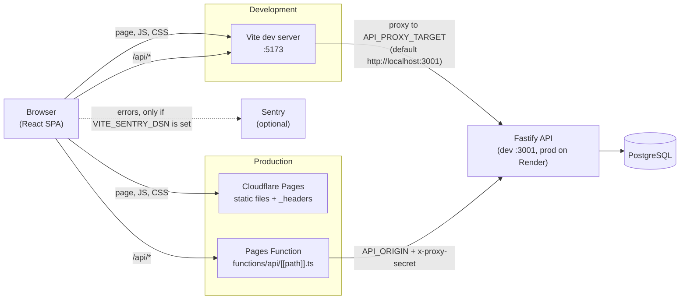
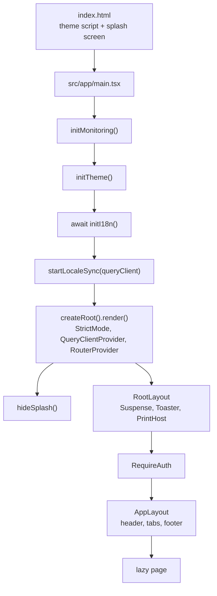

# Web app (`apps/web`)

This is the guide to the browser side of Vitae. Read it top to bottom once, then use it as a map. It covers the app shell, routing, features, data fetching, state, texts, styling, shared components, accessibility, build and deploy.

Two parts have their own documents:

- The CV / letter editor internals: [editor.md](editor.md)
- The document renderer (templates, pagination, thumbnails): [renderer.md](renderer.md)

Other useful documents: [../ARCHITECTURE.md](../ARCHITECTURE.md) (folder rules, design tokens), [../DEPLOY.md](../DEPLOY.md) (hosting), [../domain-model.md](../domain-model.md) (what a CV, job or share link is), [../api/README.md](../api/README.md) and [../api/endpoints.md](../api/endpoints.md) (the server), [../testing.md](../testing.md) (tests), [../guides/README.md](../guides/README.md) (how-to guides).

## Contents

1. [Start here](#1-start-here)
2. [Routes](#2-routes)
3. [Features](#3-features)
4. [Data fetching](#4-data-fetching)
5. [Client state](#5-client-state)
6. [Internationalisation (i18n)](#6-internationalisation-i18n)
7. [Styling and the design system](#7-styling-and-the-design-system)
8. [Shared UI kit](#8-shared-ui-kit)
9. [Accessibility](#9-accessibility)
10. [Build and deploy](#10-build-and-deploy)
11. [Gotchas](#11-gotchas)
12. [Open questions](#12-open-questions)

---

## 1. Start here

### The runtime picture

The browser only ever talks to one origin. Requests to `/api/...` are forwarded to the API: by Vite while developing, by a Cloudflare Pages Function in production.

Why a proxy in both cases: the session cookie then belongs to the web site itself (first-party), and the browser never needs cross-origin requests. See [section 4](#4-data-fetching) and [section 10](#10-build-and-deploy).

### How the app boots

Step by step, in the order the code runs:

1. **`apps/web/index.html`** has three things that run before React:
   - a tiny inline script that reads the saved theme from `localStorage` (`cv-theme`) and puts the `dark` class on `<html>`, so there is no light/dark flash;
   - an inline CSS splash screen (`#splash`) that paints before the app stylesheet loads;
   - the `<script type="module" src="/src/app/main.tsx">` entry.
2. **`apps/web/src/app/main.tsx`** runs, in this order:
   - `initMonitoring()` (`apps/web/src/shared/lib/monitoring.ts`): starts Sentry only when `VITE_SENTRY_DSN` is set. Sentry is imported dynamically, so it costs nothing when unset.
   - `initTheme()` (`apps/web/src/shared/stores/theme.ts`): applies the theme and follows the OS setting.
   - `await initI18n()` (`apps/web/src/i18n/index.ts`): loads the chosen language before the first render, so users never see an English flash. Top-level `await` is used here on purpose.
   - `startLocaleSync(queryClient)` (`apps/web/src/features/auth/localeSync.ts`): keeps the interface language and the account language together (see [section 6](#6-internationalisation-i18n)).
   - Renders `StrictMode > QueryClientProvider > RouterProvider`. `RouterProvider` comes from `react-router/dom` (not `react-router`) so navigations can flush synchronously, which view transitions need.
   - `hideSplash()` (`apps/web/src/shared/lib/splash.ts`): fades the splash out after at least 700 ms.
3. **The router** is in `apps/web/src/app/router.tsx` (`createBrowserRouter`). Everything is a child of `RootLayout`, which has `errorElement: <ErrorPage />`.
4. **`RootLayout`** (`apps/web/src/app/layouts/RootLayout.tsx`) wraps every page. It holds the page `Suspense`, the global `Toaster`, and the print host (`PrintHost`, mounted only while a print job exists, in its own `Suspense` so loading it can never blank the page). 300 ms after mounting it calls `preloadPages()` so the other lazy pages download in the background.
5. **`RequireAuth`** (`apps/web/src/features/auth/components/RequireAuth.tsx`) is a layout route that guards everything needing an account. It reads `useCurrentUser()`:

   | State of `GET /auth/me` | What happens                            |
   | ----------------------- | --------------------------------------- |
   | pending                 | `PageLoading`                           |
   | error (network, 5xx)    | `LoadError` with a retry button         |
   | no user, at exactly `/` | redirect to `/welcome`                  |
   | no user, any other path | redirect to `/login?next=<path+query>`  |
   | user                    | renders the child routes (`<Outlet />`) |

6. **`AppLayout`** (`apps/web/src/app/layouts/AppLayout.tsx`) is the frame for the three main tabs: sticky glass header (logo, tabs, language select, account drawer button), `VerifyReminder`, `<main id="main-content">`, a legal footer with the API status, and on phones a bottom tab bar. The editor, preview and public pages do **not** use it.
7. **Lazy pages** are declared in `apps/web/src/app/lazyPages.ts` with `lazyPage()` (`apps/web/src/shared/lib/lazyPage.ts`). The sign-in and register pages are imported directly (small main bundle for visitors); everything else is a separate chunk. `lazyPage` also registers the page for `preloadPages()`, and once a page is preloaded it renders without a loading flash.
8. **Errors.** There is no React `ErrorBoundary` component. The router's `errorElement` (`apps/web/src/app/pages/ErrorPage.tsx`) catches render errors and failed lazy imports. It logs the error, calls `reportError()` (Sentry, if enabled) and shows a friendly page with "Reload" and "Home". If the error message looks like a failed dynamic import (a new version was deployed and the old chunk is gone), it says "a new version is available" instead. Unknown URLs go to `NotFoundPage` (`path: '*'`). Both use `StatusPage`.

### Folder structure under `apps/web/src`

| Folder             | What lives there                                                                                                                                                                                            |
| ------------------ | ----------------------------------------------------------------------------------------------------------------------------------------------------------------------------------------------------------- |
| `app/`             | Wiring only: `main.tsx`, `router.tsx`, `lazyPages.ts`, `index.css` (Tailwind entry and print CSS), `layouts/` (`RootLayout`, `AppLayout`, `TabPill`), `pages/` (`ErrorPage`, `NotFoundPage`, `StatusPage`). |
| `features/<name>/` | One folder per product feature (pages, components, `api.ts`, `queries.ts`, state, tests). See [section 3](#3-features).                                                                                     |
| `shared/api/`      | Axios client, `ApiRequestError`, `errorMessage()`, the `QueryClient`, `useHealth`, `authKeys`.                                                                                                              |
| `shared/ui/`       | Generic components with no feature knowledge. See [section 8](#8-shared-ui-kit).                                                                                                                            |
| `shared/lib/`      | Helpers: `format` (dates), `paths` (route constants), `lazyPage`, `monitoring`, `splash`, `motion`, `viewTransitions`, `useBreakpoint`, `useMediaQuery`.                                                    |
| `shared/stores/`   | Global Zustand stores: `theme`, `toasts`, `docTransition`.                                                                                                                                                  |
| `shared/styles/`   | `tokens.css` (design tokens), `components.css` (component classes), `transitions.css` (view transitions).                                                                                                   |
| `renderer/`        | Draws CVs and letters (templates, sections, in-place editing controls, thumbnails). See [renderer.md](renderer.md).                                                                                         |
| `i18n/`            | Interface languages: setup, typed keys, `locales/{en,bg,de}`. See `apps/web/src/i18n/README.md`.                                                                                                            |
| `test/`            | Test setup (`setup.ts`), fake APIs (`fakeCvApi.ts`, `fakeAuthApi.ts`, `fakeAiApi.ts`), `appHarness.ts`, `renderRoute.tsx`, `appHelpers.ts`. See [../testing.md](../testing.md).                             |

Outside `src`: `functions/` (Cloudflare Pages Function), `build/` (security headers Vite plugin), `public/` (only `favicon.svg`), `vite.config.ts`, `.env.example`.

### Import rules

The rules come from [../ARCHITECTURE.md](../ARCHITECTURE.md). What is enforced by tooling and what is only a convention:

| Rule                                                                                                                                        | Enforced?                                                                                                         |
| ------------------------------------------------------------------------------------------------------------------------------------------- | ----------------------------------------------------------------------------------------------------------------- |
| Use `@/...` for anything outside the current folder, `./...` inside it. Never `../../x`.                                                    | Yes. ESLint `no-restricted-imports` bans the pattern `../../*` in all of `apps/web/src` (see `eslint.config.js`). |
| `shared/` and `renderer/` must not import from `@/features/*` or `@/app/*`.                                                                 | Yes. A second ESLint block for those two folders.                                                                 |
| `app/` may import anything.                                                                                                                 | Convention (nothing forbids more, nothing needs enforcing).                                                       |
| Between features, import only the data layer: `api.ts`, `queries.ts`, `state/`. A component used by several features moves to `shared/ui/`. | **Convention only, and not fully followed.** See below.                                                           |
| Every visible text goes through `t()`.                                                                                                      | Convention, plus the typed keys.                                                                                  |

I agree with the documented rules. One thing to know: the "data layer only" rule between features is not checked by ESLint, and the code already has exceptions. For example the cover-letter editor reuses `@/features/cv-editor/layout/*` (`EditorLayout`, `EditableTitle`, `SaveIndicator`, `ConflictBanner`, `useUndoShortcuts`) and `@/features/cv-editor/panels/templateThumbnail`; the CV editor imports AI panels (`@/features/ai/panels/*`) and `ShareDialog`; the dashboard imports `@/features/jobs/jobHelpers`; `PreviewPage` imports `NotFoundPage` from `@/app/pages`. Treat the rule as "prefer the data layer, and move truly shared UI to `shared/ui/`" rather than a hard wall. Also keep in mind that route-level tests mock the `api.ts` modules, so a feature's `api.ts` must stay the single place that calls `api.*`.

Tests live next to the code (`*.test.ts(x)`). Route-level tests import `@/test/appHarness` first so its `vi.mock` calls run before the app modules load.

---

## 2. Routes

Source: `apps/web/src/app/router.tsx`. All routes sit under `RootLayout` (error boundary `ErrorPage`). "Auth" means the route is inside `RequireAuth`. "Layout" is the frame around the page.

| Path                                                                 | Page component (file)                                                                                                                                    | Layout                   | Auth |
| -------------------------------------------------------------------- | -------------------------------------------------------------------------------------------------------------------------------------------------------- | ------------------------ | ---- |
| `/`                                                                  | `DashboardPage` (`features/dashboard/DashboardPage.tsx`)                                                                                                 | `AppLayout`              | yes  |
| `/documents`                                                         | redirect to `/documents/all`                                                                                                                             | -                        | yes  |
| `/documents/:subtab`                                                 | `DocumentsPage` (`features/documents/DocumentsPage.tsx`). `subtab` is `all`, `cover-letters`, `cvs` or `resignations`; anything else redirects to `all`. | `AppLayout`              | yes  |
| `/jobs`                                                              | `JobsPage` (`features/jobs/JobsPage.tsx`)                                                                                                                | `AppLayout`              | yes  |
| `/cvs/new`                                                           | `NewCvPage` (`features/new-cv/NewCvPage.tsx`)                                                                                                            | `AppLayout`              | yes  |
| `/cover-letters/new`                                                 | `NewLetterPage` (`features/cover-letters/pages/NewLetterPage.tsx`)                                                                                       | `AppLayout`              | yes  |
| `/resignations/new`                                                  | `NewResignationPage` (`features/resignation/pages/NewResignationPage.tsx`)                                                                               | `AppLayout`              | yes  |
| `/account`                                                           | redirect to `/?menu=account` (opens the account drawer)                                                                                                  | -                        | yes  |
| `/cvs/new/edit`, `/cover-letters/new/edit`, `/resignations/new/edit` | redirects to the matching `.../new` (old addresses)                                                                                                      | -                        | yes  |
| `/cvs/:id/edit`                                                      | `EditorPage type="cv"` -> `CvEditorPage` (`features/cv-editor/pages/`)                                                                                   | none (own editor layout) | yes  |
| `/cvs/:id/preview`                                                   | `PreviewPage type="cv"`                                                                                                                                  | none                     | yes  |
| `/cover-letters/:id/edit`                                            | `EditorPage type="coverLetter"` -> `LetterEditorPage`                                                                                                    | none                     | yes  |
| `/cover-letters/:id/preview`                                         | `PreviewPage type="coverLetter"`                                                                                                                         | none                     | yes  |
| `/resignations/:id/edit`                                             | `EditorPage type="resignation"` -> `ResignationEditorPage`                                                                                               | none                     | yes  |
| `/resignations/:id/preview`                                          | `PreviewPage type="resignation"`                                                                                                                         | none                     | yes  |
| `/welcome`                                                           | `WelcomePage` (`features/welcome/WelcomePage.tsx`). Signed-in users are redirected to the dashboard.                                                     | none                     | no   |
| `/login`                                                             | `LoginPage` (`features/auth/pages/`). Honors `?next=`.                                                                                                   | none (`AuthShell`)       | no   |
| `/register`                                                          | `RegisterPage`                                                                                                                                           | none (`AuthShell`)       | no   |
| `/forgot-password`                                                   | `ForgotPasswordPage`                                                                                                                                     | none (`AuthShell`)       | no   |
| `/reset-password`                                                    | `ResetPasswordPage` (token in the query string)                                                                                                          | none (`AuthShell`)       | no   |
| `/verify-email`                                                      | `VerifyEmailPage` (token in the query string)                                                                                                            | none (`AuthShell`)       | no   |
| `/privacy`                                                           | `PrivacyPage` (`features/legal/`)                                                                                                                        | `LegalLayout`            | no   |
| `/terms`                                                             | `TermsPage`                                                                                                                                              | `LegalLayout`            | no   |
| `/s/:slug`                                                           | `SharedDocumentPage` (`features/share/`). Read-only view of a shared CV or letter.                                                                       | none                     | no   |
| `*`                                                                  | `NotFoundPage` (`app/pages/NotFoundPage.tsx`)                                                                                                            | none                     | no   |

Notes:

- `?next=` is passed through `safeNext()` (`apps/web/src/features/auth/components/authStyles.ts`): only paths starting with a single `/` are accepted, so a login link cannot send people to another site.
- The `AppLayout` tabs are Dashboard (`/`), Documents (`/documents`) and Saved jobs (`/jobs`). `/cvs/new` and `/cover-letters/new` highlight the Documents tab (the `also` list in `AppLayout`). `/resignations/new` is not in that list, so on that page no tab is highlighted. The e2e accessibility test visits it anyway.
- Route paths used from code are constants in `apps/web/src/shared/lib/paths.ts` (`NEW_CV_PATH`, `NEW_LETTER_PATH`, `NEW_RESIGNATION_PATH`, `editPath(doc)`, `DOCUMENT_SUBTABS`). Use them instead of string literals.
- `EditorPage` and `PreviewPage` are the only places that switch on the document type; the rest of the routing is by URL.

---

## 3. Features

Every feature that talks to the server follows the same pattern:

- **`api.ts`**: a plain object (`jobsApi`, `cvApi`, `authApi`, ...) of async functions that call the shared axios `api` and **validate the response with a Zod schema from `@cv/shared`** (`JobSchema.parse(data)`). No React in this file. Tests replace the whole module with a fake.
- **`queries.ts`**: TanStack Query hooks (`useJobs`, `useCreateJob`, ...) plus an exported **query-key factory** (`jobKeys`, `cvKeys`, `letterKeys`, `resignationKeys`, `aiKeys`; auth keys live in `shared/api/authKeys.ts` to avoid import cycles). Mutations update the cache directly with `setQueryData` instead of refetching where they can.
- **State** that is not server data lives in `state/` (Zustand stores). See [section 5](#5-client-state).

### Overview

| Feature (folder)  | What it does                                                                                                                                                                             | Main files                                                                                                                                    | Server data (`api.ts` / `queries.ts`)                                                                                                                                                                        | Where state lives                                                                                                        |
| ----------------- | ---------------------------------------------------------------------------------------------------------------------------------------------------------------------------------------- | --------------------------------------------------------------------------------------------------------------------------------------------- | ------------------------------------------------------------------------------------------------------------------------------------------------------------------------------------------------------------ | ------------------------------------------------------------------------------------------------------------------------ |
| **auth**          | Sign in, sign up, password reset, email verification, account drawer (profile, password, theme, delete account), "confirm your email" reminder, route guard, language sync.              | `pages/*Page.tsx`, `components/AuthShell`, `RequireAuth`, `UserMenu`, `AccountSettings`, `VerifyReminder`, `localeSync.ts`, `sessionState.ts` | `authApi` (`/auth/...`); hooks `useCurrentUser`, `useLogin`, `useRegister`, `useLogout`, `useUpdateProfile`. Key `['auth','me']`.                                                                            | The current user is **TanStack Query data** (`authKeys.me`), not a store. Form fields are local `useState`.              |
| **dashboard**     | Home tab: recent documents with thumbnails, quick actions, job funnel and stat tiles, reminders for stale jobs.                                                                          | `DashboardPage`, `JobInsights`, `pipelineStats.ts`, `reminders.ts`                                                                            | None of its own. Reads `useCvList`, `useCoverLetterList`, `useResignationList`, `useJobs`, and one `useCv`/`useCoverLetter`/`useResignation` per thumbnail.                                                  | Derived from queries. Pure helpers (`remindersFor`, `pipelineStats`) are unit-tested.                                    |
| **documents**     | Documents tab: one list of all CVs, cover letters and resignation letters with search, sort, multi-select, rename, copy, download, share, delete.                                        | `DocumentsPage`, `documentActions.ts` (`useDocumentActions`)                                                                                  | Re-uses the three document features' queries.                                                                                                                                                                | Sub-tab is the URL (`:subtab`). Search, sort, selection, rename and dialogs are local `useState`.                        |
| **jobs**          | Saved Jobs tab: table (desktop) and cards (phone), details drawer, inline edits, "create tailored copy" of a CV.                                                                         | `JobsPage`, `components/JobsTable`, `JobCards`, `JobDrawer`, `fields.tsx`, `jobHelpers.ts`, `jobContext.ts`                                   | `jobsApi` (`/jobs`); `useJobs`, `useCreateJob`, `useUpdateJob` (optimistic), `useDeleteJob`, `useTailorCv`. Key `['jobs']`.                                                                                  | Open drawer and filter are in the URL (`?add=1`, `?job=<id>`, `?status=`).                                               |
| **new-cv**        | The three-step "Create new CV" wizard: profession, template, start (example or blank), then creates the CV and opens the editor.                                                         | `NewCvPage`, `ProfessionStep`, `TemplateStep`, `StartStep`, `buildNewCv.ts`, `wizardParams.ts`                                                | Uses `useCreateCv` from cv-editor.                                                                                                                                                                           | Choices are in the URL (`?profession=&template=`), so Back goes a step back.                                             |
| **cover-letters** | Create (`NewLetterPage`) and edit (`LetterEditorPage`) cover letters.                                                                                                                    | `pages/`, `state/letterEditorStore.ts`, `state/letterSession.ts`                                                                              | `coverLetterApi` (`/cover-letters`); `useCoverLetterList`, `useCoverLetter`, `useCreateLetter`, `useRenameLetter`, `useLinkLetter`, `useDuplicateLetter`, `useDeleteLetters`. Keys `['cover-letters', ...]`. | Open document in `useLetterEditor` (Zustand).                                                                            |
| **resignation**   | Create and edit resignation letters.                                                                                                                                                     | `pages/`, `state/resignationEditorStore.ts`, `state/resignationSession.ts`                                                                    | `resignationApi` (`/resignations`); same hook set as letters. Keys `['resignations', ...]`.                                                                                                                  | Open document in `useResignationEditor`.                                                                                 |
| **cv-editor**     | The CV editor page (top bar, rail, side panels for design, templates, rearrange, history), the read-only preview page, CV queries. Also provides layout pieces the letter editors reuse. | `pages/EditorPage`, `CvEditorPage`, `PreviewPage`, `layout/*`, `panels/*`, `state/*`                                                          | `cvApi` (`/cvs`, versions, share, uploads, `/shared/:slug`); `useCv`, `useCvList`, `useCreateCv`, `useRenameCv`, `useDuplicateCv`, `useDeleteCvs`, `useCvVersions`, ... Keys `['cvs', ...]`.                 | `useCvEditor`, `useEditorUi`, `useSaveState`, autosave controller. Details in [editor.md](editor.md).                    |
| **ai**            | The AI panels (Fix mistakes, Check and tailor, Assistant) that work on whichever document is open.                                                                                       | `panels/FixMistakesPanel`, `TailorPanel`, `AssistantPanel`, `AiGate`, `aiTarget.ts`, `useAiTargets.ts`                                        | `aiApi` (`/ai/status`, `/ai/fix-mistakes`, `/ai/tailor`, `/ai/assist`, 90 s timeout); `useAiStatus`, `useFixMistakes`, `useTailor`, `useAssist`. Key `['ai','status']`.                                      | Each editor page provides an `AiTarget` (a context object) so the panels do not know the document type.                  |
| **share**         | The share dialog (turn a link on/off, hide personal details, reset the link) and the public page `/s/:slug`.                                                                             | `ShareDialog`, `SharedDocumentPage`, `shareUrl.ts`                                                                                            | `queries.ts` picks the right `*Api` per document type: `useDocumentShare`, `useUpdateDocumentShare`, `useSharedDocument`. Keys `['<type>', id, 'share']`, `['shared', slug]`.                                | Dialog open state is local to the editor/list page.                                                                      |
| **print**         | "Download PDF" through the browser print dialog.                                                                                                                                         | `printCv.ts` (`printDocument`, `usePrintJob`), `PrintHost.tsx`                                                                                | None.                                                                                                                                                                                                        | `usePrintJob` (Zustand): the document to print.                                                                          |
| **legal**         | Privacy policy, terms, footer.                                                                                                                                                           | `LegalLayout`, `PrivacyPage`, `TermsPage`, `operator.ts`                                                                                      | None.                                                                                                                                                                                                        | None. Operator name and contact come from `VITE_OPERATOR_NAME` / `VITE_CONTACT_EMAIL` (fallback text `[operator name]`). |
| **welcome**       | Public landing page with an example CV drawn by the real renderer.                                                                                                                       | `WelcomePage`                                                                                                                                 | None (reads `useCurrentUser`).                                                                                                                                                                               | None.                                                                                                                    |

### Feature notes worth knowing

- **Document lists are three separate queries.** There is no combined "documents" endpoint on the web side. `cvKeys.list` (`['cvs']`), `letterKeys.list` (`['cover-letters']`) and `resignationKeys.list` (`['resignations']`) each hold `DocumentSummary[]`. `DocumentsPage` and the dashboard merge and sort them in the browser. See [../domain-model.md](../domain-model.md) for the three document types.
- **The list and the detail cache are kept in step** by `rememberCv` / `rememberLetter` / `rememberResignation`. After any create, rename, duplicate or save they write the full record under the detail key and re-insert a summary into the list, sorted by `updatedAt`. If you add a mutation that changes a document, call the matching `remember...` function.
- **Editor detail queries use `staleTime: Infinity`.** While an editor is open the Zustand store owns the document; TanStack Query must not refetch under it.
- **Deleting is done one by one** with `Promise.allSettled` (`useDeleteCvs` etc.), so a partial failure can say how many failed. `useDocumentActions().remove` fans out by document type.
- **Jobs link to documents.** Creating a letter for a job, deleting letters, and "create tailored copy" all touch `jobKeys.list` (invalidate or `setQueryData`), because the server links or unlinks `cvId` / `coverLetterId` on the job. See [../domain-model.md](../domain-model.md).
- **`useUpdateJob` is optimistic**: it patches the cached list at once and rolls back in `onError`. Copy this pattern for other inline edits.
- **`ai` and `share` are not routes.** They are panels and dialogs shown inside editor pages.
- **The new-letter and new-resignation pages** create the record on the server first and then navigate to its editor with `replace`, so Back does not return to the form. The CV wizard does the same in `StartStep`.

---

## 4. Data fetching

### The API client

`apps/web/src/shared/api/client.ts` exports one axios instance, `api`:

- `baseURL` is `import.meta.env.VITE_API_URL ?? '/api'`. `.env.example` sets it to `/api`, and you should leave it there (see gotchas).
- `withCredentials: true` (the session is an HttpOnly cookie set by the API), timeout 15 s. The AI calls override the timeout to 90 s.
- A response interceptor turns **every failure into an `ApiRequestError`**:
  - `status` (number or `null`), `code` (stable string), `message`, optional `details`;
  - `code` is the API's own error code when the body matches `ApiErrorSchema` (`{ error: { code, message, details } }`, from `@cv/shared`), else `network_error` (no response), `http_error` (unexpected body) or `unknown_error`;
  - `retryable` is true when `status` is `null` or `>= 500`.
- **401 handling:** if a request other than `/auth/...` gets a 401, the interceptor sets the `['auth','me']` query data to `null`. `RequireAuth` then re-renders and redirects to `/login?next=...`. So an expired session sends the user to sign-in without any per-page code. Failed logins (`/auth/login`) are excluded, so the login form can show "wrong password".
- `assetUrl(url)` rewrites image URLs saved as `/api/uploads/...` to the API origin when `VITE_API_URL` is an absolute `http(s)` URL. With the default `/api` it returns the URL unchanged.
- `toApiRequestError(error)` converts anything (also errors from React Query) to an `ApiRequestError`.

### Showing errors: `errorMessage`

`errorMessage(error)` (`apps/web/src/shared/api/errorMessage.ts`) returns text for the user in the current interface language. It looks up `errors.<code>` in the i18n messages (`apps/web/src/i18n/locales/en/errors.ts`); if there is no translation, it falls back to the server's message. Always use it in UI instead of `error.message`. When the API adds a new error code, add `errors.<code>` in all three locales.

`LoadError` (`apps/web/src/shared/ui/LoadStates.tsx`) is the standard "could not load, Try again" block; it takes an `ApiRequestError` and a retry callback.

### Dev proxy and production proxy

|                     | Development / e2e preview                                                      | Production                                                                                                  |
| ------------------- | ------------------------------------------------------------------------------ | ----------------------------------------------------------------------------------------------------------- |
| Who forwards `/api` | Vite `server.proxy` in `apps/web/vite.config.ts` (also used by `vite preview`) | Cloudflare Pages Function `apps/web/functions/api/[[path]].ts`                                              |
| Target              | `API_PROXY_TARGET` env var, default `http://localhost:3001`                    | `API_ORIGIN` (Pages variable, for example the Render URL)                                                   |
| Extra headers       | none                                                                           | `x-proxy-secret` (= `PROXY_SECRET`, must equal the API's value) and `x-client-ip` (from `cf-connecting-ip`) |

What the Pages Function does (`proxy()` in `apps/web/functions/api/[[path]].ts`, tested by `apps/web/functions/proxy.test.ts`):

- If `API_ORIGIN` or `PROXY_SECRET` is missing it answers 503 `proxy_not_configured`.
- It forwards method, path, query, cookies and body; removes hop headers (`host`, `connection`, ...); always **overwrites** `x-proxy-secret` and `x-client-ip` and drops `x-forwarded-for`, so a browser cannot forge them; uses `redirect: 'manual'`.
- If the API cannot be reached (for example a sleeping free-tier instance) it answers 502 `api_unreachable` with a friendly message. `errors.api_unreachable` is translated.
- `Set-Cookie` from the API passes back to the browser unchanged, so the cookie stays first-party.

The API side of the secret check is described in [../api/README.md](../api/README.md). Deployment steps are in [../DEPLOY.md](../DEPLOY.md).

### TanStack Query conventions

Global defaults (`apps/web/src/shared/api/queryClient.ts`): `staleTime` 30 s, `retry: 1`, `refetchOnWindowFocus: false`. Mutations have no defaults.

Conventions used across features:

- One **key factory per feature**, exported from `queries.ts`. Keys are arrays that start with the resource name, so a prefix invalidates everything of that resource.
- Detail queries read through a hook with `enabled: Boolean(id)`.
- Where a query should not retry forever, the code uses `retry: (count, error) => count < 2 && error.retryable === true`: retry only network failures and 5xx, never 4xx. This is repeated in `useCurrentUser`, `useCv`, `useCoverLetter`, `useResignation`, `useSharedDocument`.
- Prefer `setQueryData` (with a helper such as `rememberCv`) after mutations. Use `invalidateQueries({ queryKey, exact: true })` for lists, `removeQueries` for deleted details.
- After a sign-in, sign-out or account deletion the whole cache is wiped (`resetClientState`, see [section 5](#5-client-state)).

Cache keys:

| Key                                                                            | Data                                   | Stale time | Defined in                                                   |
| ------------------------------------------------------------------------------ | -------------------------------------- | ---------- | ------------------------------------------------------------ |
| `['auth','me']`                                                                | `User \| null`                         | 5 min      | `shared/api/authKeys.ts`, used by `features/auth/queries.ts` |
| `['health']`                                                                   | API/database status (footer indicator) | default    | `shared/api/useHealth.ts`                                    |
| `['jobs']`                                                                     | `Job[]`                                | default    | `jobKeys.list`                                               |
| `['cvs']`                                                                      | `DocumentSummary[]` (CVs)              | default    | `cvKeys.list`                                                |
| `['cvs', id]`                                                                  | `CvRecord`                             | infinite   | `cvKeys.detail`                                              |
| `['cvs', id, 'versions']`                                                      | version summaries                      | default    | `cvKeys.versions`                                            |
| `['cvs', id, 'versions', versionId]`                                           | one version with its document          | infinite   | `cvKeys.version`                                             |
| `['cvs', id, 'share']`                                                         | `ShareState`                           | default    | `cvKeys.share`                                               |
| `['shared', slug]`                                                             | public shared document                 | default    | `cvKeys.shared`                                              |
| `['cover-letters']`, `['cover-letters', id]`, `['cover-letters', id, 'share']` | list, record (infinite), share         | as above   | `letterKeys`                                                 |
| `['resignations']`, `['resignations', id]`, `['resignations', id, 'share']`    | list, record (infinite), share         | as above   | `resignationKeys`                                            |
| `['ai','status']`                                                              | AI availability and daily usage        | 1 min      | `aiKeys.status`                                              |

Careful: because `['cvs']` is a prefix of `['cvs', id, ...]`, a non-exact `invalidateQueries({ queryKey: cvKeys.list })` refetches every CV detail and version too. The existing code passes `exact: true` for that reason.

Responses are validated at runtime with the shared Zod schemas, so a server/web mismatch fails loudly in `api.ts` instead of deep inside a component. Request and response shapes: [../api/endpoints.md](../api/endpoints.md).

---

## 5. Client state

Server data lives in TanStack Query. Zustand holds only what the server does not know.

| Store (hook)           | File                                                   | Owns                                                                                                  | Persisted?                                                  |
| ---------------------- | ------------------------------------------------------ | ----------------------------------------------------------------------------------------------------- | ----------------------------------------------------------- |
| `useThemeStore`        | `shared/stores/theme.ts`                               | Theme mode `system` / `light` / `dark`.                                                               | Yes, `localStorage` key `cv-theme` (via zustand `persist`). |
| `useToasts`            | `shared/stores/toasts.ts`                              | Toasts on screen. Use `showToast`, `dismissToast`, `removeToast`.                                     | No                                                          |
| `useDocTransition`     | `shared/stores/docTransition.ts`                       | Id of the document just opened, so its thumbnail can be the target of the "close" animation.          | No                                                          |
| `usePrintJob`          | `features/print/printCv.ts`                            | The document being printed (`job` or `null`).                                                         | No                                                          |
| `useCvEditor`          | `features/cv-editor/state/cvEditorStore.ts`            | Open CV, undo/redo history (`past`, `future`).                                                        | No                                                          |
| `useLetterEditor`      | `features/cover-letters/state/letterEditorStore.ts`    | Open cover letter and history.                                                                        | No                                                          |
| `useResignationEditor` | `features/resignation/state/resignationEditorStore.ts` | Open resignation letter and history.                                                                  | No                                                          |
| `useEditorUi`          | `features/cv-editor/state/editorUi.ts`                 | Active side panel, zoom, preview version, editor `notify()`.                                          | No                                                          |
| `useSaveState`         | `features/cv-editor/state/editorSession.ts`            | Save status shown in the top bar. **Shared by all three editors** (letters import it from cv-editor). | No                                                          |

The editor stores, autosave and sessions are explained in [editor.md](editor.md).

Other client-side storage:

| Where            | Key                                                                                         | What                                                                      |
| ---------------- | ------------------------------------------------------------------------------------------- | ------------------------------------------------------------------------- |
| `localStorage`   | `cv-theme`                                                                                  | Theme mode (also read by the inline script in `index.html`).              |
| `localStorage`   | `cv-ui-language`                                                                            | Interface language chosen in this browser (`apps/web/src/i18n/index.ts`). |
| `sessionStorage` | `cv-verify-dismissed`                                                                       | "Confirm your email" reminder closed for this visit.                      |
| URL              | `?next=`, `?menu=`, `?add=`, `?job=`, `?status=`, `?profession=&template=`, `?cvId=&jobId=` | Navigation state worth keeping in the address (see the feature table).    |

All storage access is wrapped in `try/catch` (private mode), and the app works without it.

### Session state (who is signed in)

- The session itself is an HttpOnly cookie managed by the API; JavaScript never sees it.
- The browser's idea of "who am I" is the query `['auth','me']` (`useCurrentUser`). `null` means signed out.
- `resetClientState(queryClient, user)` in `apps/web/src/features/auth/sessionState.ts` runs on login, register, logout (always, in `onSettled`), password reset (`ResetPasswordPage`) and account deletion (`AccountSettings`). It clears the whole query cache, resets all three editor stores, `useSaveState`, `useEditorUi` and `usePrintJob`, then stores the new user under `['auth','me']`. This is what stops user B from seeing or saving over user A's open document. **If you add a new store with per-user data, reset it here.**
- `useLogout` first awaits `flushSave()`, `flushLetterSave()` and `flushResignationSave()`, so pending autosaves reach the server while the session still exists.
- The 401 interceptor (section 4) is the other way the user becomes `null`.

---

## 6. Internationalisation (i18n)

Full how-to for developers: `apps/web/src/i18n/README.md`. Summary:

- **Three interface languages:** English (`en`, the source), Bulgarian (`bg`), German (`de`). The list is `LOCALES` in `@cv/shared` (`packages/shared/src/auth/auth.ts`), re-exported as `UI_LANGUAGES` in `apps/web/src/i18n/languages.ts`.
- **The interface language is separate from a CV's own language.** CV text, section titles and placeholders follow the document's language (see [renderer.md](renderer.md)), not the UI language.
- **Organisation:** `apps/web/src/i18n/locales/<lang>/<area>.ts`, one file per area (`common`, `labels`, `errors`, `nav`, `auth`, `account`, `legal`, `dashboard`, `documents`, `jobs`, `editor`, `design`, `share`, `renderer`, `newCv`, `letters`, `resignation`, `ai`, `welcome`), combined in each language's `index.ts`. Keys are nested: `t('jobs.count', { count })`.
- **Typed keys:** `apps/web/src/i18n/index.ts` augments i18next's `CustomTypeOptions` with the English messages, so `t('typo.key')` is a compile error. `bg` and `de` files are declared as `Messages['<area>']` (`Messages = typeof en`), so a missing or extra key fails `pnpm typecheck`. A test (`i18n.test.tsx`) also checks that `{{placeholders}}` match across languages.
- **Loading:** English is bundled. `bg` and `de` are dynamic imports, downloaded the first time they are chosen (`setLanguage`). `initI18n()` loads the starting language before the first render.
- **Which language at start:** the saved choice (`localStorage` `cv-ui-language`), else the first match in `navigator.languages`, else English (`detectLanguage`).
- **Switching** (`setLanguage`) changes the language in place with no reload, sets `<html lang>`, and remembers the choice unless `{ remember: false }`. `LanguageSelect` calls it.
- **Product name:** write `{{app}}` in texts; it is the `APP_NAME` constant (`Vitae`) from `@cv/shared`, injected as an i18next default variable.
- **Outside components** (stores, helpers) use `i18n.t(...)` from `@/i18n`. `useUiLanguage()` and `useLocale()` (`apps/web/src/i18n/useUiLanguage.ts`) give the current language and the date/number locale (`en-GB`, `bg-BG`, `de-DE`).

### How the language syncs with the account

The account has a `locale` field (used for the language of emails). `startLocaleSync` (`apps/web/src/features/auth/localeSync.ts`) connects it to the UI:

1. **UI to account:** when the interface language changes and a user is signed in whose `locale` differs, it calls `authApi.setLocale()` (`PATCH /auth/me`) and updates `['auth','me']`. Failures are ignored on purpose (it will be saved next time).
2. **Account to UI:** whenever `['auth','me']` is updated with a user whose `locale` differs from the current language: if this browser has **no stored choice**, the UI switches to the account's language (without remembering it); if the browser **has** a stored choice, the account is updated to follow the browser instead.
3. Sign-up and "forgot password" requests send the current UI language along (`currentLocale()` in `features/auth/api.ts`) so the email is written in it.

### Adding a text, in short

1. Add the key to `locales/en/<area>.ts`, then the same key to `bg/<area>.ts` and `de/<area>.ts` (TypeScript tells you what is missing).
2. Use `const { t } = useTranslation()` and `t('area.key')`. Every visible string, `aria-label`, `title`, `placeholder` and `alt` goes through `t()`.
3. Dates: `formatDate()` (`shared/lib/format.ts`) follows the UI language; the component must call `useTranslation()` so it re-renders when the language changes.
4. API error codes: add `errors.<code>` to all three locales.

Bulgarian uses the formal "Вие", German the formal "Sie", both in sentence case; details in the i18n README.

---

## 7. Styling and the design system

Tailwind CSS 4 with the Vite plugin (`@tailwindcss/vite`). There is no `tailwind.config.js`: configuration is CSS. The entry is `apps/web/src/app/index.css`, which imports Tailwind, then `shared/styles/tokens.css`, `components.css` and `transitions.css`. Token reference tables are in [../ARCHITECTURE.md](../ARCHITECTURE.md) ("Styles: design tokens"); this section is the practical summary.

### Tokens: `apps/web/src/shared/styles/tokens.css`

- **Colours** are raw values `--theme-*` in `:root` (light) and `.dark`, then mapped in `@theme inline` to semantic `--color-*` tokens. Tailwind generates utilities from those: `bg-surface`, `text-fg`, `text-fg-muted`, `border-line`, `bg-brand`, `text-brand-fg`, `bg-danger`, `text-danger-fg`, `bg-paper` and so on. Colours are named by purpose, so **components need no `dark:` classes**.
- **Other tokens** in `@theme`: spacing (`--spacing-gutter`, `--spacing-section`, `--spacing-card`, `--spacing-touch`, `--spacing-bottom-nav`, `--spacing-drawer-inset`), radii (`rounded-control`, `rounded-card`, `rounded-pill`, `rounded-tight`), shadows, container widths (`max-w-page`, `w-panel`, `w-menu`...), breakpoints, animations and timings (`--duration-page`, `--duration-zoom`, `--duration-leave`, `--ease-spring`).
- **Rule:** use the token classes, not raw values such as `bg-teal-700`, `rounded-xl`, `z-50` or `max-w-[794px]`. Known exceptions: job-status and document-type badge colours (`shared/ui/badgeStyles.ts`, which use raw Tailwind colours with `dark:`), and the CV/letter templates (`renderer/`, which describe a printed page in `em` and pixels).
- `apps/web/src/shared/styles/tokens.test.ts` checks the tokens (for example that `BREAKPOINTS` in `useBreakpoint.ts` matches `--breakpoint-*`).

### z-index tokens

Defined in a `:root` block at the end of `tokens.css`. Use them as `z-(--z-dropdown)`.

| Token          | Value | For                                            |
| -------------- | ----- | ---------------------------------------------- |
| `--z-raised`   | 10    | sticky bars, floating buttons                  |
| `--z-dropdown` | 20    | menus, popovers                                |
| `--z-nav`      | 30    | the header and phone tab bar                   |
| `--z-overlay`  | 40    | drawers, sheets, dialogs and their backdrop    |
| `--z-toast`    | 50    | notifications, and the skip link while focused |

The splash screen in `index.html` uses `z-index: 100` in plain CSS, above everything.

### Component classes: `apps/web/src/shared/styles/components.css`

Defined with Tailwind's `@utility`, so they work with variants (`hover:`, `md:`).

| Class                                                                                                             | Use                                                                    |
| ----------------------------------------------------------------------------------------------------------------- | ---------------------------------------------------------------------- |
| `page-container`                                                                                                  | Centered page width with the page gutter.                              |
| `card`                                                                                                            | Standard card surface.                                                 |
| `grid-cards`, `grid-thumbs`, `grid-templates`                                                                     | Responsive grids with minimum column widths from tokens.               |
| `btn` + `btn-primary` / `btn-secondary` / `btn-danger` / `btn-ghost`                                              | Buttons. `btn` alone is the base; combine with one variant.            |
| `btn-icon`                                                                                                        | Square icon-only button; min 44 px on touch screens.                   |
| `btn-sm`, `input-sm`                                                                                              | Compact variants for tables and toolbars.                              |
| `input`                                                                                                           | Text fields and selects (frosted, brand halo on focus).                |
| `link`                                                                                                            | Text link style.                                                       |
| `pill`                                                                                                            | Small badge shape.                                                     |
| `glass-menu`, `menu-item`                                                                                         | Drop-down menu panel and its rows.                                     |
| `glass`, `glass-bar`, `glass-solid`, `glass-panel`, `glass-pill`, `pill-item`, `pill-item-active`, `app-backdrop` | The frosted-glass family (below).                                      |
| `toaster`, `skeleton`                                                                                             | Toast container and loading placeholder shape.                         |
| `tap-target`                                                                                                      | See below.                                                             |
| `clear-bottom-nav`, `pb-safe`, `pb-safe-card`                                                                     | Phone spacing: clear the bottom tab bar and the iPhone home indicator. |

Global base styles in the same file: slim frosted scrollbars (WebKit and Firefox) and checkbox sizing (18 px, 24 px on touch).

### The frosted-glass design language

The look is "liquid glass": panels are translucent, blur what is behind them, and have a bright rim and soft shadow.

- `app-backdrop` paints the page with soft colour glows (`--theme-glow-*`) so the glass has something to blur. `AppLayout` uses it.
- `glass` is a panel (cards, lists). `glass-bar` is a bar along a screen edge (sticky header, phone tab bar). `glass-solid`/`glass-panel` are more opaque glass for forms and drawers. `glass-pill` with `pill-item` / `pill-item-active` is a row of choices (the tabs, the editor tools).
- Buttons, fields and menus are glass too (`btn-secondary` frosted, `btn-primary` with a glow, `input` with a halo on focus).
- **Fallbacks:** browsers without `backdrop-filter` and users with `prefers-reduced-transparency` get a solid `bg-surface` instead (see `glass` in `components.css`). Motion is switched off for `prefers-reduced-motion` (`motion-reduce:` classes and `canAnimate()` / `canTransition()` in `shared/lib`).
- Light and dark have different moods: light is white/slate with a teal brand; dark is deep indigo (`--theme-page: #0d1250`, surface `#1b1a5b`). (`ARCHITECTURE.md` calls dark mode "dark slate"; the tokens are indigo.)
- Page transitions: tabs ease in from the side (`animate-page-from-left/right`); opening a document uses the View Transitions API (`shared/lib/viewTransitions.ts`, `shared/ui/TransitionLink.tsx`, `shared/styles/transitions.css`) to zoom a thumbnail into the editor and back. Browsers without the API just navigate.

### Tap targets: `tap-target`

`tap-target` gives a link or control a hit area of at least 24 px, growing to 44 px (`--spacing-touch`) on touch screens (`pointer-coarse:`). `btn-icon` does the same. Use them for small links and icon buttons so they meet WCAG target-size guidance.

### Themes: light, dark, system

- Mode (`system` | `light` | `dark`) lives in `useThemeStore` (persisted as `cv-theme`).
- Dark mode is **a `dark` class on `<html>`**, declared in `app/index.css` with `@custom-variant dark (&:where(.dark, .dark *))`. There is no `data-theme` attribute.
- It is applied twice: first by the inline script in `index.html` (before paint, so no flash), then by `initTheme()` in `main.tsx`, which subscribes to the store and to the OS `prefers-color-scheme` media query so "system" follows the OS live.
- Pickers: `ThemeSelect` (dropdown in headers) and the "Theme" view inside the account drawer (`UserMenu`).
- Print and CV pages use `bg-paper` (white in both themes).

---

## 8. Shared UI kit

All in `apps/web/src/shared/ui/`. None of these import from `features/`.

| Component / hook                                                                          | Use it when                                                                                                                                                                                                                                                                                                    |
| ----------------------------------------------------------------------------------------- | -------------------------------------------------------------------------------------------------------------------------------------------------------------------------------------------------------------------------------------------------------------------------------------------------------------- |
| `Modal`                                                                                   | You need a dialog or drawer. It wraps native `<dialog>` (`showModal`): focus trap and Escape come from the browser. Variants `center`, `drawer`, `side`. Pass `labelledBy` (id of the heading). Restores focus to the opener on close. A click on the dimmed area and Escape call `onCloseRequest ?? onClose`. |
| `useModalClose(onClose)`                                                                  | Together with `Modal` to get an exit animation: pass `closing` and `closed` to the Modal, call `requestClose()` from buttons.                                                                                                                                                                                  |
| `ConfirmDialog`                                                                           | "Are you sure?" before deleting. Built on `Modal`; has a `danger` style and a `busy` state.                                                                                                                                                                                                                    |
| `useMenu(open, setOpen)`                                                                  | A popup menu with the ARIA menu keyboard behaviour (arrows, Home/End, Escape returns focus, Tab leaves). Put `triggerRef`, `menuRef`, `onKeyDown` on the trigger, the `role="menu"` element and a wrapper. Items need `role="menuitem*"`. Used by `DocumentsPage` and the editor top bar.                      |
| `SkipLink` (+ `MAIN_CONTENT_ID`)                                                          | First focusable element of a page frame; jumps to `<main id="main-content">` and moves focus there. `AppLayout` and `LegalLayout` have it.                                                                                                                                                                     |
| `FitToWidth`, `ScaledBox`, `fitScale`                                                     | Show fixed-width content (a CV page) scaled down to the screen, or zoomed. The scaled box takes the scaled size in layout and never remounts when the scale changes.                                                                                                                                           |
| `Badges` (`JobStatusBadge`, `JobTypeBadge`, `DocumentTypeBadge`, `SharedBadge`)           | Coloured pills for statuses and types. Colours live in `badgeStyles.ts`.                                                                                                                                                                                                                                       |
| `ThemeSelect`                                                                             | Theme dropdown (System / Light / Dark) for headers. `themeModes.ts` lists modes and icons.                                                                                                                                                                                                                     |
| `LanguageSelect`                                                                          | Interface-language `<select>`; `compact` shows `EN`/`BG`/`DE`.                                                                                                                                                                                                                                                 |
| `Toaster` (+ `shared/stores/toasts`)                                                      | Mounted once in `RootLayout`. To notify, call `showToast({ tone, message })`. `info` and `success` disappear after 5 s; `warning` and `error` stay until closed. Same `id` replaces a toast. Errors use `role="alert"`, others `role="status"`.                                                                |
| `PageHeader`                                                                              | The `h1` + description + actions row of a tab page. Also exports `primaryButton`, `secondaryButton`, `card` class-name strings.                                                                                                                                                                                |
| `LoadStates` (`PageLoading`, `PageContentLoading`, `EditorLoading`, `LoadError`)          | Standard loading and error blocks for pages and editors.                                                                                                                                                                                                                                                       |
| `Skeleton` (`Skeleton`, `SkeletonText`, `ListSkeleton`, `PaperSkeleton`, `LoadingRegion`) | Shimmering placeholders. Wrap in `LoadingRegion` so screen readers hear one "Loading..." message.                                                                                                                                                                                                              |
| `TransitionLink`                                                                          | A link that runs the document open/close view transition (`transition="doc-open"` plus `docId`).                                                                                                                                                                                                               |
| `ApiStatus`                                                                               | The small "API and database are up" indicator in the footer, fed by `useHealth`.                                                                                                                                                                                                                               |
| `Logo`, `LogoMark`                                                                        | Brand logo (drawn with tokens; same drawing as `public/favicon.svg`).                                                                                                                                                                                                                                          |
| `illustrations`                                                                           | `LostPageIllustration`, `BrokenPageIllustration` for status pages.                                                                                                                                                                                                                                             |

Helpers in `shared/lib` worth knowing: `useBreakpoint('md')` (render different markup per width; prefer CSS classes for pure styling), `useMediaQuery`, `formatDate` / `localToday` / `daysBetween` (`format.ts`), `canAnimate` (`motion.ts`), `lazyPage`, `paths`.

---

## 9. Accessibility

Targets: WCAG 2.1 A and AA. Conventions in the code:

- **Automated checks in e2e.** `expectAccessible(page)` in `e2e/tests/fixtures.ts` runs axe (`@axe-core/playwright`, tags `wcag2a`, `wcag2aa`, `wcag21a`, `wcag21aa`) and fails on `serious` or `critical` violations. It waits for finite animations to end first, so colours are final. `e2e/tests/quality.spec.ts` runs it on public pages, the main tabs, the editor, the date picker, the zoom bar and the account drawer; `mobile.spec.ts` does the same on a phone. An auto fixture also fails any test that logs an unexpected browser console error. See [../testing.md](../testing.md).
- **Skip link** (`SkipLink`) on page frames; the target `<main id="main-content" tabIndex={-1}>` receives focus (a hash link alone only scrolls in an SPA).
- **Dialogs** use native `<dialog>` with `aria-labelledby`. Focus returns to the element that opened it when closing (`Modal`). Escape closes. Drawers and dialogs also close with the visible close button.
- **Keyboard menus**: `useMenu` implements the ARIA menu pattern (`role="menu"`, `role="menuitem"`; `ThemeSelect` uses `menuitemradio` with `aria-checked`). Escape returns focus to the trigger.
- **One navigation at a time.** `AppLayout` renders either the header tabs or the bottom tab bar (chosen with `useBreakpoint`), never both, so screen readers do not get duplicate landmarks. The bottom nav is a `<nav aria-label>`.
- **Icons are decorative** by default (`aria-hidden`); icon-only buttons get an `aria-label` / `title` from `t()`.
- **Live regions:** toasts (`role="status"` / `role="alert"`), skeletons (`LoadingRegion`: `role="status"` + `aria-busy`), inline save and error messages (`role="status"` / `role="alert"`), and the jobs result count (`aria-live="polite"`).
- **Reduced motion and transparency** are respected (see section 7).
- **Tap targets:** `tap-target` and `btn-icon` (44 px on touch).
- **Colour contrast:** tokens are chosen to pass AA in both themes; `features/cv-editor/lib/contrast.ts` helps the design panel avoid unreadable CV colours. Muted text on in-page editable controls is marked with an outline instead of a tint to keep contrast (comment in `app/index.css`).
- Stepper and tabs use ARIA state attributes (`aria-current="step"`, `aria-selected`).

When you add UI: label every control, keep a visible focus style, use `Modal` and `useMenu` rather than hand-rolled popups, and run the e2e accessibility spec for pages you add.

---

## 10. Build and deploy

### Vite config (`apps/web/vite.config.ts`)

- Plugins: `@vitejs/plugin-react`, `@tailwindcss/vite`, `securityHeaders()` (build only) and `previewHeaders()` (preview only), both from `apps/web/build/securityHeaders.ts`.
- Alias `@` to `src`. The same alias is in `apps/web/tsconfig.json` (`paths`); keep both in sync if you ever change it.
- Dev server port 5173; `server.proxy['/api']` goes to `API_PROXY_TARGET` or `http://localhost:3001`. The e2e run sets it to its own API.
- Vitest config is in the same file: jsdom, `src/test/setup.ts`, v8 coverage over `src/**` (tests and `src/test` excluded).
- Scripts (`apps/web/package.json`): `dev`, `build`, `preview`, `typecheck`, `test`, `test:coverage`. From the repo root, `pnpm dev` starts both apps.
- Code splitting is by route through `lazyPage`; there is no manual chunk config. Fonts come from `@fontsource*` packages imported in `renderer/templates/fonts.ts`.

### Security headers and CSP (`apps/web/build/securityHeaders.ts`)

On `vite build`, after the bundle is written, the plugin reads the final `dist/index.html`, hashes every inline `<script>` (SHA-256) and writes `dist/_headers` for Cloudflare Pages:

- `Content-Security-Policy` built by `contentSecurityPolicy(html)`: `default-src 'self'`; `script-src 'self'` plus the hashes of the inline scripts (that is how the inline theme script is allowed without `unsafe-inline`); `style-src 'self' 'unsafe-inline'` (Tailwind and the renderer set inline styles); `img-src 'self' data: blob:`; `font-src 'self' data:`; `connect-src 'self'` plus Sentry ingest hosts; `frame-src 'self'`; `object-src 'none'`; `base-uri`, `form-action` `'self'`; `frame-ancestors 'none'`.
- `X-Content-Type-Options: nosniff`, `Referrer-Policy: strict-origin-when-cross-origin`, a restrictive `Permissions-Policy`, and HSTS.
- `/assets/*`: `Cache-Control: public, max-age=31536000, immutable` (files are content-hashed).
- `/s/*`: `X-Robots-Tag: noindex, nofollow` (shared documents stay out of search; the shared page also adds a `robots` meta tag).

`previewHeaders()` makes `vite preview` send the same `/*` headers (except HSTS), so e2e tests run under the real CSP. Tests for the plugin: `apps/web/build/securityHeaders.test.ts`.

Consequence for developers: **any new inline `<script>` in `index.html` is allowed only because the build hashes it**; external scripts, third-party origins for images/fonts/XHR, or inline event handlers will be blocked in production (and in e2e) but not in `pnpm dev`, which has no CSP.

### Environment variables (web)

| Variable                                   | When          | Purpose                                                                     |
| ------------------------------------------ | ------------- | --------------------------------------------------------------------------- |
| `VITE_API_URL`                             | build         | API base URL. Keep `/api`.                                                  |
| `VITE_OPERATOR_NAME`, `VITE_CONTACT_EMAIL` | build         | Shown in privacy policy and terms (`features/legal/operator.ts`).           |
| `VITE_SENTRY_DSN`                          | build         | Turns on browser error reporting.                                           |
| `API_PROXY_TARGET`                         | dev / preview | Where Vite proxies `/api`.                                                  |
| `API_ORIGIN`, `PROXY_SECRET`               | Pages runtime | Used by the Pages Function. Not `VITE_` variables; never reach the browser. |

`VITE_*` values are baked into the bundle at build time, so changing them on Cloudflare needs a new build.

### Cloudflare Pages

Build settings (from [../DEPLOY.md](../DEPLOY.md)): root directory `apps/web`, output `dist`. Cloudflare picks up `dist/_headers` and the `functions/` folder automatically; `functions/api/[[path]].ts` answers every `/api/...` request. Merging to `main` redeploys. Step-by-step setup, secrets and the API side are in [../DEPLOY.md](../DEPLOY.md).

---

## 11. Gotchas

1. **Do not put a different `VITE_API_URL` in production.** The CSP has `connect-src 'self'` (plus Sentry), so a cross-origin API URL is blocked by the browser, and the cookie would no longer be first-party. Keep `/api` and use the proxy.
2. **Dev has no CSP, e2e and production do.** If something works in `pnpm dev` and breaks in e2e, check the CSP first.
3. **Import `RouterProvider` from `react-router/dom`**, not `react-router`, otherwise view transitions stop working. Router code imports everything else from `react-router`.
4. **Top-level `await initI18n()`** in `main.tsx` delays the first render a little on purpose. Do not move language loading after render, or users see English first.
5. **`['cvs']` is a prefix of every CV key.** Invalidate lists with `exact: true`. A plain `invalidateQueries({ queryKey: cvKeys.list })` refetches all details and versions.
6. **Editor queries never refetch** (`staleTime: Infinity`). If you change a document through another path (restore a version, tailor), write the result with `rememberCv` / `loadIntoEditor`, or the editor will not notice.
7. **Per-user client state must be reset in `resetClientState`** (`features/auth/sessionState.ts`). Forgetting this leaks one user's data to the next sign-in on the same browser.
8. **`useSaveState` is shared** by CV, letter and resignation editors; there is one editor at a time.
9. **Dark mode is the `.dark` class**, not `prefers-color-scheme` in CSS. Use the semantic colour classes; avoid `dark:` and raw palette colours.
10. **Always use token classes** (`z-(--z-dropdown)`, `rounded-card`, `px-gutter`). Hard-coded `z-50` or hex values will be rejected in review and bypass the theme.
11. **Texts must exist in all three locales.** TypeScript will fail the build if `bg` or `de` miss a key, so add the three together. Do not concatenate sentences; use interpolation and `<Trans>`.
12. **The splash screen is plain HTML in `index.html`**, with colours copied from the tokens. If you change brand or backdrop colours in `tokens.css`, update the `--splash-*` values too.
13. **A failed lazy import means "new version deployed".** After a deploy, tabs that were open can request chunks that no longer exist. `ErrorPage` detects this and offers a reload. Do not catch those errors elsewhere.
14. **`/` for a signed-out visitor redirects to `/welcome`, other paths to `/login?next=`.** If you add a public page, put it outside the `RequireAuth` branch in `router.tsx`.
15. **Documents are three types with three parallel features** (`cv-editor`, `cover-letters`, `resignation`). A change to "all documents" (list, share, print, delete) usually has to be made in each of them, or in `documentActions.ts` / `share/queries.ts`, which dispatch by type.
16. **Route-level tests mock `api.ts`**, not axios. New server calls belong in a feature's `api.ts` so the fakes in `apps/web/src/test/` can replace them. The fakes must be extended when you add an endpoint.
17. **Sentry only sees errors the app reports.** `ErrorPage` calls `reportError`; other caught errors are not sent unless you call `reportError` yourself.
18. **The API on the free tier sleeps.** The first request after idle can take a minute; the proxy then returns 502 `api_unreachable`, shown as "The server is starting up".
19. **Page `<title>` is static** (`Vitae`) except on the shared-document page and while printing (the title becomes the PDF file name).
20. **Existing docs that are partly out of date:** see the list in the open questions below.

---

## 12. Open questions

Things the code does not make clear, or where documents and code differ. Please confirm before relying on them.

- `docs/ARCHITECTURE.md` lists `ThemeToggle` in `shared/ui`; the component is now `ThemeSelect` (`apps/web/src/shared/ui/ThemeSelect.tsx`). It also says dark mode is "dark slate", while `tokens.css` uses indigo values.
- `docs/ARCHITECTURE.md` says `shared/stores/` holds only `theme`; it also holds `toasts` and `docTransition`. It lists `shared/lib` without `motion`, `viewTransitions` and `splash`.
- `docs/PLAN.md` (Step 4 notes) still mentions mock data in `apps/web/src/mocks/data.ts`; that folder no longer exists. Treat that part of the plan as history.
- The "between features, import only the data layer" rule is not enforced by ESLint and has exceptions (section 1). Should it become a lint rule, or should the document be relaxed?
- The `label` field of `DOCUMENT_SUBTABS` in `apps/web/src/shared/lib/paths.ts` is English text that `DocumentsPage` does not display (it uses `t('documents.tabs.<id>')`). It looks like dead data.
- `/resignations/new` is not in the `also` list of the Documents tab in `AppLayout`, so no tab is highlighted there while `/cvs/new` and `/cover-letters/new` highlight Documents. This may be intentional or an oversight.
- Single-page-app fallback on Cloudflare Pages (serving `index.html` for `/documents/all`, `/s/:slug` and so on) is not configured in the repository (no `_redirects` file). It presumably relies on the Pages default for projects without a `404.html`; I could not verify that from the code.
- `ErrorPage` is the only error boundary. Errors thrown inside event handlers or async code are not caught by it and are not sent to Sentry automatically.
