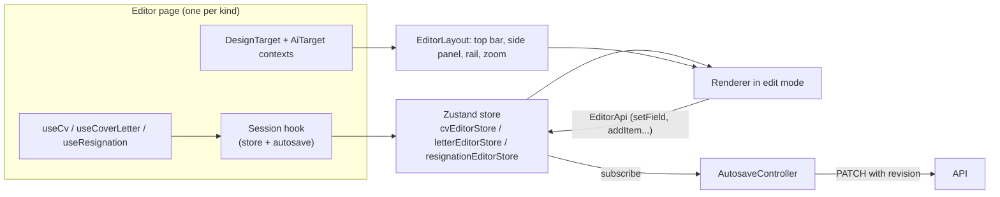
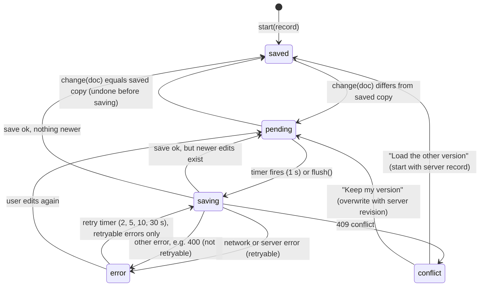
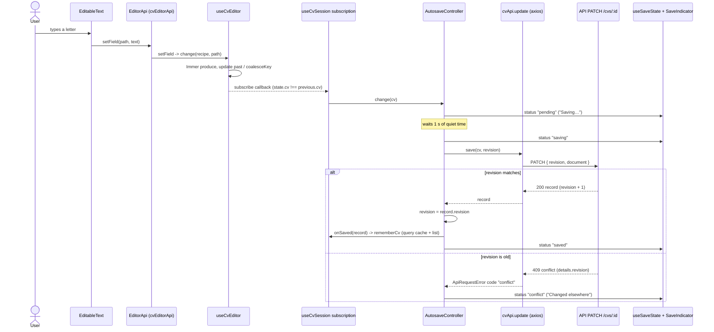

# The editor

This page explains how editing works in the web app: the editor page, the three kinds of document it can open, the stores that hold the text, autosave, version history, the panels, and the small building blocks used to edit text in place.

If you only read one section, read [The big picture](#the-big-picture) and [Autosave](#autosave). Most editor bugs live in one of those two places.

Related pages:

- [Web app overview](README.md)
- [How documents are drawn](renderer.md) (the renderer that shows the pages inside the editor)
- [Domain model](../domain-model.md) (what a CV, a cover letter and a resignation letter contain)
- [API endpoints](../api/endpoints.md) (the routes the editor calls)
- [Testing](../testing.md)
- [Guides](../guides/README.md)

All paths below are relative to the repository root. Everything in this page is under `apps/web/src/` unless it says otherwise.

## The big picture

The editor is a single full-screen shell (`features/cv-editor/layout/EditorLayout.tsx`) that wraps one of three document pages:

| Document kind (`DocumentType`) | Route                     | Page component                                         |
| ------------------------------ | ------------------------- | ------------------------------------------------------ |
| `cv`                           | `/cvs/:id/edit`           | `features/cv-editor/pages/CvEditorPage.tsx`            |
| `coverLetter`                  | `/cover-letters/:id/edit` | `features/cover-letters/pages/LetterEditorPage.tsx`    |
| `resignation`                  | `/resignations/:id/edit`  | `features/resignation/pages/ResignationEditorPage.tsx` |

`features/cv-editor/pages/EditorPage.tsx` picks the right page from a `type` prop. Each page does the same four jobs:

1. Load the record with a TanStack Query hook (`useCv`, `useCoverLetter`, `useResignation`). A 404 or 400 shows `NotFoundPage`; other errors show `LoadError` with a retry button.
2. Start a **session** (`useCvSession`, `useLetterSession`, `useResignationSession`). A session copies the record into a Zustand store and connects the store to an autosave controller.
3. Provide two React contexts to the shell: `DesignTargetContext` (what the Templates and Design & Font panels change) and `AiTargetContext` (what the AI panels read and write).
4. Render `EditorLayout` with the right props and put the renderer (`CvRenderer`, `LetterRenderer` or `ResignationRenderer`) inside it in `mode="edit"`.

The page component is rendered with `key={record.id}`, so opening a different document throws the whole session away and starts a fresh one. Each page also calls `closePanel` when the id changes, so every document opens with the side panel closed.



The important rule: **the renderer never talks to the store directly.** It receives an `EditorApi` object (see [In-place editing](#in-place-editing)) and calls that. This is why the same renderer code works for all three kinds, and why the preview page can use the renderer without any editing at all.

## Layout

`features/cv-editor/layout/EditorLayout.tsx` is the shell. It does not know which kind of document it holds, except through its props.

| Prop                    | Meaning                                                                                              |
| ----------------------- | ---------------------------------------------------------------------------------------------------- |
| `title`, `status`       | The editable title (`EditableTitle`) and the save indicator (`SaveIndicator`), shown in the top bar. |
| `backTo`, `previewTo`   | Where the back arrow and the Preview button go.                                                      |
| `cvId`                  | Only set for CVs. Its presence enables the History panel (`historyEnabled={Boolean(cvId)}`).         |
| `banner`                | Shown between the top bar and the page: the conflict banner (and, for letters, the link bar).        |
| `onDownload`, `onShare` | Print the document, open the `ShareDialog`.                                                          |
| `undoRedo`              | Undo and redo for letters. When missing, the top bar falls back to the CV store.                     |
| `kind`                  | `'cv'` (default), `'coverLetter'` or `'resignation'`. Decides which tools are available.             |
| `pageSize`              | `A4` or `Letter`. Used to compute the page width for fit and zoom.                                   |

### Wide layout (1024px and up)

The layout switches at the `lg` breakpoint: `const compact = !useBreakpoint('lg')`.

| Region           | Component                                  | What it holds                                                                                           |
| ---------------- | ------------------------------------------ | ------------------------------------------------------------------------------------------------------- |
| Top bar, left    | `EditorTopBar`                             | Back arrow, the AI Assistant button, the title and the save status.                                     |
| Top bar, centre  | `EditorTopBar` + `layout/tools.ts`         | The five `CENTER_TOOLS`: Fix Mistakes, Check & Tailor, Rearrange, Templates, Design & Font.             |
| Top bar, right   | `EditorTopBar`                             | Undo, Redo, History, a Help menu, the language and theme selects.                                       |
| Left column      | `EditorSidePanel`                          | The active panel. AI panels (`ai`, `fix`, `tailor`) get the wider `w-panel-wide`, the others `w-panel`. |
| Page area        | `FitToWidth` (from `shared/ui/FitToWidth`) | The renderer. It fits the page to the available width (never above 100%) unless a zoom is set.          |
| Beside the page  | `EditorRail`                               | A vertical pill attached to the page's left edge: Preview, Download PDF, Share link, AI assistant.      |
| Floating, bottom | `ZoomControl`                              | Minus, slider, plus, percentage, and a "fit" button.                                                    |

The Help menu items ("Help Center", "Contact Us") only show a "not available yet" toast.

### Compact layout (phones and small tablets)

Below 1024px the same data is arranged differently:

- `EditorTopBar` renders a slim bar: back arrow, title and status, undo and redo, and `EditorMoreMenu`.
- `EditorMoreMenu` (a "three dots" menu) holds everything the wide layout spreads across the rail and the right end of the top bar: Preview, Download PDF, Share link, History, Help Center, Contact Us, and the language and theme selects. It closes on an outside pointer press, and uses the shared `useMenu` hook for keyboard handling.
- `EditorToolbar` is a tab bar fixed at the bottom of the screen (`data-bottom-bar`). It lists `ALL_TOOLS` (AI Assistant plus the five centre tools).
- `EditorSidePanel` gets `sheet` set to true. The panel becomes a bottom sheet over a dimmed backdrop; tapping the backdrop closes it.
- The rail is not rendered, and the page has side padding instead of the extra room the rail needs.

### Tools and `toolUnavailable`

`layout/tools.ts` defines the tool list (`AI_TOOL`, `CENTER_TOOLS`, `ALL_TOOLS`) and `toolUnavailable(kind, panel)`. Every place that opens a panel (top bar, bottom toolbar, rail) calls it first. If it returns a message, the app shows that message as a toast and does not open the panel.

| Panel       | `cv` | `coverLetter`                                     | `resignation`                                 |
| ----------- | ---- | ------------------------------------------------- | --------------------------------------------- |
| `ai`        | yes  | yes                                               | no ("AI assistant writes CVs and letters...") |
| `fix`       | yes  | yes                                               | yes                                           |
| `tailor`    | yes  | no ("works on CVs, open the linked CV")           | no ("works on CVs")                           |
| `rearrange` | yes  | no ("no sections to rearrange")                   | no                                            |
| `templates` | yes  | yes                                               | no ("no templates, use Design & Font")        |
| `design`    | yes  | yes                                               | yes                                           |
| `history`   | yes  | no (toast "Version history is available for CVs") | no (same toast)                               |

History is not gated by `toolUnavailable`. It is gated by `historyEnabled` in `EditorTopBar` and `EditorMoreMenu`, which comes from `cvId` being set.

The texts are in `i18n/locales/en/editor.ts` (`editor.topBar.*`).

### UI state: `editorUi`

`features/cv-editor/state/editorUi.ts` is a small Zustand store shared by all three editors. It holds only UI state, never document content:

| Field / action               | Purpose                                                                                                       |
| ---------------------------- | ------------------------------------------------------------------------------------------------------------- |
| `activePanel`, `togglePanel` | Which panel is open. Toggling or closing a panel also clears `previewVersionId`.                              |
| `previewVersionId`           | A saved version shown instead of the editable CV (History).                                                   |
| `zoom`, `setZoom`            | `null` means "fit to screen". Otherwise a percent, clamped to `ZOOM_MIN` 25 and `ZOOM_MAX` 200 (`clampZoom`). |
| `notify(message, tone)`      | Shows a toast through `shared/stores/toasts` (id `editor-notice`).                                            |

`ZoomControl` steps by `ZOOM_STEP` (10) to the next multiple of ten, the slider moves in steps of 5, the percentage shows the fitted scale when `zoom` is `null`, and the "fit" button sets `zoom` back to `null`. `EditorLayout` converts the zoom to a scale (`zoom / 100`) and passes it to `FitToWidth`.

## The three document kinds

The CV, cover letter and resignation editors share one shell, one autosave controller class, one save-status store, the same undo shortcuts, the same panels and the same in-place text editing. They differ in the store, the API, the renderer and which tools make sense.

| Aspect                  | CV                                                           | Cover letter                                                             | Resignation letter                                                               |
| ----------------------- | ------------------------------------------------------------ | ------------------------------------------------------------------------ | -------------------------------------------------------------------------------- |
| Store                   | `useCvEditor` in `features/cv-editor/state/cvEditorStore.ts` | `useLetterEditor` in `features/cover-letters/state/letterEditorStore.ts` | `useResignationEditor` in `features/resignation/state/resignationEditorStore.ts` |
| Document field in store | `cv`                                                         | `letter`                                                                 | `letter`                                                                         |
| Session hook            | `useCvSession` in `cv-editor/state/editorSession.ts`         | `useLetterSession` in `cover-letters/state/letterSession.ts`             | `useResignationSession` in `resignation/state/resignationSession.ts`             |
| `EditorApi` object      | `cvEditorApi` (`cv-editor/state/editorApi.ts`)               | `letterEditorApi` (in `letterSession.ts`)                                | `resignationEditorApi` (in `resignationSession.ts`)                              |
| Renderer                | `CvRenderer` through `PageCanvas`                            | `LetterRenderer`                                                         | `ResignationRenderer`                                                            |
| API client              | `cvApi` (`cv-editor/api.ts`)                                 | `coverLetterApi` (`cover-letters/api.ts`)                                | `resignationApi` (`resignation/api.ts`)                                          |
| `DesignTarget` context  | none provided; the default reads the CV store                | provided by `LetterEditorPage`                                           | provided by `ResignationEditorPage`                                              |
| `AiTarget` context      | `useCvAiTarget`                                              | `useLetterAiTarget`                                                      | `useResignationAiTarget` (Fix Mistakes only)                                     |
| Version history         | yes                                                          | no                                                                       | no                                                                               |
| Extra bar               | none                                                         | `LinkBar`: linked CV, linked job, "use the CV's design"                  | none                                                                             |
| Print                   | `printCv`                                                    | `printLetter`                                                            | `printDocument({ kind: 'resignation', ... })`                                    |

### `DesignTarget`: one set of panels for three documents

The Templates and Design & Font panels do not know which document they edit. They call `useDesignTarget()` (`cv-editor/state/designTarget.ts`), which returns:

| Field                          | Meaning                                                                          |
| ------------------------------ | -------------------------------------------------------------------------------- |
| `kind`                         | The `DocumentType`. Panels use it to hide CV-only controls.                      |
| `design`, `language`           | The current design and language of the document.                                 |
| `updateDesign(patch, key?)`    | Change the design. Pass a `key` per control so a slider drag is one undo step.   |
| `endTyping()`, `setLanguage()` | Close the current undo step; change the document language.                       |
| `header`, `updateHeader()`     | The header with the photo, for the photo picker. `null` for resignation letters. |
| `renderThumbnail?(templateId)` | How the Templates panel draws the open document in another template.             |

If no provider exists (the CV editor), `useDesignTarget` builds a target from `useCvEditor`. The cover letter and resignation pages provide their own with `DesignTargetContext.Provider`.

What the `kind` changes in the panels:

- `DesignPanel` shows the column layout picker only when `kind === 'cv'`.
- `TemplatesPanel` lists `TEMPLATE_IDS` (16 templates) for a CV and `LETTER_TEMPLATE_IDS` (8) for anything else. Its language label says "Resume language" or "Letter language".
- `PhotoPicker` returns nothing when `header` is `null`. A resignation letter has no photo or contact header, because the sender's details are part of the letter body.
- A letter's thumbnails come from `renderThumbnail`, which renders `LetterThumbnail` with `templateChoice(id)` applied; a CV uses `CvThumbnail` with `withTemplate`.

### `AiTarget`: one set of AI panels

`features/ai/aiTarget.ts` defines the `AiTarget` interface and `AiTargetContext`. The panels call `useAiTarget()`, which throws if there is no provider. The hooks in `features/ai/useAiTargets.ts` build the target for each kind:

| Field                 | Meaning                                                                                                 |
| --------------------- | ------------------------------------------------------------------------------------------------------- |
| `kind`, `language`    | Document type and language sent to the AI.                                                              |
| `fields`              | The document's text as `{ path, label, text }` items (`cvFields`, `letterFields`, `resignationFields`). |
| `getText(path)`       | Reads the current text from the store at a path.                                                        |
| `setText(path, text)` | `store.setField(path, text)` followed by `endTyping()`, so each accepted suggestion is one undo step.   |
| `cv?`                 | CV only: id, title, linked job, summary path, bullet entries, `setBullets`, `createTailoredCopy`.       |
| `letter?`             | Cover letter only: linked CV and job, and `setParagraphs` (replaces all paragraphs in one undo step).   |

The resignation target has neither `cv` nor `letter`, which is why only Fix Mistakes works for resignation letters. `TailorPanel` reads `target.cv!` and the CV assistant reads `target.cv!`, so they must never be opened for other kinds. `toolUnavailable` is what guarantees that.

## The editor stores

Each kind has a Zustand store with the same core. The CV store is the reference.

### State shape

| Field           | Type               | Meaning                                                                                               |
| --------------- | ------------------ | ----------------------------------------------------------------------------------------------------- |
| `docId`         | `string \| null`   | Id of the open document. Pages check `s.docId === record.id` before using the content.                |
| `cv` / `letter` | document `\| null` | The current document. Always replaced, never mutated (Immer produces a new object).                   |
| `past`          | `Document[]`       | Undo stack. Capped at `HISTORY_LIMIT` = 100 (older entries are dropped).                              |
| `future`        | `Document[]`       | Redo stack. Cleared by any new change.                                                                |
| `coalesceKey`   | `string \| null`   | Key of the last change. Same key twice in a row means "same undo step".                               |
| `focusedPath`   | `string \| null`   | The text field that should keep focus after it re-mounts (see [In-place editing](#in-place-editing)). |

### Core actions

| Action                         | What it does                                                                                                                                               |
| ------------------------------ | ---------------------------------------------------------------------------------------------------------------------------------------------------------- |
| `load(docId, doc)`             | Replaces the document and empties `past`, `future`, `coalesceKey` and `focusedPath`. Used on start, after "Load the other version", and after a restore.   |
| `change(recipe, coalesceKey?)` | Runs `produce(doc, recipe)`. If nothing changed (same object), it stops. Otherwise it pushes the old document on `past` (unless merging), clears `future`. |
| `setField(path, value)`        | `change` with the path as the coalesce key. This is what typing calls.                                                                                     |
| `endTyping()`                  | Sets `coalesceKey` to `null`, so the next edit starts a new undo step.                                                                                     |
| `undo()` / `redo()`            | Move the document between `past`, the present and `future`. Both reset `coalesceKey`.                                                                      |
| `setFocusedPath(path)`         | Remembers which field has focus.                                                                                                                           |

The rest of the CV store is a set of helpers built on `change`: `updateHeader`, `updateItem`, `addItem`, `duplicateItem`, `removeItem`, `moveItem`, `addBullet`, `removeBullet`, `moveSection`, `setSectionVisible`, `updateSection`, `renameSection`, `addSection`, `removeSection`, `updateDesign`, `setLanguage`. Two of them also set `focusedPath` so the cursor lands in the new entry or bullet.

The letter store has `updateHeader`, `updateDesign`, `setLanguage`, `addParagraph`, `removeParagraph` and `applyFromCv`. The resignation store has the same without `updateHeader` and `applyFromCv`. Paragraphs are capped at `MAX_PARAGRAPHS` = 20, and the last paragraph cannot be removed.

### How `coalesceKey` makes typing one undo step

In `change`, the new state merges into the previous undo step when `coalesceKey !== undefined && coalesceKey === lastKey`. Merging means `past` is left alone (the old "before" document stays the undo target), while `cv` moves forward.

| Source                   | Key                 | Result                                                                                       |
| ------------------------ | ------------------- | -------------------------------------------------------------------------------------------- |
| Typing in a field        | the field's path    | All keystrokes in that field are one step, until the field loses focus (`endTyping`).        |
| Moving to another field  | a different path    | New step.                                                                                    |
| Design slider or colour  | `design:<field>`    | A whole drag is one step. The panel calls `endTyping` on pointer up, key up or button click. |
| Dragging a section       | `drag:<sectionId>`  | A whole drag is one step. `RearrangePanel` calls `endTyping` on drop or cancel.              |
| Renaming a section       | `title:<sectionId>` | Typing a title is one step; `onBlur` calls `endTyping`.                                      |
| Any action without a key | none (`null`)       | Always its own step, and it also breaks any running merge.                                   |

`undo` and `redo` set `coalesceKey` to `null` on purpose, so typing after an undo never merges into the step you just undid.

### `applyFromCv` (cover letters)

`useLetterEditor.applyFromCv(header, design)` is used by the "Use the CV's design" button in `LinkBar`. It loads the linked CV (`useLoadCv`), copies its header (name, contacts, photo) into the letter and sets `design = letterDesign(cvDesign)`. `letterDesign` (in `@cv/shared`, `cv/design.ts`) keeps the look but swaps a CV-only template for the closest letter template with `letterTemplateFor`. The letter's signature is updated only if it still equals the old header name. It is one `change`, so it is one undo step.

### Paths

Text is addressed by a dot path, defined in `features/cv-editor/state/documentPath.ts`:

```text
header.name
sections.<sectionId>.text
sections.<sectionId>.items.<itemId>.title
sections.<sectionId>.items.<itemId>.bullets.<index>
paragraphs.<index>            (letters)
sender.name, employer.city    (resignation)
```

`setAtPath` and `getAtPath` look up array entries by `id` first and by numeric index second, so a path with ids stays valid when items move. `setAtPath` returns `false` if the path does not exist, and then nothing changes. Section order helpers (`moveSection`, `sectionsIn`) live in `state/sectionOrder.ts`; the document keeps main-column sections first, then sidebar sections.

### Undo shortcuts

`layout/useUndoShortcuts.ts` adds a `keydown` listener on `window`:

- Ctrl or Cmd + Z: undo.
- Ctrl or Cmd + Shift + Z, or Ctrl or Cmd + Y: redo.
- It ignores events with Alt held, and events whose target is an `INPUT`, `SELECT` or `TEXTAREA`, so date pickers and other form fields keep the browser's own undo. The editable text on the page is a `contentEditable` span, not an input, so it does use the document-wide undo.

The CV page calls `useUndoShortcuts()` (CV store by default). The letter pages pass a function returning their own store state. The top bar buttons call the same `undo` and `redo` and are disabled when `past` or `future` is empty.

## Autosave

The autosave logic is one class, `AutosaveController`, in `features/cv-editor/state/autosave.ts`. It is plain TypeScript with no React in it, and it is generic: the CV, cover letter and resignation sessions each create one with their own `save` function. Its unit tests are in `state/autosave.test.ts`.

### What it guarantees

- **Debounce.** After a change it waits for a quiet `delayMs` (default 1000 ms) before saving.
- **One save at a time.** `run()` returns the in-flight promise if one exists. Changes made during a save are saved afterwards.
- **Revision on every save.** Each save sends `{ revision, document }`, where `revision` is the one the client last saw. On success the controller adopts the revision from the response.
- **Retry with backoff.** Network errors and server errors (status `null` or 500 and above, `ApiRequestError.retryable` in `shared/api/client.ts`) are retried after 2 s, 5 s, 10 s, then every 30 s.
- **No pointless retries.** Other errors (for example a 400 for invalid data) set the status to `error` but schedule no retry. The next edit schedules a normal save again.
- **Stop on conflict.** A 409 with code `conflict` stops all saving until the user chooses what to do.

### Status values

`SaveStatus` is `'saved' | 'pending' | 'saving' | 'error' | 'conflict'`. The session hooks write every state change into one global store, `useSaveState` (defined in `editorSession.ts` and reused by the letter and resignation sessions). `SaveIndicator` reads it:

| Status                 | Shown as                                                     |
| ---------------------- | ------------------------------------------------------------ |
| `saved`                | "Saved" with a check icon                                    |
| `pending`, `saving`    | "Saving…" with a spinner                                     |
| `error`, retryable     | "Not saved, retrying…" with a cloud-off icon                 |
| `error`, not retryable | "Not saved" with a warning icon (the message is the tooltip) |
| `conflict`             | "Changed elsewhere" in the danger colour                     |

The texts are `common.saved`, `common.saving` and `editor.save.*` in `i18n/locales/en`.

Because `useSaveState` is a single global store, only one editor can be open at a time. The same is true of the module-level `session` variable in each session file.

### State diagram



After "Keep my version" the `pending` state is left at once: `overwrite()` schedules a save with a delay of 0, and that save sends the server's revision.

While in `conflict`, `change()` still remembers the newest document but does not change the status or schedule a save.

### Sequence: from typing to a new revision



### The session hook

`useCvSession(record)` in `features/cv-editor/state/editorSession.ts` does this once per mounted editor (in an effect that keeps the first `record` in a ref):

1. Creates an `AutosaveController` whose `save` calls `cvApi.update(id, { revision, document })`, whose `onState` writes `useSaveState`, and whose `onSaved` calls `rememberCv` (updates the TanStack Query detail and list caches).
2. Stores the controller in a module-level `session` object and calls `loadIntoEditor(record)`, which calls `controller.start(record)` and `useCvEditor.getState().load(...)`.
3. Subscribes to the store. When `state.cv` changes for the same `docId`, it calls `controller.change(state.cv)`.
4. Adds a `beforeunload` listener. If there are unsaved changes it calls `flush()` and `preventDefault()`, so the browser asks before closing the tab.
5. On unmount it unsubscribes and calls `controller.flush().finally(() => controller.dispose())`. Leaving the editor therefore saves right away. If the flush fails (offline, conflict), the unsaved edits are not kept anywhere.

`useCv` uses `staleTime: Infinity`, because the editor owns the document while it is open: TanStack Query must not refetch it underneath the editor. `rememberCv` keeps the cache in step with each successful save.

The helpers other code uses:

| Function                        | Use                                                                                                        |
| ------------------------------- | ---------------------------------------------------------------------------------------------------------- |
| `flushSave()`                   | Save now and wait. Resolves `false` if it could not. History uses it before saving or restoring a version. |
| `loadIntoEditor(record)`        | Replace the editor content with a server record: restart the controller and reload the store.              |
| `overwriteServerCopy(revision)` | "Keep my version": adopt the server's revision and save again at once.                                     |

The letter and resignation sessions have the same functions with different names (`flushLetterSave`, `loadLetterIntoEditor`, `overwriteLetterServerCopy`, and the `...Resignation...` versions).

### The conflict flow

A conflict means someone (another tab, another device) saved a newer revision first. The API answers 409 with `details.revision` set to the current server revision (`apps/api/src/modules/cvs/routes.ts`).

`layout/ConflictBanner.tsx` shows a red alert when `status === 'conflict'`. It has two buttons:

- **Load the other version** calls the page's `reload` function: fetch the latest record (`cvApi.get`), update the query cache, then `loadIntoEditor(record)`. This restarts the controller and replaces the store content. Your unsaved edits are discarded, and the undo history is cleared by `load`. If the fetch fails the banner shows a browser `alert`.
- **Keep my version** calls `overwrite(serverRevision)`. The controller adopts the server's revision and saves the current editor content again. This button is disabled when the error has no `details.revision`.

`CvConflictBanner` wires the CV session in; the cover letter and resignation pages pass their own `reload` and `overwrite` into the generic `ConflictBanner` (the banner text depends on `kind`).

### Offline

There is no special offline mode. A request that cannot reach the server becomes `ApiRequestError` with `status === null` and code `network_error` (this includes the 15-second axios timeout in `shared/api/client.ts`). It is retryable, so the indicator shows "Not saved, retrying…" and the controller retries with the backoff above. Edits keep working in memory. If the user closes the tab meanwhile, `beforeunload` asks for confirmation.

## Version history

Only CVs have version history. Cover letters and resignation letters do not (the API has no versions routes for them).

| Piece                | File                                           | API call                                          |
| -------------------- | ---------------------------------------------- | ------------------------------------------------- |
| List versions        | `panels/HistoryPanel.tsx` via `useCvVersions`  | `GET /cvs/:id/versions`                           |
| Save a named version | `HistoryPanel.saveVersion`                     | `POST /cvs/:id/versions` with an optional `label` |
| Preview a version    | `panels/VersionPreview.tsx` via `useCvVersion` | `GET /cvs/:id/versions/:versionId`                |
| Restore a version    | `VersionPreview.restore`                       | `POST /cvs/:id/versions/:versionId/restore`       |

How it works:

- Clicking a version in the History panel sets `previewVersionId` in `editorUi`. `CvEditorPage` then renders `VersionPreview` instead of `PageCanvas`. The version is shown read-only in `mode="preview"`, with "Back to editing" and "Restore" buttons.
- Before saving a named version or restoring, the code calls `flushSave()`. If the flush fails it shows "Your latest changes are not saved yet" and stops. This guarantees the snapshot contains your latest edits.
- **Restore** calls the API, then `rememberCv(record)` and `loadIntoEditor(record)`, which restarts autosave on the restored revision and clears the undo history. The API first stores the current content as a version labelled "Before restore", so a restore can itself be undone from the History panel.
- **Automatic snapshots** are made by the API, not by the web app: when a save arrives, the previous content is kept as an automatic version, at most once every 10 minutes (`AUTO_VERSION_MINUTES` in the CV routes). The panel labels them "Automatic snapshot". Old versions beyond the plan's `maxVersionsPerCv` (30 for free, 200 for pro, in `packages/shared/src/api/api.ts`) are deleted.
- `EditorSidePanel` only renders the History panel when it has a `cvId`.

## Panels

All panels render inside `EditorSidePanel`, chosen by `activePanel`.

| Panel (label)             | Component and file                                     | What it does                                                                                                                                                                              | API calls                                                                        |
| ------------------------- | ------------------------------------------------------ | ----------------------------------------------------------------------------------------------------------------------------------------------------------------------------------------- | -------------------------------------------------------------------------------- |
| AI Assistant (`ai`)       | `AssistantPanel` in `features/ai/panels/`              | CV: writes a summary or bullets for one entry. Cover letter: writes the paragraphs. "Use" applies the proposal as one undo step.                                                          | `POST /ai/assist`                                                                |
| Fix Mistakes (`fix`)      | `FixMistakesPanel` in `features/ai/panels/`            | Spelling and grammar suggestions; each can be accepted or rejected, or "Accept all". A suggestion is skipped as "stale" if the text changed.                                              | `POST /ai/fix-mistakes`                                                          |
| Check & Tailor (`tailor`) | `TailorPanel` in `features/ai/panels/`                 | Compares the CV with a job posting (a saved job or pasted text), shows a match score and missing keywords, and offers rewrites. Rewrites can be applied here or saved as a tailored copy. | `POST /ai/tailor`; the copy uses `POST /cvs/:id/duplicate` then `PATCH /cvs/:id` |
| Rearrange (`rearrange`)   | `panels/RearrangePanel.tsx`                            | Drag sections within and between the main column and the sidebar (dnd-kit, mouse and keyboard), rename, hide or show, delete, and add a section.                                          | none (store actions only)                                                        |
| Templates (`templates`)   | `panels/TemplatesPanel.tsx`                            | Pick a template (grouped by category), set paper size (A4 or US Letter) and document language.                                                                                            | none                                                                             |
| Design & Font (`design`)  | `panels/DesignPanel.tsx`, `panels/PhotoPicker.tsx`     | Photo, margins, section spacing, accent colour, font, font size, line height, column layout (CV only), background, reset.                                                                 | `POST /uploads` (photo)                                                          |
| History (`history`)       | `panels/HistoryPanel.tsx`, `panels/VersionPreview.tsx` | See [Version history](#version-history).                                                                                                                                                  | versions routes                                                                  |

Notes on the AI panels:

- All AI panels are wrapped in `AiGate` (`features/ai/panels/AiGate.tsx`). It calls `GET /ai/status`, shows a setup hint if AI is not enabled, and shows "N requests left today" under the content. The AI itself runs on the server, so no key reaches the browser. The calls are in `features/ai/api.ts` with a 90-second timeout.
- Accepting a suggestion goes through `AiTarget.setText`, so it is a normal edit: it is autosaved and can be undone with Ctrl+Z.
- The Tailor rewrites are applied only when the field still holds the exact original text; others are skipped with a notice.

Notes on Rearrange:

- Moving a section to the other column happens while dragging (`onDragOver`), so rows make room. Reordering inside one column is applied on drop. Both use the key `drag:<id>`, so one drag is one undo step.
- Deleting a section shows a toast "Section deleted. Press Ctrl+Z to undo."
- Single-column templates show a warning: main sections come first, then sidebar sections. The renderer does the merging; see [renderer.md](renderer.md#sections-and-blocks).
- You can add one of each section type, except `custom` sections, which can repeat.

### Design & Font and template choice

`DesignPanel` groups controls in this order: Photo, Page margins, Section spacing, Colours, Font, Font size, Line height, Column layout (CV only), Background, and a "Reset to template defaults" button. Every control calls `updateDesign` from the design target.

- The four sliders (`LevelSlider`) store a level from 1 to 5. The pixel values for each level are in `renderer/templates/tokens.ts`. Each slider uses the coalesce key `design:<field>`.
- Accent colour: six presets from `ACCENT_PRESETS`, a native colour input, and a hex field (applies only when it is a valid `#RRGGBB`). A warning appears when the colour has too little contrast with white text: the limit is 4.5 when the template paints a solid sidebar or a header band, and 3 otherwise (`features/cv-editor/lib/contrast.ts`).
- Font: ten families from `FONT_FAMILIES`, each drawn in its own font (`FONT_STACKS`). All of them cover Cyrillic.
- Background: 19 patterns from `renderer/templates/backgrounds.ts`.

**Choosing a template applies its suggested settings.** In `TemplatesPanel` a click calls `updateDesign(templateChoice(id))`. `templateChoice` (in `renderer/templates/templates.ts`) returns `{ templateId, ...template.suggested }`, and `suggested` contains exactly five settings: `fontFamily`, `columnLayout`, `sectionSpacing`, `fontSize`, `lineHeight`. So switching template overwrites those five values, and leaves accent colour, margins, paper size, background and icons alone. After that the user can change anything.

**Reset to template defaults** builds `{ ...DEFAULT_DESIGN, ...template.suggested }`, removes `templateId` and `pageSize` from it, and applies the rest. It therefore also resets accent colour, margins, background and icons to the defaults from `packages/shared/src/cv/design.ts`, and keeps the chosen template and paper size.

The thumbnails in the Templates panel are live renders of the open document, not images: `CvThumbnail` with `withTemplate(cv, id)`, scaled down inside `FitToWidth` (width `TEMPLATE_THUMBNAIL_WIDTH` = 120). Templates recommended for the CV's profession get a "Recommended" badge, from `PROFESSIONS[professionId].recommendedTemplates`; the profession comes from the saved record read with `useCv(cvId)` in `EditorSidePanel`.

### Photo upload and picker

The photo can be changed in two places, and both end in the same `updateHeader` call:

- The **Photo group** of Design & Font (`panels/PhotoPicker.tsx`): upload or change, remove, a show/hide switch, three shapes (`PHOTO_SHAPES`: circle, rounded, square) and three positions (`PHOTO_POSITIONS`: next to the name, top left, top right). You can click the dashed box or drop an image on it.
- The **header toolbar** on the page (`HeaderControls` in `renderer/editing/controls.tsx`): add, change or remove the photo.

The upload steps (`renderer/editing/image.ts`):

1. `pickImage` opens a hidden file input that accepts PNG, JPEG and WebP. `resizeImage` rejects non-images and files over 5 MB.
2. The image is scaled so its longest side is at most `PHOTO_MAX_SIZE` = 480 px, drawn on a canvas, and encoded as PNG (if the original was PNG) or JPEG at quality 0.85.
3. `cvApi.uploadImage` posts it as multipart form data (field `file`) to `POST /uploads` and gets a `{ url }`.
4. The editor stores `photoUrl: url` and `showPhoto: true` in the header.

Removing a photo sets `photoUrl: null` and `showPhoto: false`; the web app does not call `DELETE /uploads/:id`. Stored URLs are relative to the API; `assetUrl()` in `shared/api/client.ts` turns them into absolute URLs when the API is on another origin. Where the photo is drawn is decided by `placePhoto`; see [renderer.md](renderer.md#photo-placement).

Cover letters upload through `cvApi.uploadImage` too. The resignation `EditorApi.uploadImage` returns an empty string, because that editor never shows photo controls.

## In-place editing

The renderer draws the document, and the same elements are editable when an `EditorApi` is present.

### `EditorApi`

`renderer/editing/editorApi.ts` is the contract between the renderer and a store. Each document kind supplies an object that implements it:

| Method                                                             | Purpose                                                  |
| ------------------------------------------------------------------ | -------------------------------------------------------- |
| `setField(path, value)`, `endTyping()`                             | Text edits and closing the undo step.                    |
| `getFocusedPath()`, `setFocusedPath()`                             | Remember and restore the focused field.                  |
| `updateHeader(patch)`                                              | Header text and photo fields.                            |
| `updateItem`, `addItem`, `duplicateItem`, `removeItem`, `moveItem` | Entry actions inside a section.                          |
| `addBullet`, `removeBullet`                                        | Bullet actions inside an entry.                          |
| `updateSection(sectionId, patch)`                                  | Section settings, e.g. how skills look (`levelDisplay`). |
| `uploadImage(blob)`                                                | Upload a photo or company logo, return its URL.          |
| `notify(message)`                                                  | Show a toast.                                            |

Letters and resignation letters supply a no-op (`none`) for the entry methods that do not apply, so renderer code can call them without checking.

The renderer reads the API through `useEditor()` in `renderer/context.ts`, which returns it only when `mode === 'edit'` and the render is not the hidden measuring copy. So preview mode, thumbnails and the measuring copy never get editing controls.

### `Field` and `EditableText`

`Field` (in `renderer/editing/primitives.tsx`) shows a text value. If it has a `path` and an editor is present it renders `EditableText`. Otherwise it renders plain text, a grey placeholder (edit mode, empty value), nothing (preview mode, empty value), or a blurred stand-in for hidden personal details (see [renderer.md](renderer.md#hidden-personal-details)).

`EditableText` (`renderer/editing/EditableText.tsx`) is a `<span contentEditable="plaintext-only" role="textbox">` with `data-path` set to the document path. Key points:

- **Uncontrolled while typing.** React only writes the DOM text when the incoming `value` differs from what is in the DOM (undo, redo, another field). That is what keeps the caret from jumping.
- **Input handler.** On every input it truncates the text to the field's limit, then calls `editor.setField(path, text)`. For single-line fields, newlines become spaces.
- **Keys.** Enter in a single-line field calls `onEnter` (for example "new bullet") or just leaves the field. Backspace in an empty field calls `onBackspaceEmpty` (for example "delete this bullet"). Escape leaves the field. Multi-line fields (summary, addresses) keep Enter as a newline.
- **Paste** is forced to plain text.
- **Blur** calls `editor.endTyping()`, which closes the undo step.
- **Focus memory.** `onFocus` stores the path with `setFocusedPath`. When a field is removed and mounted again somewhere else (for example its block moved to the next page, or a new bullet was added), the new instance sees that `getFocusedPath()` equals its own path and takes focus back, with the caret at the end. On blur a short timeout clears the stored path, unless the element was removed from the page.

### Limits while typing

`EditableText` enforces a maximum length per field:

```text
max = fieldMaxLength(path) ?? resignationFieldMaxLength(path) ?? TEXT_MAX
```

| Source                        | Limit                                                                                                                                                                          |
| ----------------------------- | ------------------------------------------------------------------------------------------------------------------------------------------------------------------------------ |
| `fieldMaxLength` (`header.*`) | `HEADER_LIMITS`: name 150, headline 300, email 254, phone 40, location 150, link 300.                                                                                          |
| `resignationFieldMaxLength`   | `RESIGNATION_LIMITS`: sender (name 150, email 254, phone 40, residence 200), employer (company 150, contact 150, address 200, postal code 20, city 100), subject 200, date 60. |
| `TEXT_MAX`                    | 5000, for any other single text (a summary, a bullet, a paragraph).                                                                                                            |

These come from `@cv/shared` (`cv/header.ts`, `resignation/resignation.ts`, `common/textLimit.ts`). The API enforces the same limits when saving (`SaveableCvSchema` and friends in `packages/shared/src/api/api.ts`) and rejects longer text with a 400. It does not enforce them when reading, so an older document with longer text still opens.

### Controls toolbars

`renderer/editing/controls.tsx` wraps parts of the page in hover and focus toolbars (only when an editor is present):

| Component         | Appears on                 | Buttons                                                                                               |
| ----------------- | -------------------------- | ----------------------------------------------------------------------------------------------------- |
| `ItemControls`    | One entry (job, school...) | "+ Entry" below, edit (focus the first field), move up, move down, add bullet, duplicate, delete.     |
| `SectionControls` | A section title            | "+ Entry", and for skills sections a skills style picker (`SkillStyleButton`, writes `levelDisplay`). |
| `HeaderControls`  | The header                 | Add, change or remove the photo.                                                                      |

All buttons call `onMouseDown={(e) => e.preventDefault()}` so clicking them does not steal focus (and the caret) from the field being edited. The toolbar stays at its real size at any zoom: `useToolbarPlacement` measures the page (`[data-cv-page]`) and applies a counter-scale and a shift that keeps it inside the page. `blocks.tsx` decides where these wrappers go; see [renderer.md](renderer.md#sections-and-blocks).

### Date inputs

Dates are not typed as text. `DateRangeField`, `SingleDateField` and `CertificateDatesField` (in `primitives.tsx`) show the formatted date as a `Field`; in the editor they become a button that opens a `Popover` (`renderer/editing/Popover.tsx`, rendered in a portal because the page clips its overflow). The popover holds `DateRangeForm`, `SingleDateForm` or `CertificateDatesForm` from `renderer/editing/dateInputs.tsx`.

- A date is a string `"YYYY"` or `"YYYY-MM"`, or `null`. `YearMonthPicker` has year arrows, a grid of years (from 1950 up to 15 years ahead) and twelve months. "Year only" keeps just the year.
- A date range has From and To tabs and an "is current" (Present) option. Picking the start moves to the end tab.
- If the end is before the start (`isBefore` from `@cv/shared`) the field gets the class `cv-date-warning` (a wavy amber underline) and a note in the picker. The value is still saved; it is a warning, not an error.
- Month names follow the interface language, not the CV language (Bulgarian uses the table from `@cv/shared` because browsers return numbers for Bulgarian short months).

Other click-to-edit pieces: `LevelIndicator` (dots or a bar for skill levels, clickable and keyboard-operable), the language level label (click cycles the level), the achievement icon picker and the company logo upload (`renderer/sections/items.tsx`).

## Where to look when something breaks

| Symptom                                           | Start here                                                                                                 |
| ------------------------------------------------- | ---------------------------------------------------------------------------------------------------------- |
| Typing makes the caret jump                       | `renderer/editing/EditableText.tsx` (the uncontrolled `useLayoutEffect`).                                  |
| One keystroke is one undo step, or a drag is many | The `coalesceKey` passed to `change`, and who calls `endTyping`.                                           |
| "Saving…" never goes away                         | `AutosaveController.run` and the save function of the session; check the network tab for the PATCH.        |
| "Changed elsewhere" after your own save           | Two tabs open on the same document, or a save that succeeded but whose response was lost (stale revision). |
| Edits lost after leaving the editor               | `useCvSession` cleanup: `flush()` failed (offline or conflict).                                            |
| A panel will not open                             | `layout/tools.ts` `toolUnavailable`, then `EditorSidePanel`.                                               |
| Template change looks wrong                       | `templateChoice` and the template's `suggested` in `renderer/templates/templates.ts`.                      |

Tests live next to the code: `state/autosave.test.ts`, `state/cvEditorStore.test.ts`, `state/documentPath.test.ts`, `state/sectionOrder.test.ts`, `editor.test.tsx`, `panels/*.test.tsx`, `features/cover-letters/coverLetters.test.tsx`, `features/resignation/resignation.test.tsx` and `renderer/editing/dateInputs.test.tsx`. See [testing](../testing.md) for how to run them.

## Open questions and things that look off

- **Race conflict has no revision.** In `apps/api/src/modules/cvs/routes.ts`, the early revision check throws a 409 with `details.revision`, but the 409 thrown when the `UPDATE ... WHERE revision = ...` matches no row (a concurrent save) carries no details. In that case `ConflictBanner` disables "Keep my version", because it needs `serverRevision`. The resignation routes use the same pattern. It may be intended that the user reloads, but nothing in the code says so.
- **Pruning removes named versions too.** The comment on `pruneVersions` says "oldest automatic snapshots", but the query selects every version of the CV beyond the plan limit, named or not.
- **Stale texts.** `editor.rail.letterDownloads` and `editor.rail.letterLinks` ("arrive in Step 13") are only used as fallbacks when `onDownload` or `onShare` are missing, which no editor page does today.
- **Lost edits on leave.** When the final flush on unmount fails, the edits exist only in memory and are dropped. There is no draft kept in local storage.
