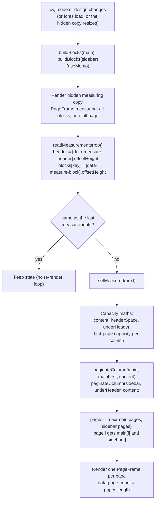
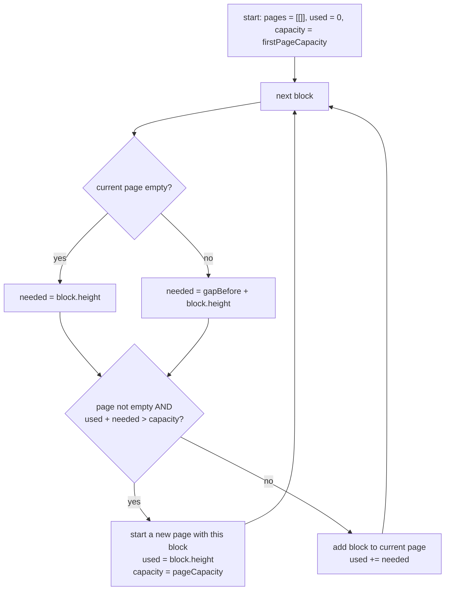

# The renderer

This page explains how documents are drawn: how a CV becomes real-size A4 or Letter pages, how templates work, how letters are drawn, and how the same drawing code is reused for the editor, the preview page, thumbnails, printing to PDF and public share links.

If you are new, read [Overview](#overview), then [How a CV is paginated](#how-a-cv-is-paginated). The last section, [How to debug layout problems](#how-to-debug-layout-problems), is the one you will probably come back to.

Related pages:

- [Web app overview](README.md)
- [The editor](editor.md) (the editing side: stores, autosave, panels)
- [Domain model](../domain-model.md) (the document schemas the renderer reads)
- [API endpoints](../api/endpoints.md)
- [Testing](../testing.md)
- [Guides](../guides/README.md)

All paths below are relative to the repository root and live under `apps/web/src/` unless they say otherwise. `docs/ARCHITECTURE.md` has the rule that `renderer/` never imports from `features/`; the renderer only gets data and an `EditorApi` through props.

## Overview

The renderer draws a document at its **real size in pixels** (96 px per inch). A4 is 794 x 1123 px and US Letter is 816 x 1056 px (`PAGE_SIZE_PX` in `renderer/templates/tokens.ts`). The page is then shrunk or enlarged with a CSS `transform: scale()` where needed (`FitToWidth`, thumbnails). It is never laid out at a smaller size. That is why what you see in the editor, the thumbnail and the PDF all break lines and pages in the same places.

```text
renderer/
  index.ts              Public API: CvRenderer, LetterRenderer, ResignationRenderer,
                        thumbnails, getTemplate, templateChoice, withTemplate
  context.ts            RenderContext: what every component below needs to know
  placeholders.ts       Grey hint texts for empty fields (per CV language)
  icons.ts              Icons for the Key Achievements picker
  document/
    CvRenderer.tsx      Measure, then paginate, then draw pages
    paginate.ts         paginateColumn(): the page-splitting function (pure)
    PageFrame.tsx       One page: header, columns, sidebar, photo, background
    LetterRenderer.tsx  Cover letter (one page that can grow)
    ResignationRenderer.tsx  Resignation letter (same idea)
    CvThumbnail.tsx     CvThumbnail, LetterThumbnail, ResignationThumbnail
  sections/
    blocks.tsx          buildBlocks(): turns sections into blocks
    items.tsx           One view per entry type (experience, education, skills...)
  templates/
    templates.ts        The 16 template definitions
    headers.tsx         The header component of each template, photo helpers
    tokens.ts           Page sizes and slider step values
    pageStyle.ts        Font, size and the --cv-* colour variables
    fonts.ts            Fontsource imports and font stacks
    backgrounds.ts      Page background patterns (SVG)
    photo.ts            placePhoto(): where the photo goes
  editing/              In-place editing building blocks (see editor.md)
    primitives.tsx      Field, SectionTitle, Bullets, date fields, LevelIndicator...
    EditableText.tsx, controls.tsx, dateInputs.tsx, Popover.tsx, image.ts, editorApi.ts
```

### Where the renderer is used

| Place                      | File                                                                             | Component and mode                                              |
| -------------------------- | -------------------------------------------------------------------------------- | --------------------------------------------------------------- |
| Editor                     | `features/cv-editor/pages/CvEditorPage.tsx` (via `PageCanvas`), the letter pages | `mode="edit"` with an `EditorApi`                               |
| Preview page               | `features/cv-editor/pages/PreviewPage.tsx`                                       | `mode="preview"`, wrapped in `FitToWidth`                       |
| Version preview (History)  | `features/cv-editor/panels/VersionPreview.tsx`                                   | `mode="preview"`                                                |
| Thumbnails                 | `renderer/document/CvThumbnail.tsx`                                              | `mode="preview"` by default, `staticLinks`                      |
| Templates panel thumbnails | `features/cv-editor/panels/TemplatesPanel.tsx`                                   | `CvThumbnail` / `LetterThumbnail` with another template applied |
| PDF (browser print)        | `features/print/PrintHost.tsx`                                                   | `mode="preview"` in an off-screen `.print-root`                 |
| Public share page          | `features/share/SharedDocumentPage.tsx`                                          | `mode="preview"` with `hidePersonal` from the server            |

## RenderContext

`renderer/context.ts` defines `RenderContext`. Each renderer builds one value and provides it to everything below; deep components read it with `useRender()`. No prop drilling.

| Field          | Type                  | Meaning                                                                                                                  |
| -------------- | --------------------- | ------------------------------------------------------------------------------------------------------------------------ |
| `mode`         | `'edit' \| 'preview'` | `edit`: placeholders for empty fields, empty sections shown, controls available. `preview`: empty things are left out.   |
| `language`     | `CvLanguage`          | Language of the document (section titles, placeholders, language level labels). Not the interface language.              |
| `titleVariant` | `TitleVariant`        | Which section-title style `SectionTitle` draws. Comes from the template.                                                 |
| `timeline`     | `boolean`             | Dated entries are drawn on a vertical line (Timeline template).                                                          |
| `inlineSkills` | `boolean`             | Skills are drawn compactly. True for every single-column template.                                                       |
| `measuring`    | `boolean`             | True only inside the hidden measuring copy: plain static text, no controls.                                              |
| `hidePersonal` | `boolean`             | A share link that hides personal details: the stand-in texts are drawn blurred.                                          |
| `staticLinks`  | `boolean`             | Links are drawn as plain text, because thumbnails sit inside a link of their own (a link inside a link is invalid HTML). |
| `editor`       | `EditorApi \| null`   | The editing API. `null` outside the editor.                                                                              |

`useEditor()` is the helper to remember: it returns the `EditorApi` only if `mode === 'edit' && !measuring`. Every control and every editable field is guarded by it, so the hidden measuring copy, previews and thumbnails are always inert.

## How a CV is paginated

A CV is not drawn as one tall element that the browser splits. The page count and the content of each page are decided in JavaScript, by `CvRenderer` (`renderer/document/CvRenderer.tsx`) and `paginateColumn` (`renderer/document/paginate.ts`). The approach is **measure, then paginate**:

1. Turn the sections into **blocks** (`buildBlocks`, see [Sections and blocks](#sections-and-blocks)). A block is the smallest unit that can move to another page: a section title together with its first entry, or one further entry.
2. Draw **every block once, in a hidden copy** of the page, and read how tall each one is.
3. Use those heights to split the blocks over pages with `paginateColumn`.
4. Draw the visible pages, giving each page only its own blocks.



### The hidden measuring copy

Inside `CvRenderer`, after the visible pages, there is a second `PageFrame`:

```tsx
<div
  ref={measureRef}
  aria-hidden
  className="pointer-events-none fixed top-0 -left-[10000px] invisible"
>
  <RenderContext.Provider value={measuringContext}>
    <PageFrame {...frameProps} isFirstPage main={main} sidebar={sidebar} measuring />
  </RenderContext.Provider>
</div>
```

- It is off-screen and invisible, but still laid out by the browser, so `offsetHeight` returns real numbers.
- It has the **same width and fonts** as a real page (`pageStyle` sets the width), so lines break exactly as on the visible pages.
- `measuring` has three effects in `PageFrame`: the page has no fixed `height` (it grows with its content), every block wrapper gets `data-measure-block={block.key}`, and the header wrapper gets `data-measure-header`. It also has no `data-cv-page`, so tests and print CSS do not mistake it for a page.
- The measuring context sets `measuring: true` and `editor: null`, so nothing inside it is editable and the toolbars are not drawn.

`readMeasurements` reads `offsetHeight` of the header and of each block. The wrapper's `marginTop` is not part of `offsetHeight`, which is why the spacing between blocks is added separately by the paginator (`gapBefore`).

### When it measures again

The measuring effect in `CvRenderer` is a `useLayoutEffect` with **no dependency array**: it runs after every render, so any change to the content or design is measured before the browser paints. It also:

- observes the hidden root with a `ResizeObserver` (so a change in its size triggers a new read, for example when an image loads or the text reflows), and
- calls `document.fonts.ready.then(update)`, because web fonts load late and change text widths and therefore line breaks.

`setMeasured` is only called when the numbers actually changed (`sameMeasurements` compares the header and the block heights). Without that check, the `setState` inside an effect that runs after every render would loop forever.

On the very first render there are no measurements yet (`measured === null`), so `pages` is a single page holding everything. The layout effect then measures and re-renders before the first paint.

### Capacity maths

All numbers are pixels, taken from `layoutTokens(design)` (`renderer/templates/tokens.ts`):

| Name         | Meaning                                                                         |
| ------------ | ------------------------------------------------------------------------------- |
| `H`          | Page height (`tokens.page.height`).                                             |
| `m`          | Page margin (`tokens.margin`, from the margin slider: 10, 14, 18, 22 or 26 mm). |
| `sectionGap` | Space above a section (12 to 38 px from the spacing slider).                    |
| `itemGap`    | Space above a further entry: `round(sectionGap / 2)`.                           |

The code in `CvRenderer`:

```text
content      = H - 2m                       (usable height of a full page)
headerSpace  = header height - m            if the header is full width (it is measured with its top margin m)
             = header height                otherwise
underHeader  = content - headerSpace - sectionGap
```

The first page is shorter than the others because the header is on it. Which column loses that space depends on `template.headerPlacement`:

| Header placement   | Where the header is           | Main column, first page | Sidebar column, first page                                               |
| ------------------ | ----------------------------- | ----------------------- | ------------------------------------------------------------------------ |
| `full`             | Across the top of the page    | `underHeader`           | `underHeader`                                                            |
| `main`             | At the top of the main column | `underHeader`           | `underHeader` (a spacer as tall as the header keeps the columns aligned) |
| `sidebar` (2 cols) | At the top of the sidebar     | `content` (full page)   | `underHeader`                                                            |

From page two on, both columns have `content`. For a `full` header, the columns have `paddingTop: 0` on page one because the header block already includes the top margin `m`; that is why `m` is subtracted from the header height. Every page has `paddingBottom: m`.

### `paginateColumn`

`paginateColumn(blocks, firstPageCapacity, pageCapacity)` returns, for each page, the indexes of the blocks on it. It is a pure function with its own test (`renderer/document/paginate.test.ts`).



Things to know:

- It is greedy and in order. A block that does not fit moves to the next page; later, smaller blocks never jump back to fill a gap.
- `gapBefore` is `sectionGap` for a block with `kind: 'section'` and `itemGap` for `kind: 'item'`. The first block on a page has no gap above it.
- A block taller than a whole page cannot be split. If it is first on its page it stays there and is clipped by the page's `overflow-hidden` (a known limit, also noted in `docs/PLAN.md` Step 4).
- Main and sidebar are paginated **independently**, then paired by index: page `i` shows `main[i]` and `sidebar[i]`. The page count is the larger of the two. A short sidebar leaves empty space on later pages.
- Pagination in edit mode and preview mode can differ, because edit mode shows placeholders and empty sections that preview mode leaves out.

## PageFrame

`renderer/document/PageFrame.tsx` draws one page. The same component is used for visible pages and for the measuring copy; the `measuring` flag only changes the few things listed above.

What it takes from the template (`TemplateDefinition`) and design:

- `columns`, `sidebarSide`, `headerPlacement`, `headerBand`, `Header` from the template.
- `sidebarFor(template, design.columnLayout)`: the sidebar width (a fraction of the page) and fill for the chosen "Column layout" 1 to 4.
- Margins and gaps from the tokens.

### Regions

The three header placements, with a left or right sidebar depending on `sidebarSide` (the row is `flex-row-reverse` for a left sidebar):

```text
headerPlacement: 'full'            'main'                      'sidebar'
+--------------------------+   +----------------+--------+   +--------+----------------+
| HEADER (full width)      |   | HEADER         | spacer |   | HEADER | first section  |
| (accent band if          |   |  ~ sectionGap  | (header|   |  ~ gap | ...            |
|  headerBand)             |   | first section  |  height|   | first  |                |
+-------------+------------+   | ...            |  or    |   | section|                |
| main        | sidebar    |   |                | photo) |   | ...    |                |
| data-column | data-column|   |                | first  |   |        |                |
| ="main"     | ="sidebar" |   |                | section|   | sidebar| main           |
+-------------+------------+   +----------------+--------+   +--------+----------------+
```

Details:

- The page root has `data-cv-page={pageSize}` (not on the measuring copy), a fixed `height` equal to the paper height, `overflow-hidden`, the paper colour `bg-paper`, the font and colour variables from `pageStyle`, and the background from `backgroundStyle`.
- The header is drawn on the first page only (`isFirstPage`). It is wrapped in `HeaderControls` (the hover toolbar for the photo) and in `WithCornerPhoto`.
- `headerBand: true` (Contemporary, Vivid, Executive) paints the full-width header on the accent colour, with `SOLID_SIDEBAR_VARS` so its text is white.
- In the `main` placement, the sidebar's first page starts with a spacer `div` of height `headerHeight`. This lines the sidebar's first section up with the main column's first section. The profile photo can be drawn in that spacer (see below).
- Padding: main column `paddingLeft/Right` is `margin` on the outer edge and `round(margin * 0.6)` on the side facing the sidebar. A filled sidebar (`tint` or `solid`) pads its outer edge with `margin` and its inner edge with `round(margin * 0.8)`; an unfilled one uses `round(margin * 0.6)`.
- Each block is wrapped in a `div` with `marginTop`: `sectionGap` for a section block, `itemGap` for an item, and `0` for the first block of a column (except on page one below a header, where it is `sectionGap`).

### Sidebar fills

`sidebarFor` returns `{ width, fill }`, and `fill` is `none`, `tint` or `solid` (`SidebarFill`):

| Fill    | What `PageFrame.sidebarStyle` does                                                                                |
| ------- | ----------------------------------------------------------------------------------------------------------------- |
| `none`  | Nothing: the sidebar is plain paper.                                                                              |
| `tint`  | Background `withAlpha(accentColor, 0.08)`.                                                                        |
| `solid` | Background is the accent colour, and `SOLID_SIDEBAR_VARS` override the text colour variables so text turns white. |

### Photo placement

`renderer/templates/photo.ts` decides where the photo goes, using `header.photoPosition` (`name`, `top-left`, `top-right`), the template's `columns`, `sidebarSide` and `headerPlacement`:

| Case                                                                             | Result                                                                                  |
| -------------------------------------------------------------------------------- | --------------------------------------------------------------------------------------- |
| Photo hidden, missing, `position === 'name'`, or `headerPlacement === 'sidebar'` | Unchanged: the template's own `Header` draws the photo where it wants it.               |
| A corner on the side where the sidebar is, with a `main` header and 2 columns    | `inSidebar: true`. `PageFrame` draws the photo in the spacer at the top of the sidebar. |
| Any other corner                                                                 | `corner: 'left' \| 'right'`. `WithCornerPhoto` puts the photo beside the whole header.  |

When the photo is drawn somewhere else, `placePhoto` returns a copy of the header with `showPhoto: false`, so the template header does not draw it a second time. `PhotoImage` (in `templates/headers.tsx`) draws the picture with the chosen shape class from `PHOTO_SHAPE_CLASS`.

## The template system

All templates are objects in one record, `TEMPLATES`, in `renderer/templates/templates.ts`, keyed by `TemplateId`. `getTemplate(id)` returns the definition and falls back to `polished` for an unknown id.

### `TemplateDefinition`

| Field             | Meaning                                                                                                                                                         |
| ----------------- | --------------------------------------------------------------------------------------------------------------------------------------------------------------- |
| `id`, `name`      | The id stored in `design.templateId`. The name shown to users comes from translations (`labels.template.<id>`).                                                 |
| `columns`         | `1` or `2`. A one-column template merges sidebar sections under the main ones and sets `inlineSkills`.                                                          |
| `sidebarSide`     | `'left'` or `'right'` (only meaningful for 2 columns).                                                                                                          |
| `headerPlacement` | `'main'`, `'full'` or `'sidebar'`. See [Capacity maths](#capacity-maths) and [Regions](#regions).                                                               |
| `headerBand`      | A full-width header on an accent band.                                                                                                                          |
| `titleVariant`    | The section title style. See [Section title variants](#section-title-variants).                                                                                 |
| `timeline`        | Draw dated entries on a vertical line.                                                                                                                          |
| `Header`          | The React component that draws the header (name, headline, contacts, photo).                                                                                    |
| `sidebarOptions`  | Four `{ width, fill }` entries, one per "Column layout" choice 1 to 4 in the Design & Font panel. One-column templates use `NO_SIDEBAR` (width 0).              |
| `suggested`       | The look the template recommends: `fontFamily`, `columnLayout`, `sectionSpacing`, `fontSize`, `lineHeight`. Applied when the template is chosen and by "Reset". |

Helpers in the same file:

- `templateChoice(id)` returns `{ templateId: id, ...suggested }`. This is what choosing a template writes into the design.
- `withTemplate(cv, id)` returns the CV with that design change applied, used for thumbnails in the Templates panel.
- `sidebarFor(template, columnLayout)` returns the `sidebarOptions` entry, clamping the layout to 1 to 4.

### Reading all 16 templates

The 16 ids are listed once, in `packages/shared/src/cv/design.ts` (`TEMPLATE_IDS`). The first eight are `LETTER_TEMPLATE_IDS`; the other eight are CV-only.

| Id              | Cols | Sidebar | Header placement | Band | Title variant  | Header component     | Category     | Letters | CV-only fallback for letters |
| --------------- | ---- | ------- | ---------------- | ---- | -------------- | -------------------- | ------------ | ------- | ---------------------------- |
| `polished`      | 2    | right   | `main`           |      | `underline`    | `PolishedHeader`     | professional | yes     |                              |
| `contemporary`  | 2    | right   | `full`           | yes  | `accent-small` | `ContemporaryHeader` | marketing    | yes     |                              |
| `creative`      | 2    | left    | `main`           |      | `bar`          | `CreativeHeader`     | design       | yes     |                              |
| `timeline`      | 1    | n/a     | `full`           |      | `accent-rule`  | `CompactHeader`      | sales        | yes     |                              |
| `stylish`       | 2    | left    | `full`           |      | `pill`         | `StylishHeader`      | design       | yes     |                              |
| `single-column` | 1    | n/a     | `full`           |      | `accent-rule`  | `SingleColumnHeader` | professional | yes     |                              |
| `compact`       | 2    | left    | `full`           |      | `accent-small` | `CompactHeader`      | professional | yes     |                              |
| `multicolumn`   | 2    | right   | `full`           |      | `accent-rule`  | `SingleColumnHeader` | professional | yes     |                              |
| `portfolio`     | 2    | left    | `sidebar`        |      | `caps`         | `PortfolioHeader`    | design       | no      | `creative`                   |
| `elegant`       | 2    | right   | `full`           |      | `elegant`      | `ElegantHeader`      | design       | no      | `stylish`                    |
| `vivid`         | 2    | left    | `full`           | yes  | `block`        | `VividHeader`        | design       | no      | `contemporary`               |
| `spotlight`     | 2    | right   | `sidebar`        |      | `pill`         | `SpotlightHeader`    | marketing    | no      | `creative`                   |
| `modern`        | 2    | right   | `full`           |      | `accent-rule`  | `ModernHeader`       | marketing    | no      | `polished`                   |
| `bold`          | 2    | right   | `full`           |      | `caps`         | `BoldHeader`         | sales        | no      | `compact`                    |
| `monogram`      | 2    | left    | `full`           |      | `accent-small` | `MonogramHeader`     | sales        | no      | `polished`                   |
| `executive`     | 2    | left    | `full`           | yes  | `block`        | `ExecutiveHeader`    | sales        | no      | `contemporary`               |

`timeline` also has `timeline: true`. Categories come from `TEMPLATE_CATEGORY` in `packages/shared/src/cv/design.ts`; the fallback column is the private `LETTER_FALLBACK` map in the same file. The suggested fonts and column layouts are in `templates.ts`; for example `polished` suggests Rubik with column layout 4, and `compact` suggests Open Sans with the smallest spacing, font size and line height.

Two templates share a header component (`timeline` and `compact` use `CompactHeader`; `single-column` and `multicolumn` use `SingleColumnHeader`), and `portfolio` and `spotlight` share `SidebarHeader` with different centring.

To add or change a template, you touch four places: `TEMPLATE_IDS` (and `TEMPLATE_CATEGORY`) in `packages/shared`, a new entry in `TEMPLATES`, a header component in `headers.tsx` if needed, and the translation key `labels.template.<id>`. A unit test (`CvRenderer.test.tsx`, "has its own definition for every template id") fails if an id has no definition. The e2e visual test needs new screenshots; see [How to debug layout problems](#how-to-debug-layout-problems).

### Letter templates

Cover letters and resignation letters call `getTemplate(letterTemplateFor(design.templateId))`. `letterTemplateFor` (in `@cv/shared`) returns the id itself for the eight letter templates, and the closest letter template for a CV-only one. That way a letter created from a CV with a CV-only template still matches it, and `letterDesign(design)` does the same for a whole design.

### Section title variants

`SectionTitle` in `renderer/editing/primitives.tsx` draws a section heading according to `titleVariant`: `underline` (the default), `accent-rule`, `accent-small`, `bar`, `pill`, `block`, `caps` and `elegant`. Sizes are in `em`, so titles scale with the font size slider, and colours use the `--cv-*` variables, so they adapt on a solid sidebar. The `pill` and `block` variants use `--cv-title-bg` (the accent colour on paper, a translucent white on a solid sidebar).

## Layout tokens, page style and colours

### Tokens (`renderer/templates/tokens.ts`)

`PAGE_SIZE_PX` holds the two paper sizes. The Design & Font sliders store a level from 1 to 5; `layoutTokens(design)` turns the levels into pixels:

| Setting         | Level 1 to 5                            |
| --------------- | --------------------------------------- |
| Margin          | 10, 14, 18, 22, 26 mm (converted to px) |
| Section spacing | 12, 18, 24, 30, 38 px                   |
| Font size       | 11.5, 12.5, 13.5, 14.5, 15.5 px         |
| Line height     | 1.25, 1.35, 1.45, 1.55, 1.7             |

`itemGap` is half of `sectionGap`. `withAlpha(hex, alpha)` makes an `rgba()` colour.

> This is a difference from `docs/PLAN.md` section 3.2, which says each slider step maps to a CSS variable (`--cv-margin` and so on). The code does not use CSS variables for these: the values are computed in JavaScript, because the paginator needs the numbers.

### Page style (`renderer/templates/pageStyle.ts`)

`pageStyle(design, tokens)` returns the inline style of every page: width, `fontFamily` from `FONT_STACKS`, `fontSize`, `lineHeight`, `color`, and the colour variables. Components never hard-code colours; they use these variables, so a solid sidebar can recolour everything inside it by overriding them.

| Variable            | Default on paper  | Used for                                |
| ------------------- | ----------------- | --------------------------------------- |
| `--cv-text`         | `#1f2937`         | Body text                               |
| `--cv-strong`       | `#4b5563`         | Names and emphasised text               |
| `--cv-muted`        | `#6b7280`         | Dates, contacts, secondary text         |
| `--cv-muted-strong` | `#4b5563`         | Bullets and descriptions                |
| `--cv-accent`       | the accent colour | Timeline dots and similar               |
| `--cv-accent-text`  | the accent colour | Headings, levels, links                 |
| `--cv-rule`         | translucent dark  | Lines and rules                         |
| `--cv-hover`        | translucent dark  | Hover tint of editable text             |
| `--cv-title-bg`     | the accent colour | Background of `pill` and `block` titles |

`SOLID_SIDEBAR_VARS` (same file) is the override set for a solid accent background (a solid sidebar or a header band): text, strong, accent text become white, muted becomes translucent white, rules and hovers become translucent white, and `--cv-title-bg` becomes a translucent white. It does not override `--cv-accent`. `PageFrame` applies it with `sidebarStyle('solid', accent)` and on the header band. The `LetterRenderer` applies it to a banded header too.

Letter and resignation pages use `pageStyle` too, which is why the editing CSS classes in `app/index.css` (`.cv-editable`, `.cv-hidden-personal`, `.cv-date-warning`) rely on `--cv-hover` and friends.

### Fonts (`renderer/templates/fonts.ts`)

Fonts are self-hosted from [Fontsource](https://fontsource.org/) npm packages (`@fontsource-variable/*`, and `@fontsource/pt-sans`). Each package includes Latin and Cyrillic subsets and the browser only downloads the files for the fonts and characters in use. There is no request to Google at runtime. `FONT_STACKS` maps each `FontFamily` to a CSS `font-family` string with a fallback (`system-ui, sans-serif` or `Georgia, serif`). The Lora italic file is imported separately because the Elegant template shows the name in italics. The list of ten families is `FONT_FAMILIES` in `packages/shared/src/cv/design.ts`.

The fonts file is loaded for its side effects when `pageStyle.ts` imports `FONT_STACKS`, so any renderer pulls the fonts in.

### Backgrounds (`renderer/templates/backgrounds.ts`)

`BACKGROUNDS` lists 19 ids (`none`, `dots`, `grid`, `diagonal`, `cross`, `waves`, `hexagons`, `corner`, `honeycomb`, and more). `backgroundStyle(id, accent, preview?)` returns a CSS `backgroundImage` made from an inline SVG data URI tinted with the accent colour. Small patterns are repeating tiles; the "artwork" ones are drawn once and stretched to cover the page (`background-size: cover`). Results are cached per `id|accent|preview`. The picker passes `preview = true` to draw artwork stronger and fully visible in a small square. The style is applied on the page root in `PageFrame`, `LetterRenderer` and `ResignationRenderer`.

## Sections and blocks

`renderer/sections/blocks.tsx` turns the document's `sections` into a flat list of `Block`s for each column:

```ts
interface Block {
  key: string // used by pagination to look up the measured height
  kind: 'section' | 'item' // decides the gap above it
  node: ReactNode
}
```

`CvRenderer` first splits sections into columns:

- For a **two-column** template: sections with `column === 'main'` go to the main column, the others to the sidebar.
- For a **one-column** template: everything is in one list, main sections first, then the former sidebar sections. The sidebar is empty.

Then `buildBlocks(sections, language, mode)` runs per column. The rules:

- Hidden sections (`visible === false`) are skipped.
- **Summary** and **Skills** sections are a single block each (title plus content). They are never split across pages.
- For other sections, each **entry** is a block. The first entry's block also carries the section title, so a title is never left alone at the bottom of a page. Further entries are `kind: 'item'` blocks with the smaller gap above them. The key is `<sectionId>:<itemId>`; summary and skills use the section id.
- An entry's bullets stay with the entry, so one entry is never split.
- A section with no entries: in edit mode it is a title-only block (so you can still add an entry); in preview mode it is left out.
- In preview mode, empty entries (`isItemEmpty`: all text fields blank, ignoring `id` and `icon`), an empty summary, and a skills section with no names are left out.
- Each entry is wrapped in `ItemControls` (hover toolbar) and `TimelineEntry` (the dot and line, only for `experience`, `education` and `projects`, and only when the template has `timeline`). Each title is wrapped in `SectionControls`.

The entry views are in `renderer/sections/items.tsx`: `ExperienceView`, `EducationView`, `AchievementView`, `CourseView`, `ProjectView`, `CertificateView`, `LanguageView`, `CustomView`, `SkillsView` and `SummaryView`. They only compose `Field`, `Bullets`, `DateRangeField`, `SplitRow` and the other primitives from `renderer/editing/primitives.tsx`, and give each editable value its document path (for example `sections.<id>.items.<id>.title`).

### Skills displays

`SkillsView` draws a skills section according to `section.levelDisplay` (one of `SKILL_DISPLAYS` in `@cv/shared`):

| Display   | Looks like                                                                                             |
| --------- | ------------------------------------------------------------------------------------------------------ |
| `none`    | A plain list. In `inlineSkills` mode (one-column templates): names in one paragraph, separated by "·". |
| `dots`    | Name on the left, five dots for the level on the right (`SplitRow` + `LevelIndicator`).                |
| `bar`     | Name with a progress bar below (`LevelIndicator display="bar"`).                                       |
| `pills`   | Rounded pills tinted with `--cv-accent-text`. Names only.                                              |
| `bullets` | A bulleted list. Names only. In `inlineSkills` mode it uses two columns.                               |

A skill without a level is shown at level 3 as soon as levels are shown. In the editor the dots and bars are clickable. In `dots` and `bar` mode with `inlineSkills`, the list is a two-column grid. Languages (`LanguageView`) have their own displays (`none`, `text`, `bar`, `dots`): the text form shows a level label from `LANGUAGE_LEVEL_LABELS` for the CV language.

## Letters

### `LetterRenderer` (cover letters)

`renderer/document/LetterRenderer.tsx` draws a cover letter as **one page that can grow**. It does not paginate or measure. The page root has `data-letter-page={pageSize}` and `minHeight` equal to the paper height; if the text is longer, the page simply becomes taller. In the editor you see one tall page. In print, the browser splits it (see [Printing](#printing-and-pdf)).

Structure, top to bottom:

1. The **header of the chosen template** (`getTemplate(letterTemplateFor(design.templateId)).Header`), wrapped in `HeaderControls` and `WithCornerPhoto`. Reusing the template's header is what makes a letter look like its CV. For a template with a header band, the whole top is painted on the accent colour (with `SOLID_SIDEBAR_VARS`); for others there is a thin rule under it with side margins. The photo placement uses `placePhoto(header, { ...template, columns: 1 })`, because a letter has no sidebar.
2. A body with padding `0.8 * margin` at the top and `margin` at the sides and bottom: date (right-aligned), recipient block (name, title, company, address), greeting, the paragraphs (`Paragraphs`), then closing and signature.

`Paragraphs` is exported from this file and reused by the resignation renderer. It renders one `Field` per paragraph with the path `paragraphs.<index>`. Enter adds a paragraph, Backspace in an empty one removes it (through `LetterActions`, supplied by `letterActions` / `resignationActions`), and an "Add paragraph" button appears in the editor. The first, middle and last empty paragraph show different hint texts. Its `key` includes the paragraph count, so adding or removing a paragraph re-mounts the fields and the new one takes focus.

### `ResignationRenderer`

`renderer/document/ResignationRenderer.tsx` is also one growing page, but it is a plain formal letter and does **not** reuse a template header. It takes the design's page size, margins, fonts, size and accent colour (`pageStyle`, `backgroundStyle`, and `padding: margin` on the page). Top to bottom: sender block on the left and date on the right with a rule under them in the accent colour, employer block, subject, greeting, paragraphs (the same `Paragraphs`, with its own hints), closing and signature.

In preview mode the sender and employer blocks are hidden when all their fields are empty (`useShown`), and the postal code and city line is hidden when both are empty. In edit mode they always show, with placeholders. The template is only used for the context (`titleVariant`), because the page has no section titles.

### What differs between the three renderers

| Aspect                  | `CvRenderer`                      | `LetterRenderer`                   | `ResignationRenderer`              |
| ----------------------- | --------------------------------- | ---------------------------------- | ---------------------------------- |
| Pages                   | Measured and paginated, `n` pages | One page that grows (`min-height`) | One page that grows (`min-height`) |
| Page marker             | `data-cv-page`                    | `data-letter-page`                 | `data-letter-page`                 |
| Template header         | Yes                               | Yes (letter-capable template)      | No                                 |
| Sidebar and sections    | Yes                               | No                                 | No                                 |
| Document label (`aria`) | `labels.documentType.cv`          | `labels.documentType.coverLetter`  | `labels.documentType.resignation`  |
| Photo                   | Yes                               | Yes                                | No                                 |

## Thumbnails

`renderer/document/CvThumbnail.tsx` exports `CvThumbnail`, `LetterThumbnail` and `ResignationThumbnail`. They all work the same way: render the real renderer in `mode="preview"` (or `edit` if asked, to show hints of empty fields) with `staticLinks`, inside a wrapper of the requested width whose height is one scaled page. The inner element has the real page width and `transform: scale(width / pageWidth)` with `transform-origin: top left`. The wrapper clips everything else, so only the first page shows.

They are `memo`ised, `aria-hidden`, `inert` and `pointer-events-none`. Because they are real renders, they always match the real template; there are no image files to keep in sync.

`FitToWidth` and `ScaledBox` (`shared/ui/FitToWidth.tsx`) are the related helpers for scaling in the app: `FitToWidth` shows fixed-width content at full size when there is room and scaled down otherwise, and takes a `scale` override for zoom. The scaled box takes up the scaled size in the layout so scrolling and centring work. Its structure is the same at every scale, so zooming never re-mounts the pages. The editor, the preview page, the shared page and the Templates panel all use it.

## Printing and PDF

"Download PDF" is the browser's print dialog, not a server-generated file. It is code in `features/print/`. The text stays selectable, which matters for applicant tracking systems. (`docs/PLAN.md` calls this "phase 1"; a server-side renderer is a possible later step.)

### The flow

1. Code calls `printCv(cv, title)`, `printLetter(letter, title)` or `printDocument(doc, title, { hidePersonal })` from `features/print/printCv.ts`. These set a `PrintJob` (with a new numeric `id`, so asking twice prints twice) in a small Zustand store, `usePrintJob`.
2. `RootLayout` (`app/layouts/RootLayout.tsx`) renders `PrintHost` when a job exists. It is loaded lazily, in its own `Suspense`, so loading the printer can never blank the page.
3. `PrintHost` renders a `PrintView` through a portal into `document.body`. `PrintView` draws the document in `mode="preview"` (with `hidePersonal` if set) inside `<div class="print-root" data-testid="print-root">`.
4. `whenReady` waits: one animation frame, `document.fonts.ready`, every `` to load or fail, and two more frames, so the renderer's measuring and pagination have settled.
5. It sets `document.title` to the job title (browsers suggest it as the PDF file name), adds an `afterprint` listener and calls `window.print()`. When printing ends, `finish` restores the title and clears the job.

### `app/index.css`: print rules

On screen, `.print-root` is `position: fixed; left: -20000px`, off-screen but laid out, so the CV renderer can measure inside it. Under `@media print`:

- `body > :not(.print-root)` is hidden, so only the document prints. `.print-root` becomes `position: static`.
- For CVs, each `[data-cv-page]` has `break-after: page` (the last one `auto`), no shadow, and is pinned to the paper: `210mm x 297mm` for A4 and `8.5in x 11in` for Letter. Pages are drawn in whole pixels, so without the pin a fraction of a pixel could create a blank extra page.
- `print-color-adjust: exact` keeps backgrounds, the accent band and tints in the PDF.
- For letters, `[data-letter-page]` gets `min-height: calc(297mm - var(--letter-margin))` (or `11in` for Letter), and no shadow.

### `@page` and `--letter-margin`

A CV page is a fixed-height box, so `PrintView` writes `@page { size: A4 portrait; margin: 0; }` and the CV draws its own margins.

A letter is different: it grows and the **browser** splits it over pages. Its own padding would only be at the top of page one and the bottom of the last page, so text on later pages would touch the paper edge. So for letters `PrintView` writes:

```css
@page {
  size: A4 portrait;
  margin: <margin>px 0;
}
@page :first {
  margin-top: 0;
}
```

- The paper itself keeps the letter's top and bottom margin on every page (the horizontal margins stay in the letter's own padding).
- `@page :first { margin-top: 0 }` is there because the first page starts with the letter's own top padding, which can be a coloured header band that must reach the paper edge. Without it, the first page would have a double top margin and a white strip above the band.
- Every page now loses `margin` at the bottom, so the minimum height of the letter is `paper height - margin`; that is what `--letter-margin` is for. `PrintView` sets `--letter-margin` on `.print-root` to the margin in px for letters and `0px` for CVs, and the CSS uses `calc(297mm - var(--letter-margin, 0px))`. Result: a short letter fits exactly on one page, with no empty second page.

### How the e2e tests make PDFs

`e2e/tests/pdf.spec.ts` does not use a real print dialog. `interceptPrint` (in `e2e/tests/fixtures.ts`) replaces `window.print` with a counter, the test clicks "Download PDF", waits until the app has built its print layout and called `window.print()`, and then calls Playwright's `page.pdf({ preferCSSPageSize: true, printBackground: true })`. `preferCSSPageSize` makes Chromium use the `@page` rules above. `e2e/pdf.ts` reads the PDF with `pdfjs-dist` and offers `readPdf` (page sizes and the position of each piece of text) and `margins`. The tests check page count and size, Cyrillic text, that a long cover letter keeps at least 8 mm of white on every side of every page, and that a long CV flows over three or more pages without running off the paper.

## The preview page

`features/cv-editor/pages/PreviewPage.tsx` serves `/cvs/:id/preview`, `/cover-letters/:id/preview` and `/resignations/:id/preview`. It loads the record with the normal query hook, then prefers the **live editor state** if the same document is open (`useCvEditor((s) => s.docId === id ? s.cv : null)` and the letter equivalents), so you see your latest edits even if the last save is still running. It renders the document in `mode="preview"` inside `FitToWidth`, with a floating top bar offering Back to editing, Share and Download PDF (which calls the print functions above with the same live document).

## Shared pages

`features/share/SharedDocumentPage.tsx` serves `/s/:slug`, a public read-only page. It loads `GET /shared/:slug` (`cvApi.getShared`, in `features/cv-editor/api.ts`, through `useSharedDocument`), adds a `noindex, nofollow` meta tag while open, sets the browser tab title, and renders the right renderer by `shared.type`, in `mode="preview"`, with `hidePersonal`. Its Download PDF button calls `printDocument(..., { hidePersonal })`, so the printed PDF is blurred too.

### Hidden personal details

A share link can hide personal details. The important point: **the hiding happens on the server.** `hidePersonalDetails` in `packages/shared/src/documents/share.ts` runs in the API and replaces the name, email, phone, link and location (and, for letters, the recipient, sender and employer details, and the signature) with fixed stand-ins from `HIDDEN_PERSONAL` such as `Xxxxx Xxxxxxx`. It removes the photo and swaps the name and contacts wherever other text mentions them. The real values never reach the visitor's browser. The shared document carries `hidePersonal: true`.

The browser's only job is to make the stand-ins look hidden. `Field` (`renderer/editing/primitives.tsx`) checks `value && hidePersonal && path && HIDDEN_PERSONAL_PATHS.has(path)`. If true it draws the stand-in blurred (CSS class `cv-hidden-personal`: `filter: blur(0.3em)`, `user-select: none`) with `aria-hidden`, plus a screen-reader-only text saying the detail is hidden, and marks the element `data-hidden-personal`. `HIDDEN_PERSONAL_PATHS` (same file in `@cv/shared`) is the set of document paths that hold stand-ins, such as `header.name`, `signature`, `recipient.company` and `employer.address`. Fields not in the set are drawn normally. The page shows a banner saying details are hidden (`share.page.hiddenBanner`).

## How to debug layout problems

Start by finding out which of the three layers is wrong: the **content** (blocks), the **measurement** (heights), or the **page split** (capacity maths). Then use this list.

1. **Reproduce in the editor and the preview.** Edit mode and preview mode can paginate differently (placeholders and empty sections). If it only happens in the editor, suspect a placeholder or an empty section block; if it only happens in preview or print, suspect an empty-item filter in `buildBlocks`.
2. **Count the pages.** The container with `role="document"` has `data-page-count`. In DevTools, `$0.dataset.pageCount`. `e2e/tests/pdf.spec.ts` asserts it with `toHaveAttribute('data-page-count', /^[3-9]$/)`.
3. **Find the real pages.** Each real CV page has `data-cv-page="A4"` or `"Letter"`. The hidden measuring copy does **not** have it. Letters and resignation letters use `data-letter-page` instead. Columns are `[data-column="main"]` and `[data-column="sidebar"]`.
4. **Look at the measuring copy.** In the Elements panel, find the element with the classes `invisible` and `-left-[10000px]` (it is the second child inside the renderer's fragment). Remove `invisible` and `fixed` to see it. Inside it:
   - `[data-measure-header]` is the element whose `offsetHeight` becomes `measured.header`.
   - `[data-measure-block="<key>"]` are the blocks. The key is `<sectionId>:<itemId>`, or the section id. Check `$0.offsetHeight` against what you expect.
   - If a height is `0`, the block rendered nothing, or the copy is `display: none` somewhere up the tree.
5. **Check the maths.** Compare `H - 2m` (`content`), the header height and `sectionGap` with the block heights. Remember the `full` header subtracts `m`, the `sidebar` header leaves the whole first page to the main column, and a block taller than a page is never split.
6. **Fonts and late layout.** A page count that is right after a moment and wrong at first usually means fonts or images loaded late. Re-measuring is triggered by the `ResizeObserver` and `document.fonts.ready`; e2e tests wait for `document.fonts.ready` before screenshots for the same reason.
7. **Cursor jumps between pages while typing.** When an entry moves to another page its fields are re-mounted; `focusedPath` in the store is how `EditableText` takes focus back. See [the editor page](editor.md#field-and-editabletext).
8. **Print or PDF differs from the screen.** Check `app/index.css` (`@media print`) and the `<style>` element inside `.print-root`. Remember `@page margin: 0` for CVs and `@page` with `margin-top: 0` on the first page for letters. To see the print layout on screen, set a print job and inspect `.print-root`: it is off-screen at `left: -20000px`; in DevTools, use the Rendering panel to emulate `print` media.
9. **Template looks different.** Compare the template's entry in `renderer/templates/templates.ts` (`sidebarOptions`, `headerPlacement`, `titleVariant`), the header in `headers.tsx`, and `placePhoto`. The Design & Font panel's column layout (1 to 4) picks the `sidebarOptions` entry.
10. **Colours wrong inside a sidebar or band.** Look for `--cv-*` variables overridden by `SOLID_SIDEBAR_VARS`. A component with a hard-coded colour will not follow them.

### Tests that cover this area

| Test                                                       | What it checks                                                                                                                                                                                                                                                                                                                                        |
| ---------------------------------------------------------- | ----------------------------------------------------------------------------------------------------------------------------------------------------------------------------------------------------------------------------------------------------------------------------------------------------------------------------------------------------- |
| `renderer/document/paginate.test.ts`                       | The page-splitting function, on its own.                                                                                                                                                                                                                                                                                                              |
| `renderer/document/CvRenderer.test.tsx`                    | Placeholders in edit vs preview, hidden sections, languages, skills styles, certificates, template definitions, header placement, timeline, background. It does not test real pagination (no real layout in unit tests).                                                                                                                              |
| `renderer/document/CvThumbnail.test.tsx`                   | Thumbnails.                                                                                                                                                                                                                                                                                                                                           |
| `renderer/templates/photo.test.ts`                         | `placePhoto`.                                                                                                                                                                                                                                                                                                                                         |
| `renderer/editing/dateInputs.test.tsx`                     | The date pickers.                                                                                                                                                                                                                                                                                                                                     |
| `features/print/PrintHost.test.tsx`                        | The print host, including the Letter page size.                                                                                                                                                                                                                                                                                                       |
| `e2e/tests/pdf.spec.ts`                                    | Real page counts and margins in generated PDFs (see above).                                                                                                                                                                                                                                                                                           |
| `e2e/tests/visual.spec.ts`                                 | Screenshots of all 16 template thumbnails and of six full-size templates (`polished`, `portfolio`, `vivid`, `bold`, `elegant`, `monogram`). Runs in CI and locally only with `E2E_VISUAL=1`; the pictures are made by CI (label a pull request `update-screenshots` to refresh them). Screenshots are in `e2e/tests/__screenshots__/visual.spec.ts/`. |
| `e2e/tests/edge-data.spec.ts`, `e2e/tests/quality.spec.ts` | Odd data, accessibility, and the paper staying white in dark mode (they look for `[data-cv-page]`).                                                                                                                                                                                                                                                   |

See [testing](../testing.md) for how to run unit and e2e tests.

## Open questions

- `CvRenderer`'s `useMemo` names the sections list `visible`, but visibility is applied later in `buildBlocks`; the name is misleading rather than wrong.
- `docs/PLAN.md` (Step 4) says a block taller than a page "gets a page of its own and is cut off". In `paginateColumn`, a too-tall block moves to a new page only when it follows other blocks on its page; when it is the first block on its page (including page one, under the header) it stays there. The result is the same clipping, but the description is slightly different.
- `ResignationRenderer` gets its `titleVariant` from a template it otherwise ignores. It is harmless today (there are no section titles), but it is not obvious why the template lookup is there.
- It is not clear from the code whether a very long letter with a background pattern repeats the artwork on each printed page; artwork uses `background-size: cover` on one tall element.
